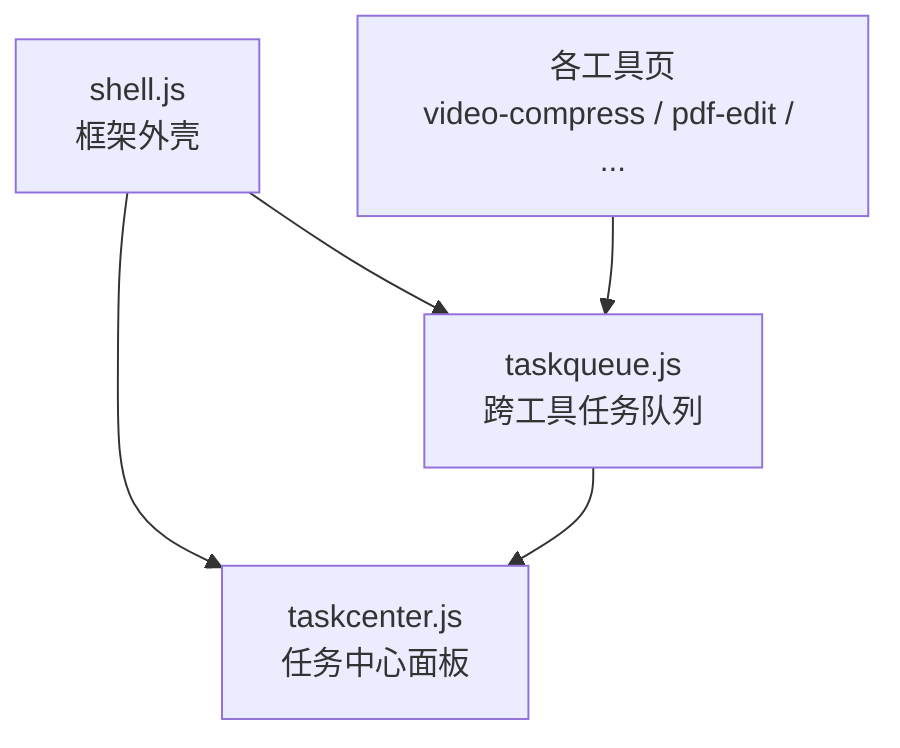
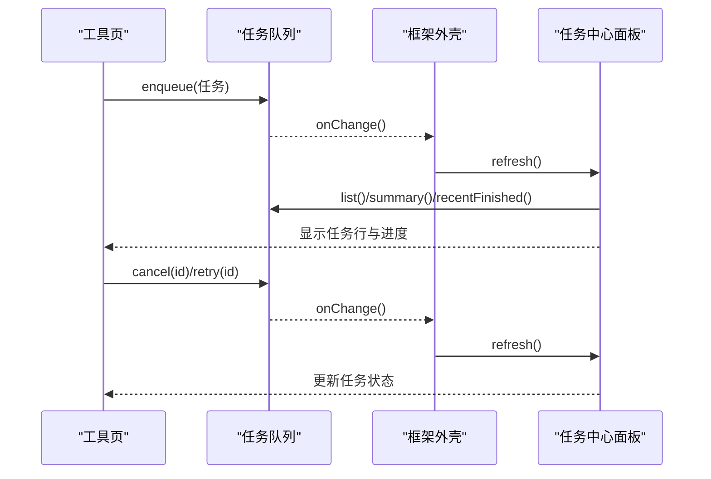
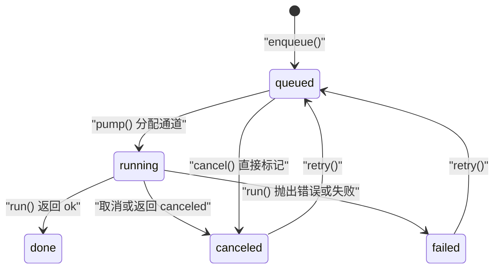
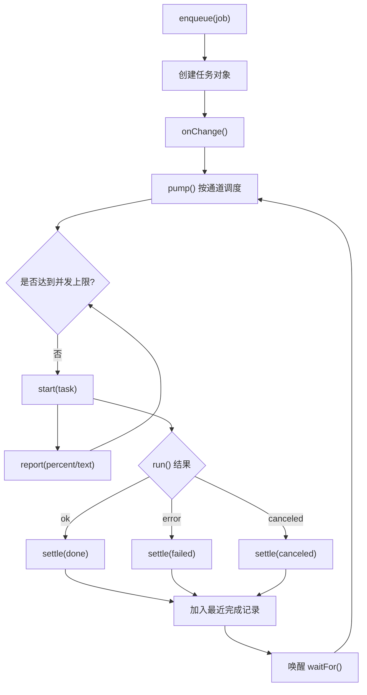
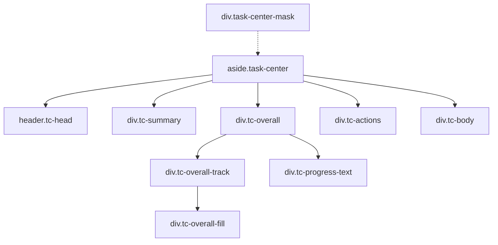
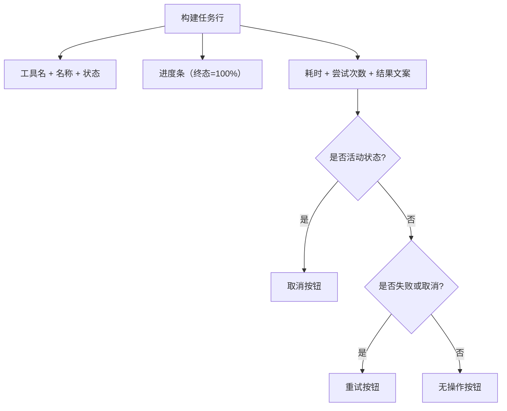
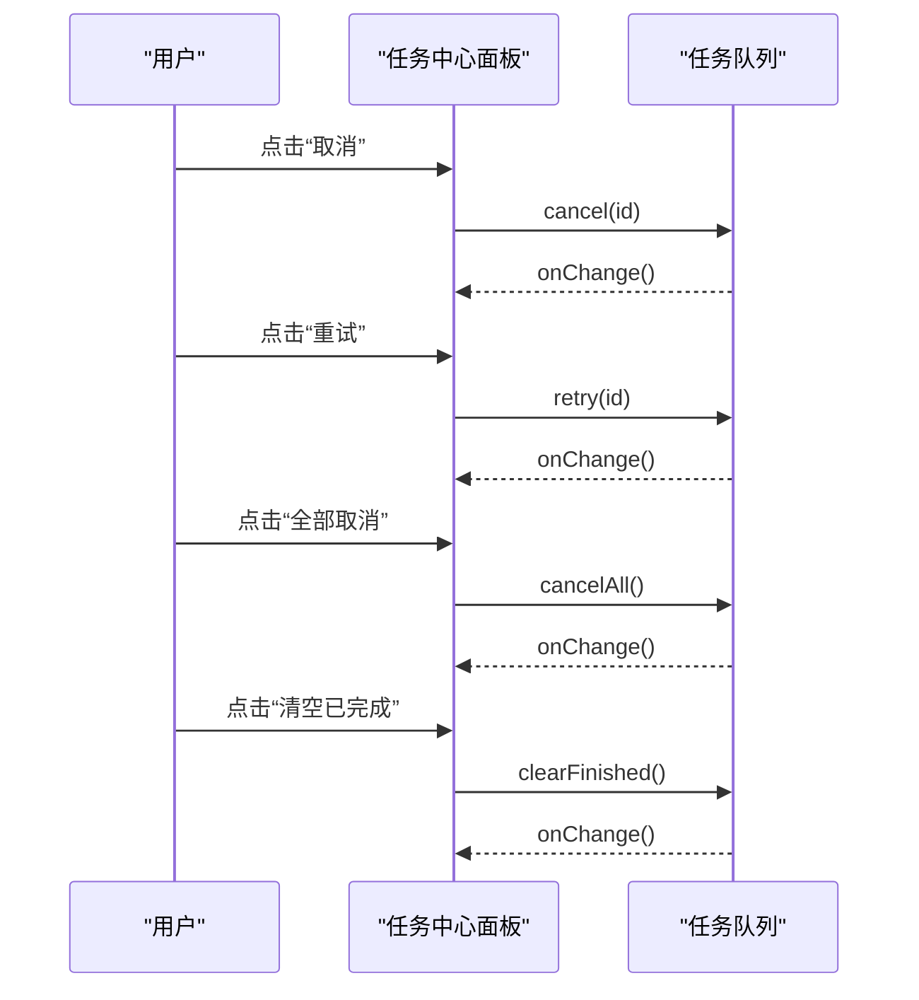
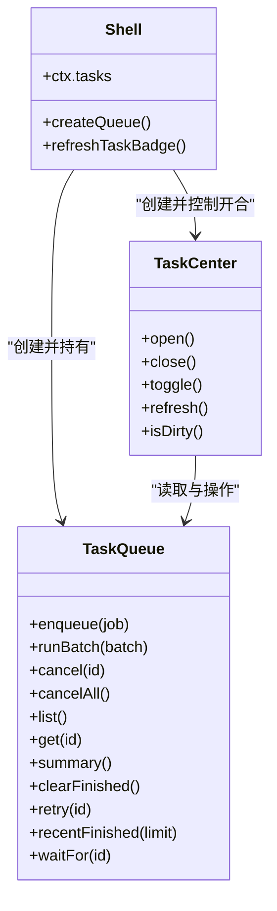

# 任务中心面板

<cite>
**本文引用的文件**   
- [taskcenter.js](file://app/src/shell/taskcenter.js)
- [taskqueue.js](file://app/src/shared/taskqueue.js)
- [shell.js](file://app/src/shell/shell.js)
- [task-queue.md](file://spec/modules/task-queue.md)
</cite>

## 目录
1. [引言](#引言)
2. [项目结构定位](#项目结构定位)
3. [核心组件](#核心组件)
4. [架构总览](#架构总览)
5. [详细组件分析](#详细组件分析)
6. [依赖关系分析](#依赖关系分析)
7. [性能与渲染特性](#性能与渲染特性)
8. [可访问性与键盘导航](#可访问性与键盘导航)
9. [故障排查](#故障排查)
10. [结论](#结论)

## 引言
任务中心面板是工具箱应用中的“全局任务观察窗口”。它不负责执行工具逻辑，也不持有任务状态；任务由共享的跨工具任务队列统一管理。任务中心只做三件事：展示任务列表、计算总体进度、转发用户操作（取消、重试、清空）到队列。

根据规范文档，该能力解决两个历史问题：
- 批量任务原先在各工具页自行 `for` 循环执行，切走页面后看不到整体进度。
- 工具页存在保活上限和 LRU 回收；旧实现会在回收时取消运行中任务，导致“切走工具就杀掉后台任务”。

任务中心的硬契约是：**面板开关不影响任务执行**。

**章节来源**
- [task-queue.md:1-81](file://spec/modules/task-queue.md#L1-L81)

## 项目结构定位
任务中心属于“外壳层”的侧滑抽屉 UI，位于 shell 模块；其数据源来自 shared 层的纯逻辑任务队列。框架入口 shell.js 负责创建队列实例、暴露给工具、并创建任务中心实例。

**图表来源**
- [shell.js:200-233](file://app/src/shell/shell.js#L200-L233)
- [taskqueue.js:1-60](file://app/src/shared/taskqueue.js#L1-L60)
- [taskcenter.js:1-20](file://app/src/shell/taskcenter.js#L1-L20)

**章节来源**
- [shell.js:1-60](file://app/src/shell/shell.js#L1-L60)
- [taskcenter.js:1-20](file://app/src/shell/taskcenter.js#L1-L20)
- [taskqueue.js:1-30](file://app/src/shared/taskqueue.js#L1-L30)

## 核心组件
- **任务队列（shared/taskqueue.js）**：纯逻辑对象，维护任务 Map、入队顺序、最近完成历史、通道并发调度、统计摘要、取消/重试/等待等 API。
- **任务中心面板（shell/taskcenter.js）**：DOM 侧滑抽屉，渲染汇总、总进度条、活动任务区、最近完成区，并提供取消、重试、清空等操作按钮。
- **框架外壳（shell/shell.js）**：创建唯一队列实例、将队列方法代理到 `ctx.tasks`，在队列变化时刷新任务徽标和任务中心。

**章节来源**
- [taskqueue.js:1-60](file://app/src/shared/taskqueue.js#L1-L60)
- [taskcenter.js:1-20](file://app/src/shell/taskcenter.js#L1-L20)
- [shell.js:1-60](file://app/src/shell/shell.js#L1-L60)

## 架构总览
任务生命周期由队列驱动，UI 仅订阅变化：

**图表来源**
- [shell.js:100-120](file://app/src/shell/shell.js#L100-L120)
- [shell.js:200-233](file://app/src/shell/shell.js#L200-L233)
- [taskcenter.js:120-256](file://app/src/shell/taskcenter.js#L120-L256)
- [taskqueue.js:201-354](file://app/src/shared/taskqueue.js#L201-L354)

## 详细组件分析

### 任务数据结构与状态
任务对象由队列创建，包含以下关键信息：
- 标识：`id`、`toolId`、`toolName`、`label`。
- 通道：`lane`，取值 `cpu` 或 `io`，未知值归为 `cpu`。
- 状态：`queued`、`running`、`done`、`failed`、`canceled`。
- 进度：`progress`（0–100）、`stepText`（当前步骤文案）。
- 输入输出：`input.paths`、`output.paths`、`output.dir`。
- 错误与重试：`error`、`retryCount`。
- 时间戳：`createdAt`、`startedAt`、`endedAt`。
- 取消标志：`cancelRequested`。

终态集合为 `{done, failed, canceled}`；活动状态集合用于界面显示为 `{queued, running}`。

**图表来源**
- [taskqueue.js:60-120](file://app/src/shared/taskqueue.js#L60-L120)
- [taskqueue.js:201-354](file://app/src/shared/taskqueue.js#L201-L354)

**章节来源**
- [taskqueue.js:60-120](file://app/src/shared/taskqueue.js#L60-L120)
- [task-queue.md:20-45](file://spec/modules/task-queue.md#L20-L45)

### 任务队列的实现要点
- **通道与并发**：`cpu` 默认并发 1，`io` 默认并发 2；通过 `pump()` 按入队顺序调度。
- **进度上报**：`report({percent, text})` 被限制到 0–100，且仅在 `running` 状态生效。
- **取消语义**：对 `queued` 直接置为 `canceled`；对 `running` 设置 `cancelRequested` 并调用工具的 `onCancel`；若 `run` 因取消抛错，仍视为取消而非失败。
- **摘要计算**：每个任务贡献 1 份权重；排队记 0%，运行中记自身进度，终态（含失败/取消）记 100%。
- **最近完成记录**：新完成的记录插入头部，最多保留 50 条；`recentFinished(limit)` 默认返回 10 条。
- **重试机制**：只允许对 `failed` 或 `canceled` 的任务重试，新任务 `retryCount + 1`，不自动重试以避免覆盖产物。

**图表来源**
- [taskqueue.js:60-120](file://app/src/shared/taskqueue.js#L60-L120)
- [taskqueue.js:201-354](file://app/src/shared/taskqueue.js#L201-L354)

**章节来源**
- [taskqueue.js:60-120](file://app/src/shared/taskqueue.js#L60-L120)
- [taskqueue.js:201-354](file://app/src/shared/taskqueue.js#L201-L354)

### 任务中心 UI 架构
任务中心以函数式工厂创建 DOM 树，并通过类名区分状态区域：
- 容器：`.task-center`，带 `aria-label="任务中心"` 和 `aria-hidden`。
- 头部：标题与关闭按钮。
- 汇总区：`tc-summary` 显示进行中、排队、完成、失败数量。
- 总进度条：轨道 `.tc-overall-track` 与填充 `.tc-overall-fill`，文本 `.tc-progress-text`。
- 操作区：全部取消、清空已完成。
- 主体区：`.tc-body`，动态插入“进行中/排队”和“最近完成”两个区块。
- 遮罩：`.task-center-mask`，点击关闭面板。

**图表来源**
- [taskcenter.js:40-120](file://app/src/shell/taskcenter.js#L40-L120)

**章节来源**
- [taskcenter.js:40-120](file://app/src/shell/taskcenter.js#L40-L120)

### 任务行渲染逻辑
每个任务行通过 `taskRow(task, now)` 构建，包含：
- 任务头：工具名、名称、状态标签。
- 进度条：`.tc-bar` 与 `.tc-bar-fill`，终态固定 100%。
- 元信息：耗时、尝试次数、结果文案。
- 操作按钮：
  - 活动状态（`queued`/`running`）：显示“取消”，调用 `queue.cancel(task.id)`。
  - 失败或取消：显示“重试”，调用 `queue.retry(task.id)`。

状态文本映射：
- `queued` → “排队中”
- `running` → “进行中”
- `done` → “已完成”
- `failed` → “失败”
- `canceled` → “已取消”

结果文案策略：
- 失败：优先使用 `task.error`，否则“失败（原因未知）”。
- 取消：固定“已取消”。
- 成功：取首个产物文件名，多产物显示“→ 首产物 等 N 个”。
- 其他状态：显示 `stepText`。

耗时文案：
- 运行中：基于 `now - startedAt`。
- 已结束：基于 `endedAt - startedAt`。
- 小于 60 秒显示秒，否则显示“分 秒”。

**图表来源**
- [taskcenter.js:60-120](file://app/src/shell/taskcenter.js#L60-L120)

**章节来源**
- [taskcenter.js:60-120](file://app/src/shell/taskcenter.js#L60-L120)

### 任务操作方法
- **取消单个任务**：面板按钮触发 `queue.cancel(id)`。
- **取消全部任务**：`queue.cancelAll()`，作用于所有未完成任务。
- **重试单个任务**：面板按钮触发 `queue.retry(id)`，仅对失败或取消任务有效。
- **清空已完成**：`queue.clearFinished()`，清除终态任务与最近完成记录。

这些操作均通过面板事件绑定到队列方法，随后触发 `render()` 刷新界面。

**图表来源**
- [taskcenter.js:120-256](file://app/src/shell/taskcenter.js#L120-L256)
- [taskqueue.js:201-354](file://app/src/shared/taskqueue.js#L201-L354)

**章节来源**
- [taskcenter.js:120-256](file://app/src/shell/taskcenter.js#L120-L256)
- [taskqueue.js:201-354](file://app/src/shared/taskqueue.js#L201-L354)

### 任务摘要统计计算
摘要由队列提供，包含：
- `queued`：排队中任务数。
- `running`：运行中任务数。
- `done`：已完成任务数。
- `failed`：失败任务数。
- `canceled`：已取消任务数。
- `total`：任务总数。
- `percent`：加权平均百分比。

加权规则：
- 排队任务权重 0%。
- 运行中任务权重为其当前进度。
- 终态任务（包括失败和取消）权重 100%。

任务中心根据 `total` 和 `percent` 决定总进度条宽度与文字；当没有任务时显示“暂无任务”。

**章节来源**
- [taskqueue.js:260-310](file://app/src/shared/taskqueue.js#L260-L310)
- [taskcenter.js:140-200](file://app/src/shell/taskcenter.js#L140-L200)

### 任务列表分组与空态
任务列表分为两个区块：
- “进行中/排队”：过滤出活动状态任务。
- “最近完成”：从队列的最近完成历史取前 10 条。

空态处理：
- 若无任何任务也无最近完成记录，显示友好提示，说明任务在任意工具开始后出现，且切走工具不会中断。
- 有任务但某区块为空时，显示对应空行提示。

**章节来源**
- [taskcenter.js:140-200](file://app/src/shell/taskcenter.js#L140-L200)

## 依赖关系分析
任务中心依赖队列提供的数据与方法，但不反向依赖工具；shell 作为唯一协调者，把队列方法暴露给工具，并把队列变化通知任务中心。

**图表来源**
- [shell.js:100-120](file://app/src/shell/shell.js#L100-L120)
- [shell.js:200-233](file://app/src/shell/shell.js#L200-L233)
- [taskcenter.js:120-256](file://app/src/shell/taskcenter.js#L120-L256)
- [taskqueue.js:201-354](file://app/src/shared/taskqueue.js#L201-L354)

**章节来源**
- [shell.js:100-120](file://app/src/shell/shell.js#L100-L120)
- [shell.js:200-233](file://app/src/shell/shell.js#L200-L233)
- [taskcenter.js:120-256](file://app/src/shell/taskcenter.js#L120-L256)
- [taskqueue.js:201-354](file://app/src/shared/taskqueue.js#L201-L354)

## 性能与渲染特性
- **延迟渲染**：面板关闭时只标记脏位 `dirty = true`，打开时才重新渲染，减少不必要的 DOM 重建。
- **惰性汇总**：每次渲染才调用 `queue.summary()`、`queue.list()`、`queue.recentFinished()`，避免在不可见状态下浪费计算。
- **轻量任务行**：任务行通过逐元素创建与追加，避免大型模板字符串；按钮事件直接绑定到队列方法，降低中间层开销。
- **队列回调容错**：`onChange` 与 `onTaskDone` 被包裹在 try/catch 中，防止界面回调异常影响队列调度。
- **通道隔离**：`cpu` 与 `io` 通道独立计数并发，避免错误通道配置导致 CPU 打满。

**章节来源**
- [taskcenter.js:160-256](file://app/src/shell/taskcenter.js#L160-L256)
- [taskqueue.js:60-120](file://app/src/shared/taskqueue.js#L60-L120)

## 可访问性与键盘导航
- **面板角色**：根节点设置 `aria-label="任务中心"`，打开时 `aria-hidden="false"`，关闭时 `aria-hidden="true"`。
- **关闭交互**：支持点击关闭按钮、点击遮罩、按 `Escape` 键关闭。
- **按钮语义**：操作按钮使用 `<button>` 类型，具备原生可聚焦行为。
- **键盘导航现状**：当前实现未显式管理焦点捕获、Tab 顺序或 ARIA 区域；主要依赖浏览器默认按钮行为。建议后续补充：
  - 打开面板时将焦点移动到关闭按钮或第一个可操作元素。
  - 关闭面板后将焦点恢复到触发打开的元素。
  - 为任务行增加 `role="row"` 与状态相关的 `aria-live` 区域，便于屏幕阅读器播报状态变化。
  - 为进度条增加 `role="progressbar"`、`aria-valuenow`、`aria-valuemin`、`aria-valuemax`。

**章节来源**
- [taskcenter.js:40-120](file://app/src/shell/taskcenter.js#L40-L120)
- [taskcenter.js:220-256](file://app/src/shell/taskcenter.js#L220-L256)

## 故障排查
- **任务不在任务中心出现**：确认工具已通过 `ctx.tasks.enqueue` 或 `runBatch` 入队；某些工具（如 `obfuscate`、`transcribe`、`pdf-convert`）明确不接入任务中心，但仍可正常使用。
- **取消无效**：检查任务是否已是终态；终态任务无法再次取消。
- **重试无效**：只有 `failed` 或 `canceled` 的任务可重试；活动或排队任务应使用取消。
- **进度不更新**：检查工具是否正确调用 `report({percent, text})`；进度只在 `running` 状态上报。
- **切换工具后任务丢失**：正常运行时任务归属队列，不应被工具 `unmount` 取消；若出现此问题，需检查工具是否在 `unmount` 中错误调用了队列取消逻辑。
- **最近完成记录缺失**：重启后记录清空属预期行为；记录仅内存保存，上限 50 条。

**章节来源**
- [task-queue.md:1-81](file://spec/modules/task-queue.md#L1-L81)
- [taskqueue.js:201-354](file://app/src/shared/taskqueue.js#L201-L354)

## 结论
任务中心面板是一个轻量的任务观察与操作界面，核心职责清晰：展示、统计、转发。真正的任务生命周期由共享队列管理，确保工具切换与保活回收不会影响后台任务。对于扩展与维护者而言，重点在于：
- 工具通过 `ctx.tasks` 接入队列，而不是直接管理 UI。
- 面板只消费队列数据，不持有状态。
- 状态文案、进度计算和操作语义集中在队列与面板两处，边界明确。
- 可访问性仍有改进空间，尤其是焦点管理与进度条语义。