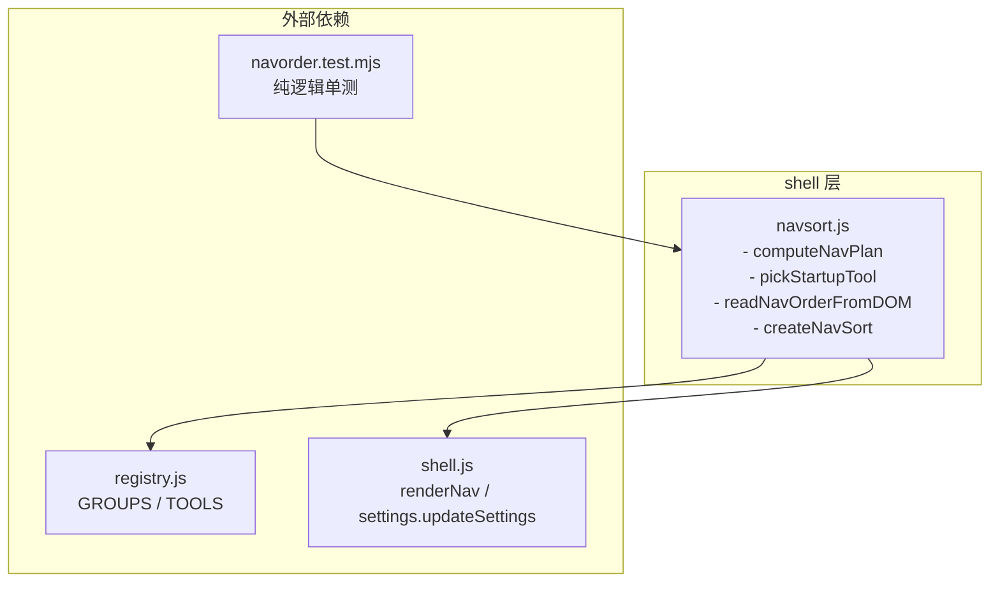
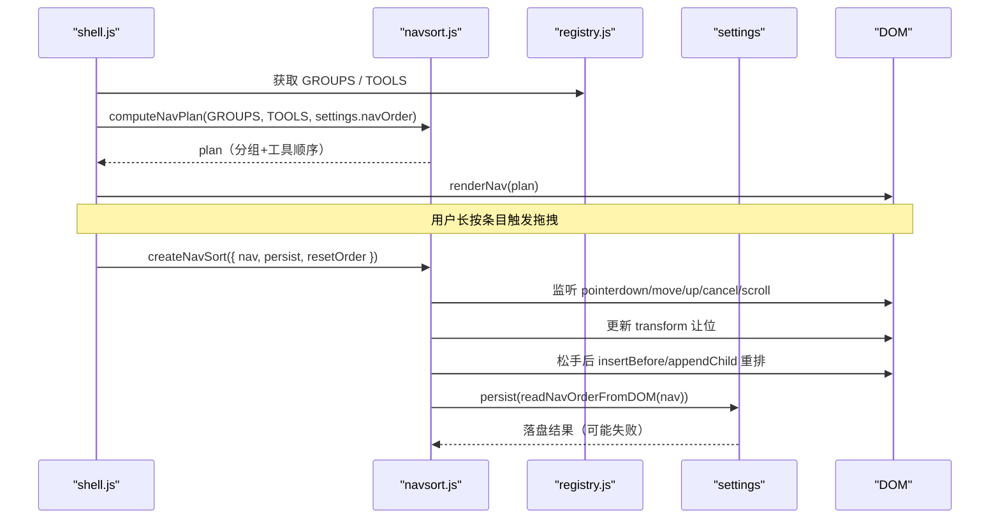
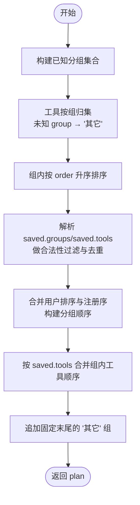
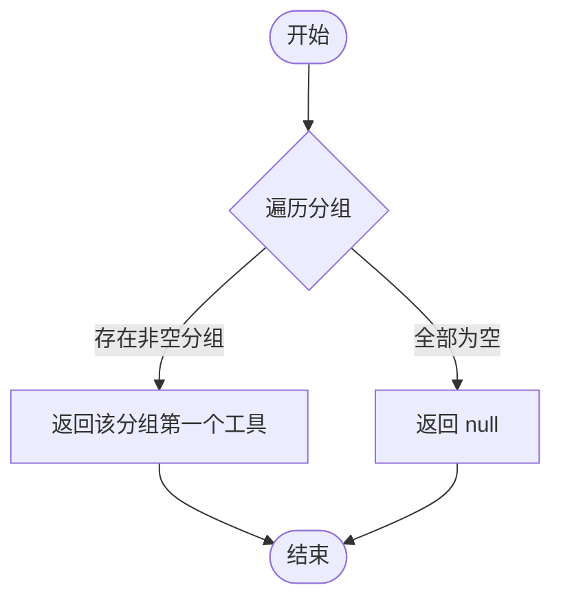
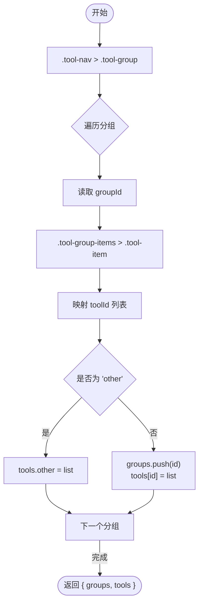
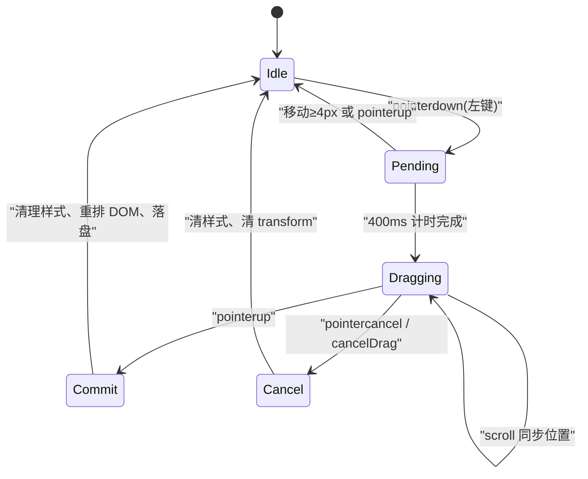
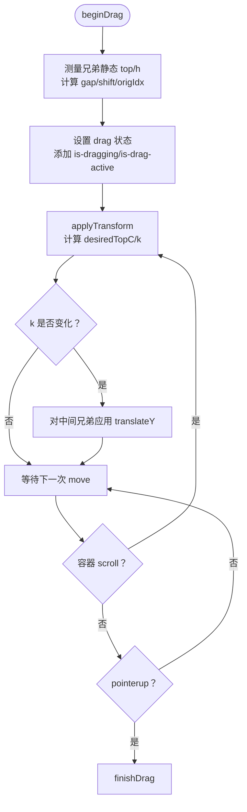
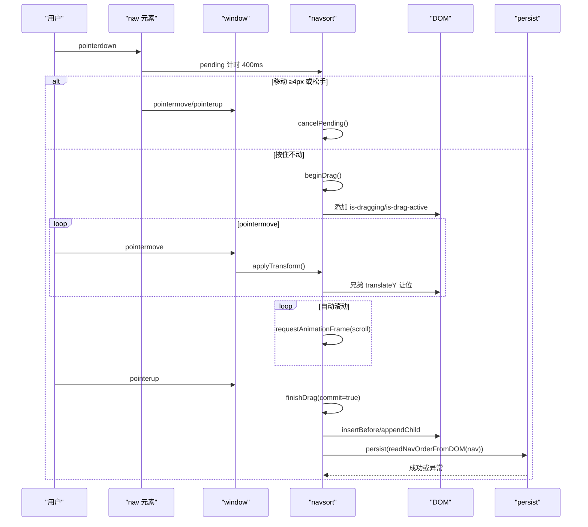
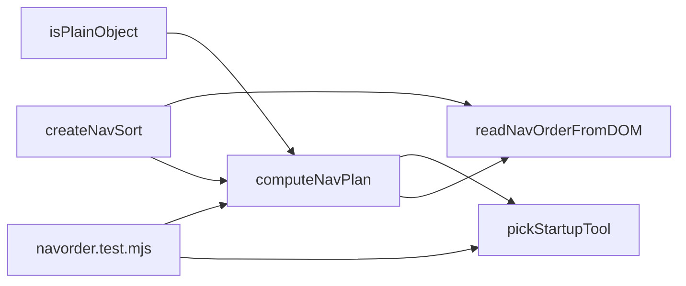

# 导航排序系统

<cite>
**本文引用的文件**   
- [navsort.js](file://app/src/shell/navsort.js)
- [navorder.test.mjs](file://app/app/tests/navorder.test.mjs)
</cite>

## 目录
1. [简介](#简介)
2. [项目结构](#项目结构)
3. [核心组件](#核心组件)
4. [架构总览](#架构总览)
5. [详细组件分析](#详细组件分析)
6. [依赖关系分析](#依赖关系分析)
7. [性能与优化建议](#性能与优化建议)
8. [故障排查指南](#故障排查指南)
9. [结论](#结论)

## 简介
本文件面向“导航排序系统”，围绕 `app/src/shell/navsort.js` 展开，系统性说明其纯逻辑部分（分组净化、工具归组与顺序计算）和交互部分（长按拖拽、Pointer Events、视觉反馈与 DOM 重排）。重点覆盖以下能力：
- `computeNavPlan`：从注册分组、工具声明和用户保存的顺序中计算最终渲染计划。
- `pickStartupTool`：选择默认启动的工具。
- `readNavOrderFromDOM`：从当前界面快照读取用户自定义顺序。
- `createNavSort`：实现长按拖拽的导航排序控制器，包括长按检测、Pointer Events 处理、让位动画、自动滚动、落盘持久化与错误恢复。

该模块将“纯函数式数据净化”与“UI 拖拽交互”解耦：前者可在 Node 环境单测运行，后者仅在浏览器环境中通过 shell 注入。

**章节来源**
- [navsort.js:1-10](file://app/src/shell/navsort.js#L1-L10)

## 项目结构
导航排序功能集中在单一模块中，采用“导出多个职责清晰的函数”的组织方式：
- 纯逻辑：`computeNavPlan`、`pickStartupTool`、`readNavOrderFromDOM`
- 交互控制：`createNavSort`

**图表来源**
- [navsort.js:1-10](file://app/src/shell/navsort.js#L1-L10)

**章节来源**
- [navsort.js:1-10](file://app/src/shell/navsort.js#L1-L10)

## 核心组件
本节概述四个导出成员的职责与输入输出契约。

- `computeNavPlan(groups, tools, saved)`
  - 输入：分组定义数组、工具声明数组、已保存的 `settings.navOrder`（可为 null 或任意损坏形状）。
  - 输出：排序后的分组列表，每个分组包含 `id`、`name`、`icon`、`tools`；末尾固定追加“其它”组。
  - 特点：纯函数、健壮净化、不依赖 DOM。

- `pickStartupTool(plan)`
  - 输入：`computeNavPlan` 的输出。
  - 输出：首个非空分组的第一个工具，若无工具则返回 null。

- `readNavOrderFromDOM(navEl)`
  - 输入：由渲染器生成的 `.tool-nav` DOM 节点。
  - 输出：`{ groups, tools }` 结构，其中 `tools.other` 对应“其它”组。

- `createNavSort({ nav, persist, resetOrder, onStatus })`
  - 作用：绑定导航容器的 Pointer Events，实现长按拖拽、视觉让位、自动滚动、真实 DOM 重排与落盘。
  - 返回值：`cancelDrag()`，用于在重建 DOM 前防御性收尾。

**章节来源**
- [navsort.js:11-18](file://app/src/shell/navsort.js#L11-L18)
- [navsort.js:19-110](file://app/src/shell/navsort.js#L19-L110)
- [navsort.js:111-137](file://app/src/shell/navsort.js#L111-L137)
- [navsort.js:138-185](file://app/src/shell/navsort.js#L138-L185)
- [navsort.js:186-388](file://app/src/shell/navsort.js#L186-L388)

## 架构总览
下图展示导航排序系统的整体协作：shell 负责渲染导航并持有拖拽控制器实例；navsort 提供纯逻辑与交互；测试对纯逻辑进行验证。

**图表来源**
- [navsort.js:19-110](file://app/src/shell/navsort.js#L19-L110)
- [navsort.js:138-185](file://app/src/shell/navsort.js#L138-L185)
- [navsort.js:186-388](file://app/src/shell/navsort.js#L186-L388)

## 详细组件分析

### computeNavPlan：分组净化与顺序计算
该函数是导航渲染顺序的权威来源。它执行三层净化与排序：

1. **工具按组归集**
   - 以 `groups` 中的 id 建立已知分组集合。
   - 遍历 `tools`，将属于已知分组的工具放入对应数组；不属于任何已知分组或 group 未声明的工具归入“其它”。
   - 每个组内工具按 `order` 升序排列，保证默认顺序稳定。

2. **分组顺序构建**
   - 若 `saved.groups` 合法且为数组，只保留字符串类型且属于已知分组且不等于“其它”的 id，去重后作为用户排序的前缀。
   - 未在用户排序中出现过的分组，按注册顺序追加。
   - “其它”组不参与此阶段排序，始终固定到末尾。

3. **组内工具顺序构建**
   - 若 `saved.tools[groupId]` 合法且为数组，仅保留字符串 id，并以这些 id 在前、其余按 order 追加的方式合并。
   - 如果用户未对该组排序，整组沿用默认 order 升序。

最后构造 plan：每个元素含 `id`、`name`、`icon`、`tools`；末尾追加“其它”组。

**图表来源**
- [navsort.js:19-110](file://app/src/shell/navsort.js#L19-L110)

关键设计要点：
- 使用 `Set` 去重、`Map` 按组收集，时间复杂度接近 O(n)。
- 对非法 `saved` 直接回退默认，避免崩溃。
- “其它”组隔离不可信配置，防止用户把工具走私到其他分组。

**章节来源**
- [navsort.js:19-110](file://app/src/shell/navsort.js#L19-L110)

### pickStartupTool：启动工具选择算法
算法非常简单：按 plan 顺序扫描分组，返回首个非空分组的第一个工具；若所有分组为空则返回 null。

**图表来源**
- [navsort.js:111-137](file://app/src/shell/navsort.js#L111-L137)

语义约定：
- 用户把某组拖到首位，即表示“最常用”，启动时直接进入该组第一个工具。
- 从未排序（`navOrder=null`）时，行为等价于默认分组顺序的第一个工具。

**章节来源**
- [navsort.js:111-137](file://app/src/shell/navsort.js#L111-L137)

### readNavOrderFromDOM：从当前界面读取用户自定义顺序
该函数解析渲染后的导航 DOM，生成可落盘的顺序快照。解析规则：
- 选择 `.tool-nav > .tool-group` 作为分组容器。
- 在每个分组内，选择 `.tool-group-items > .tool-item` 作为工具项。
- 读取每个元素的 `dataset.groupId` 与 `dataset.toolId`。
- 将“其它”组单独写入 `tools.other`，其余分组 id 依次写入 `groups` 并记录各自工具列表。

**图表来源**
- [navsort.js:138-185](file://app/src/shell/navsort.js#L138-L185)

注意事项：
- 该函数假设渲染器严格遵循约定的 DOM 类名与 data 属性；否则可能得到空或错位的结果。
- 它是拖放成功后唯一落盘数据的来源，因此需要保持与渲染器约定一致。

**章节来源**
- [navsort.js:138-185](file://app/src/shell/navsort.js#L138-L185)

### createNavSort：长按拖拽排序控制器
这是导航排序的交互核心。它把 Pointer Events、视觉反馈、自动滚动、真实 DOM 重排与持久化整合在一起，并明确区分“点击”和“拖拽”。

#### 交互状态机

**图表来源**
- [navsort.js:186-388](file://app/src/shell/navsort.js#L186-L388)

#### 长按检测与指针事件
- 只在 `button === 0`（左键）且无其他拖拽进行时响应。
- 支持两种拖拽目标：
  - 工具项 `.tool-item`：组内移动。
  - 分组头 `.tool-group-head`：整组移动。
- 在 `pending` 状态下：
  - 监听 window 的 `pointermove`、`pointerup`、`pointercancel`。
  - 移动超过 4px 视为取消按压。
  - 400ms 后才进入 `beginDrag`，确保普通点击不被误判为拖拽。

#### 视觉反馈与让位算法
- 拿起后立即给被拖元素添加 `is-dragging`，使其呈现“玻璃卡”效果；同时给导航容器添加 `is-drag-active`，临时放宽 overflow，避免阴影与位移被裁剪。
- 兄弟元素让位：
  - 拖拽开始时一次性测量同级兄弟的静态位置，之后不再回流。
  - 根据“被拖块高度 + 间距”计算 `shift`，对位于原位与目标插入位之间的兄弟施加 `translateY`。
  - 插入位 `k` 由被拖块中心越过的兄弟个数决定。
- 拖拽中持续用内容坐标（`clientY + nav.scrollTop`）计算 `desiredTopC`，并通过 `transform: translateY(...) scale(...)` 让被拖元素跟随指针。

**图表来源**
- [navsort.js:201-288](file://app/src/shell/navsort.js#L201-L288)

#### 自动滚动
当指针靠近容器上下边缘（阈值 40px）时，通过 `requestAnimationFrame` 循环调整 `scrollTop`，速度随距离线性增长但限制在 2–14px/帧之间。

#### 松手与真实重排
- 先按最终指针位置确定 `k`，再判断 `k !== origIdx`。
- 若未移动：仅移除拖拽样式，平滑回到原位。
- 若移动：
  - 使用 `insertBefore` 或 `appendChild` 把被拖元素放到正确插槽。
  - 清空兄弟的 transform。
  - 对被拖元素执行 mini-FLIP：先清 transform 量出新自然布局，再以旧视觉位置反推 `translateY`，强制一次回流后清除 transform，实现顺滑过渡。
  - 调用 `persist(readNavOrderFromDOM(nav))` 落盘；落盘失败不影响 UI。

#### 点击保护
拖拽结束后 500ms 内的 `click` 一律拦截，防止拖完后浏览器仍派发的 click 误切工具或折叠分组。

**图表来源**
- [navsort.js:186-388](file://app/src/shell/navsort.js#L186-L388)

**章节来源**
- [navsort.js:186-388](file://app/src/shell/navsort.js#L186-L388)

## 依赖关系分析
- 模块内部依赖：
  - `computeNavPlan` 依赖 `isPlainObject` 做类型校验。
  - `createNavSort` 依赖 DOM API（`querySelectorAll`、`getBoundingClientRect`、`setPointerCapture`、`addEventListener`、`requestAnimationFrame`）。
  - `readNavOrderFromDOM` 依赖渲染器约定的 DOM 结构与 data 属性。
- 外部耦合：
  - 与 shell 的耦合点：`btnSortReset` 按钮、`resetOrder` 回调、`settings.updateSettings` 作为 `persist`。
  - 与 registry 的耦合点：`GROUPS`、`TOOLS` 由 shell 传入 `computeNavPlan`。
- 测试耦合：
  - `navorder.test.mjs` 针对纯逻辑函数进行断言，不依赖 DOM。

**图表来源**
- [navsort.js:11-18](file://app/src/shell/navsort.js#L11-L18)
- [navsort.js:19-110](file://app/src/shell/navsort.js#L19-L110)
- [navsort.js:138-185](file://app/src/shell/navsort.js#L138-L185)
- [navsort.js:186-388](file://app/src/shell/navsort.js#L186-L388)

**章节来源**
- [navsort.js:11-18](file://app/src/shell/navsort.js#L11-L18)
- [navsort.js:19-110](file://app/src/shell/navsort.js#L19-L110)
- [navsort.js:138-185](file://app/src/shell/navsort.js#L138-L185)
- [navsort.js:186-388](file://app/src/shell/navsort.js#L186-L388)

## 性能与优化建议
当前实现已经做了多项性能优化，但仍可按场景继续优化：

- 避免不必要的回流
  - 拖拽中只读兄弟静态位置，不重复查询布局。
  - 使用 `transform` 替代布局属性改变，减少回流与重绘。
  - mini-FLIP 只在松手重排后做一次，且用 `void offsetHeight` 精准触发一次回流。

- 高效数据结构
  - `Set` 用于分组 id 去重、工具 id 白名单校验。
  - `Map` 按组收集工具，避免多次查找。
  - 组内顺序合并采用“用户排序在前 + 剩余默认追加”的两遍策略，避免频繁插入与查找。

- 事件与定时器
  - 长按计时与 `pointermove`/`pointerup`/`pointercancel` 成对增删监听，避免内存泄漏。
  - 自动滚动使用 `requestAnimationFrame`，避免高频节流代码。
  - 拖拽结束时用时间窗拦截 click，而不是全局标志，适配多次拖拽场景。

- 进一步优化的方向
  - 当分组数量很大时，可在 `beginDrag` 中缓存兄弟 `topC+h/2` 的中值，避免每次 `applyTransform` 都线性扫描。
  - 对 `readNavOrderFromDOM` 可加入简单校验（如分组 id 与工具 id 非空），提前发现渲染约定不一致的问题。
  - 将 `LONG_PRESS_MS`、`CANCEL_MOVE_PX`、`CLICK_GUARD_MS`、自动滚动阈值等参数抽离为配置对象，便于 A/B 测试与不同设备适配。

**章节来源**
- [navsort.js:186-388](file://app/src/shell/navsort.js#L186-L388)
- [navsort.js:19-110](file://app/src/shell/navsort.js#L19-L110)

## 故障排查指南
常见问题与定位思路：

1. 拖拽无法触发
   - 检查是否只在左键触发（`button !== 0` 会忽略）。
   - 检查是否在已有拖拽进行中（`drag` 或 `pending` 非空时会短路）。
   - 确认长按未满 400ms 就松手会被当作普通点击。

2. 拖拽过程中点击误触
   - 检查拖拽结束后 500ms 内 click 是否被拦截。
   - 若点击仍然生效，检查 `nav.addEventListener('click', ..., true)` 是否被移除或冒泡链被改写。

3. 兄弟让位错乱
   - 检查拖拽开始时是否一次性测量了兄弟静态位置。
   - 若分组展开/收起导致高度变化，确认 `shift` 基于“被拖块高度 + 间距”，而非兄弟自身高度。
   - 检查 `k` 的计算是否基于被拖块中心越过的兄弟个数。

4. 自动滚动失效
   - 检查 `requestAnimationFrame` 是否被 `stopAutoScroll` 正确取消。
   - 检查指针坐标是否相对于视口，而容器滚动基于 `nav.scrollTop`。

5. 落盘失败导致顺序丢失
   - `persist` 包裹在 try/catch 中，不会阻塞 UI。
   - 若设置持久化失败，下次启动会退回默认顺序；可通过 `settings.navOrder` 初始值诊断。

6. 重置顺序无效
   - 检查 `btnSortReset` 是否存在，以及 `resetOrder` 回调是否正确清除 `navOrder` 并重渲染。

**章节来源**
- [navsort.js:186-388](file://app/src/shell/navsort.js#L186-L388)

## 结论
导航排序系统以“纯函数数据净化 + 轻量拖拽控制器”的分层设计，既保证了排序算法的可测试性与稳定性，又提供了流畅的用户体验。`computeNavPlan` 提供健壮的分组与工具顺序计算，`pickStartupTool` 给出明确的启动语义，`readNavOrderFromDOM` 桥接 UI 与持久化，`createNavSort` 则用 Pointer Events 与 transform 动画实现了无模式、低侵入的拖拽排序。在实际工程中，应优先维护渲染器与 DOM 约定的一致性，并充分利用现有防抖、回流控制与异常隔离机制来保障长期稳定性。