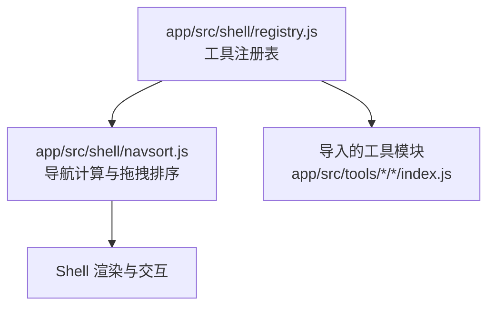
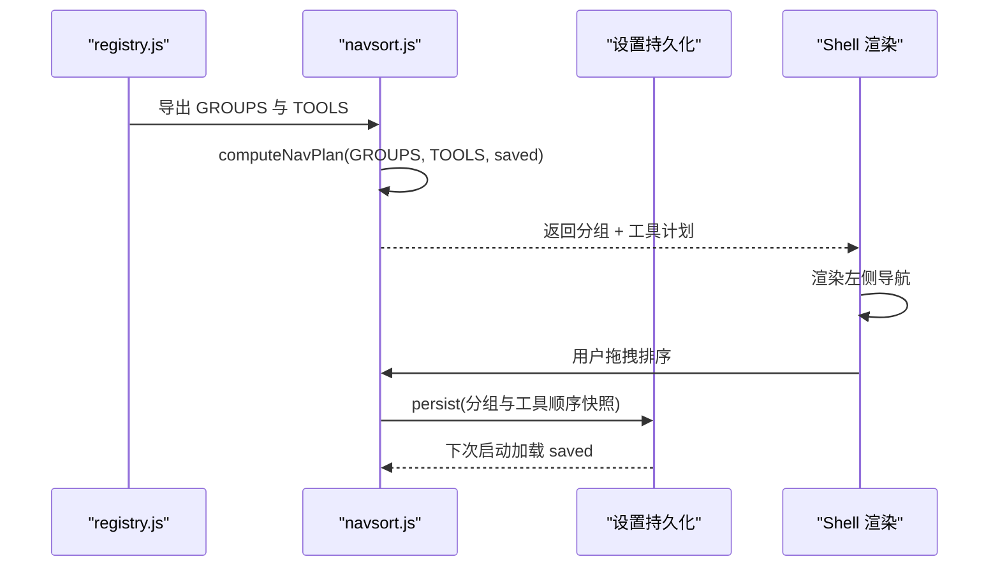
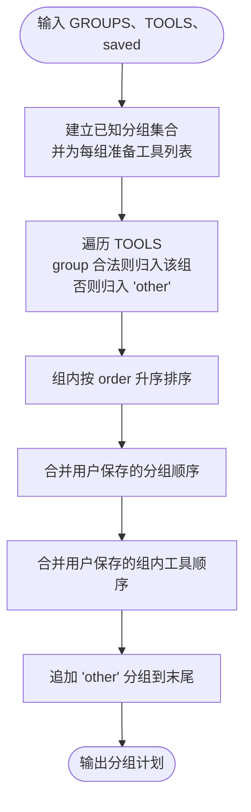
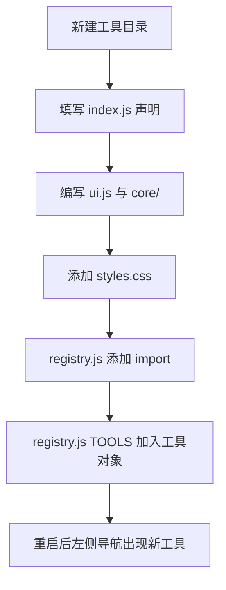
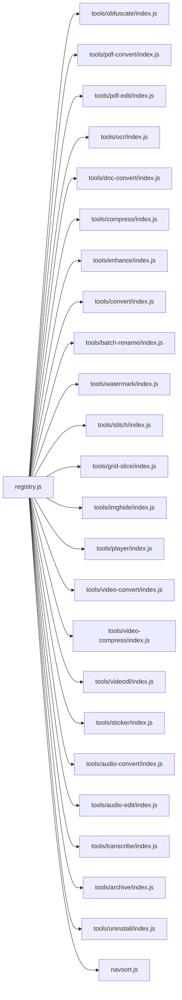

# 工具注册机制

<cite>
**本文引用的文件**   
- [app/src/shell/registry.js](file://app/src/shell/registry.js)
- [app/src/shell/navsort.js](file://app/src/shell/navsort.js)
- [docs/新增工具指南.md](file://docs/新增工具指南.md)
</cite>

## 目录
1. [简介](#简介)
2. [项目结构定位](#项目结构定位)
3. [核心组件](#核心组件)
4. [架构总览](#架构总览)
5. [详细组件分析](#详细组件分析)
6. [依赖关系分析](#依赖关系分析)
7. [性能与复杂度](#性能与复杂度)
8. [故障排查](#故障排查)
9. [结论](#结论)
10. [附录：最佳实践](#附录最佳实践)

## 简介
本文件聚焦于前端工具注册机制，围绕 `registry.js` 中的工具清单与分组系统展开。目标是让读者理解：
- `TOOLS` 数组的结构、每个工具声明对象的字段含义；
- `GROUPS` 分组系统的实现方式，包括分组图标、名称和组织逻辑；
- 新工具如何注册，以及 `group` 字段如何决定左侧导航位置；
- 工具与分组的映射关系、排序规则与最佳实践。

该机制的入口是 `app/src/shell/registry.js`，它导出两个关键常量：
- `GROUPS`：左侧导航分组定义；
- `TOOLS`：全部工具的导入与声明数组。

导航渲染和排序逻辑由 `app/src/shell/navsort.js` 提供，它将 `GROUPS` 与 `TOOLS` 组合为最终可渲染的导航计划。

**章节来源**
- [app/src/shell/registry.js:1-67](file://app/src/shell/registry.js#L1-L67)
- [app/src/shell/navsort.js:1-100](file://app/src/shell/navsort.js#L1-L100)

## 项目结构定位
工具注册机制位于前端 Shell 层，属于“框架”部分。实际工具则按“一个工具一个文件夹”的方式放在 `app/src/tools/<标识>/` 下。

**图表来源**
- [app/src/shell/registry.js:1-67](file://app/src/shell/registry.js#L1-L67)
- [app/src/shell/navsort.js:1-100](file://app/src/shell/navsort.js#L1-L100)

**章节来源**
- [docs/新增工具指南.md:1-20](file://docs/新增工具指南.md#L1-L20)

## 核心组件
本节说明 `registry.js` 中两个最重要的导出对象。

### TOOLS 数组
`TOOLS` 是一个按注册顺序排列的工具声明数组。每个元素来自对应工具模块的默认导出，通常是如下结构的对象：
- `id`：工具的唯一标识，用于导航状态、持久化配置、测试选择等场景；
- `name`：左侧列表显示的名称；
- `icon`：工具图标，通常使用 emoji；
- `group`：分组标识，必须与 `GROUPS` 中某个分组的 `id` 匹配；
- `order`：组内排序权重，数值越小越靠前；
- `styles`：工具专属样式路径；
- `mount` / `unmount`：工具界面挂载与卸载回调；
- 其他 UI 或上下文相关字段由具体工具实现决定。

`TOOLS` 的顺序本身不是最终显示顺序；真正显示顺序由分组系统和组内 `order` 共同决定。

**章节来源**
- [app/src/shell/registry.js:1-67](file://app/src/shell/registry.js#L1-L67)
- [docs/新增工具指南.md:21-46](file://docs/新增工具指南.md#L21-L46)

### GROUPS 分组系统
`GROUPS` 定义了左侧导航的分组，顺序即默认分组顺序。每条分组记录包含：
- `id`：分组唯一标识，如 `image`、`video`、`audio`、`doc`、`archive`、`system`；
- `name`：分组显示名，如“图片”“视频”“音频”“文档”“压缩”“系统”；
- `icon`：分组图标，通常使用 emoji。

分组的作用是把同类工具组织在一起，便于查找。用户可以在左侧点击分组标题收起或展开，并记住折叠状态。

**章节来源**
- [app/src/shell/registry.js:24-41](file://app/src/shell/registry.js#L24-L41)

## 架构总览
工具注册机制的整体流程可以概括为：
1. `registry.js` 导入各工具模块，并将它们放入 `TOOLS`；
2. `navsort.js` 读取 `GROUPS` 与 `TOOLS`，将工具归入对应分组；
3. 未声明合法 `group` 或 `group` 不在 `GROUPS` 中的工具，会被放入“其它”分组；
4. 分组内部按 `order` 升序排序；
5. 用户可以手动拖动调整分组顺序和组内工具顺序；
6. 排序结果被持久化到设置中，下次启动时恢复。

**图表来源**
- [app/src/shell/registry.js:1-67](file://app/src/shell/registry.js#L1-L67)
- [app/src/shell/navsort.js:1-100](file://app/src/shell/navsort.js#L1-L100)

## 详细组件分析

### 工具声明对象字段语义
| 字段 | 类型 | 必填 | 作用说明 |
| --- | --- | --- | --- |
| `id` | 字符串 | 是 | 工具唯一标识，用于导航、配置、测试和运行时识别 |
| `name` | 字符串 | 是 | 左侧列表中显示的工具名 |
| `icon` | 字符串 | 是 | 工具图标，通常使用 emoji |
| `group` | 字符串 | 推荐是 | 所属分组标识；若非法或未声明，工具进入“其它”分组 |
| `order` | 数字 | 否 | 组内排序权重；未设置时视为 `0` |
| `styles` | 字符串或数组 | 视工具实现 | 工具专属样式路径 |
| `mount` | 函数 | 是（有界面） | 工具界面挂载回调 |
| `unmount` | 函数 | 是（有界面） | 工具页面被销毁时的清理回调 |
| 其他字段 | 任意 | 视工具实现 | 由具体工具 UI 或业务逻辑使用 |

字段来源依据：
- `registry.js` 注释指出 `id`、`name`、`group`、`order` 等字段；
- `docs/新增工具指南.md` 给出了完整声明示例；
- `navsort.js` 在排序时使用 `t.id` 与 `t.order`。

**章节来源**
- [app/src/shell/registry.js:1-23](file://app/src/shell/registry.js#L1-L23)
- [docs/新增工具指南.md:21-46](file://docs/新增工具指南.md#L21-L46)
- [app/src/shell/navsort.js:1-40](file://app/src/shell/navsort.js#L1-L40)

### 分组系统与工具归属
分组系统由 `GROUPS` 定义，并由 `navsort.js` 的 `computeNavPlan` 负责消费。其核心规则如下：

**图表来源**
- [app/src/shell/navsort.js:1-100](file://app/src/shell/navsort.js#L1-L100)

关键点：
- 分组默认顺序由 `GROUPS` 数组顺序决定；
- `group` 字段必须等于某个 `GROUPS` 条目中的 `id`，才能进入对应分组；
- 未声明 `group`、`group` 为空、或 `group` 不在 `GROUPS` 中的工具，都会被归入“其它”分组；
- “其它”分组始终固定在最后；
- 组内默认按 `order` 升序排序；
- 用户可通过长按拖拽调整分组顺序和组内工具顺序。

**章节来源**
- [app/src/shell/registry.js:24-41](file://app/src/shell/registry.js#L24-L41)
- [app/src/shell/navsort.js:1-100](file://app/src/shell/navsort.js#L1-L100)

### 新工具注册流程
根据仓库文档，新增工具的标准流程如下：

1. **复制模板**  
   把 `src/tools/_template/` 复制为新工具目录，例如 `compress`。

2. **修改工具声明**  
   在新工具的 `index.js` 中填写 `id`、`name`、`icon`、`group`、`order`、`styles`、`mount`、`unmount` 等字段。

3. **编写界面与逻辑**  
   - 界面放在 `ui.js`；
   - 核心算法放在 `core/`；
   - 样式放在 `styles.css`。

4. **注册工具**  
   在 `app/src/shell/registry.js` 中添加两行：
   - 一行 `import` 新工具模块；
   - 一行将该工具对象加入 `TOOLS` 数组。

**图表来源**
- [docs/新增工具指南.md:1-83](file://docs/新增工具指南.md#L1-L83)
- [app/src/shell/registry.js:1-67](file://app/src/shell/registry.js#L1-L67)

**章节来源**
- [docs/新增工具指南.md:1-83](file://docs/新增工具指南.md#L1-L83)
- [app/src/shell/registry.js:1-23](file://app/src/shell/registry.js#L1-L23)

### 工具与分组的映射关系
`group` 字段决定工具出现在哪个分组：

- 如果 `group` 等于 `GROUPS` 中的某个 `id`，工具进入该分组；
- 如果 `group` 不合法或缺失，工具进入“其它”分组；
- “其它”分组不参与用户自定义分组排序，但组内工具仍可排序；
- 分组图标和名称来自 `GROUPS`，而非工具声明；
- 工具图标来自工具声明的 `icon`。

因此，分组图标并不表示单个工具的图标，而是分组标题图标；每个工具仍需要自己的 `icon`。

**章节来源**
- [app/src/shell/registry.js:24-41](file://app/src/shell/registry.js#L24-L41)
- [app/src/shell/navsort.js:1-100](file://app/src/shell/navsort.js#L1-L100)
- [docs/新增工具指南.md:21-46](file://docs/新增工具指南.md#L21-L46)

### 排序规则
默认排序规则如下：

| 层级 | 排序依据 | 说明 |
| --- | --- | --- |
| 分组顺序 | `GROUPS` 数组顺序 | 默认从“图片”到“系统” |
| 组内顺序 | 工具 `order` 升序 | 数值越小越靠前 |
| 用户自定义 | 拖拽后的 `navOrder` | 覆盖默认分组与组内顺序 |
| “其它”分组 | 固定末尾 | 未正确归属的工具聚合在此 |

当没有用户自定义顺序时，“其它”分组不会显示在用户自定义分组列表中，但会作为兜底分组附加在最后。

**章节来源**
- [app/src/shell/registry.js:24-67](file://app/src/shell/registry.js#L24-L67)
- [app/src/shell/navsort.js:1-100](file://app/src/shell/navsort.js#L1-L100)

## 依赖关系分析
`registry.js` 与工具模块之间是单向依赖：注册表导入工具，工具模块不应反向依赖注册表。`navsort.js` 消费这两个常量，但不直接修改 `registry.js`。

**图表来源**
- [app/src/shell/registry.js:1-67](file://app/src/shell/registry.js#L1-L67)

**章节来源**
- [app/src/shell/registry.js:1-67](file://app/src/shell/registry.js#L1-L67)

## 性能与复杂度
从导航计划计算的角度看：

- 分组收集：遍历 `GROUPS`，时间复杂度为 O(G)，G 为分组数量；
- 工具归组：遍历 `TOOLS`，时间复杂度为 O(T)，T 为工具数量；
- 组内排序：对每个分组内的工具执行排序，总体接近 O(T log T)；
- 合并用户保存顺序：涉及过滤、去重和查找，整体接近 O(T + S)，S 为用户保存的配置规模；
- 空间复杂度：主要为分组映射和用户配置缓存，近似 O(G + T)。

对于当前约二十多个工具和六个分组，这些开销非常低，不会影响主界面响应。

**章节来源**
- [app/src/shell/navsort.js:1-100](file://app/src/shell/navsort.js#L1-L100)

## 故障排查
常见问题及定位建议：

| 现象 | 可能原因 | 处理建议 |
| --- | --- | --- |
| 左侧没有出现新工具 | `registry.js` 未添加 `import` 或未加入 `TOOLS` | 检查是否添加两行 |
| 工具出现在“其它”分组 | `group` 未声明、为空，或不在 `GROUPS` 中 | 确保 `group` 值与 `GROUPS` 中某个 `id` 完全一致 |
| 工具顺序不符合预期 | `order` 未设置或与其他工具冲突 | 为工具设置合适的 `order` |
| 样式不生效 | `styles` 路径错误 | 确认相对路径指向工具 `styles.css` |
| 切换工具后报错 | `unmount` 未清理定时器、事件或 DOM 引用 | 检查生命周期清理逻辑 |
| 拖拽后顺序丢失 | 持久化失败或设置损坏 | 使用重置顺序功能，再重新排序 |
| 想加新分组 | 未在 `GROUPS` 中定义 | 先在 `GROUPS` 添加分组，再让工具使用该 `group` |

**章节来源**
- [docs/新增工具指南.md:47-83](file://docs/新增工具指南.md#L47-L83)
- [app/src/shell/navsort.js:1-100](file://app/src/shell/navsort.js#L1-L100)

## 结论
`registry.js` 通过 `GROUPS` 和 `TOOLS` 构建了前端工具注册表的核心契约：
- `GROUPS` 控制分组元数据与默认顺序；
- `TOOLS` 集中管理所有工具声明；
- `navsort.js` 负责把两者组合成可渲染、可排序、可持久化的导航计划；
- 新工具只需复制模板、填写声明、并在 `registry.js` 中添加两行即可完成注册。

这种设计降低了新增功能的成本，同时保证了左侧导航的一致性和可维护性。

[本节为总结性内容，不直接分析具体代码片段]

## 附录：最佳实践

### 工具命名规范
- `id` 使用英文小写，避免空格和特殊字符；
- `name` 使用中文或目标语言的用户可读名称；
- `icon` 使用 emoji 即可，保持简洁直观；
- `group` 使用已注册的分组 `id`；
- `order` 使用整数，同组内从小到大排列。

### 分组策略
- 优先复用现有分组：图片、视频、音频、文档、压缩、系统；
- 只有确实存在大量同类型工具时才考虑新增分组；
- 新分组必须先写入 `GROUPS`，再让工具引用其 `id`；
- “其它”分组仅作为兜底，不要把它当作正式分类。

### 排序规则
- 常用工具放较小 `order`；
- 同一组内工具按功能相关性排序；
- 如果需要长期调整顺序，使用长按拖拽；
- 避免频繁改动 `TOOLS` 数组物理顺序，因为真正顺序由分组与 `order` 决定。

### 新工具开发建议
- 先补 spec，明确目标、输入输出和非目标；
- 工具之间禁止互相 import，复用能力放入 `shared/`；
- 样式只使用 Shell 主题变量，类名加工具前缀；
- 在 `mount` 中从零构建界面，在 `unmount` 中释放资源；
- 全局交互要区分激活状态，避免抢占其他工具事件。

**章节来源**
- [docs/新增工具指南.md:1-83](file://docs/新增工具指南.md#L1-L83)
- [app/src/shell/registry.js:1-67](file://app/src/shell/registry.js#L1-L67)
- [app/src/shell/navsort.js:1-100](file://app/src/shell/navsort.js#L1-L100)