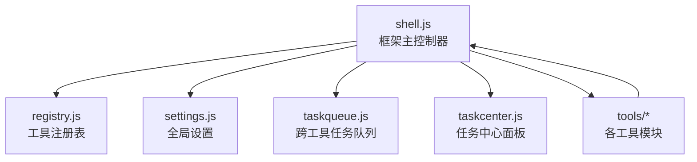
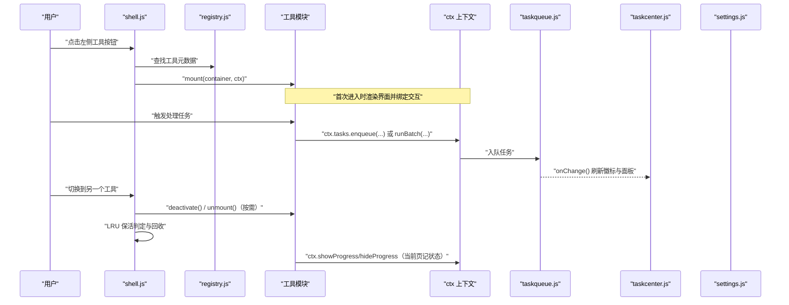
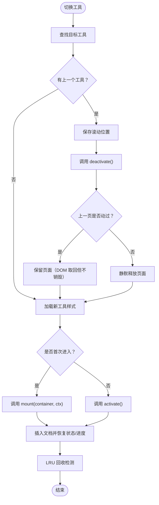
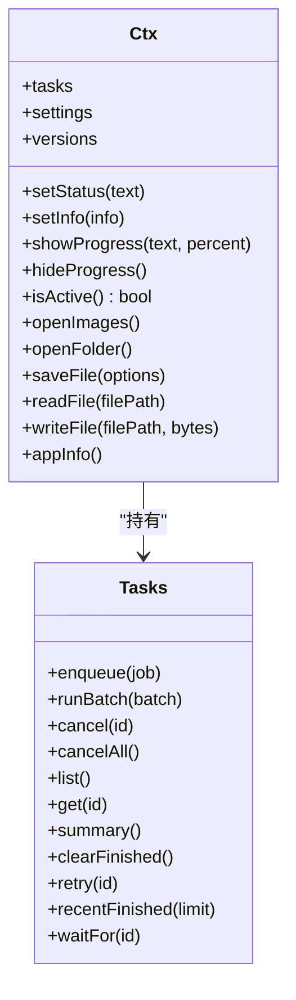
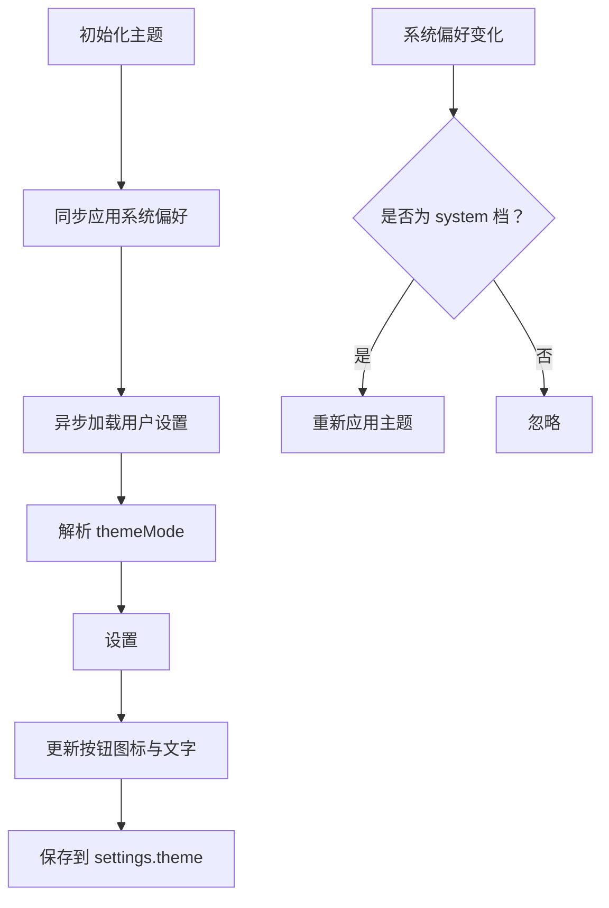
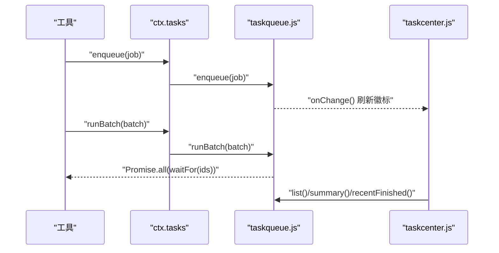
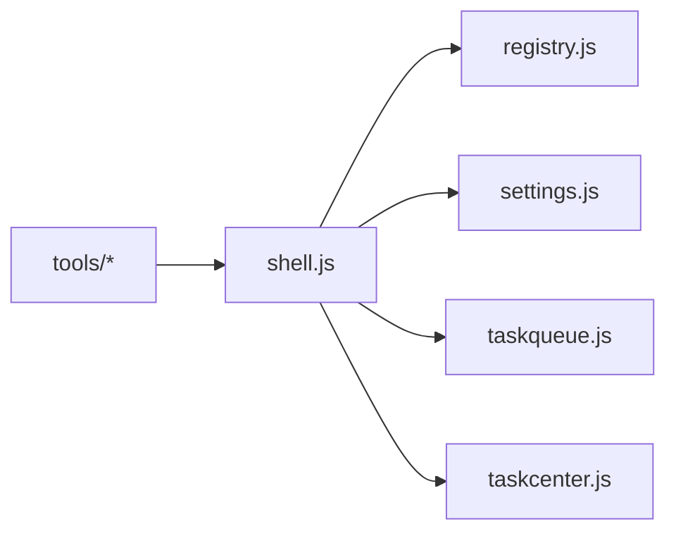

# 工具箱框架

<cite>
**本文引用的文件**   
- [shell.js](file://app/src/shell/shell.js)
- [registry.js](file://app/src/shell/registry.js)
- [taskcenter.js](file://app/src/shell/taskcenter.js)
- [settings.js](file://app/src/shared/settings.js)
- [taskqueue.js](file://app/src/shared/taskqueue.js)
- [toolkit.md](file://spec/modules/toolkit.md)
- [theme.md](file://spec/modules/theme.md)
- [ui.md](file://spec/modules/ui.md)
</cite>

## 目录
1. [简介](#简介)
2. [项目结构](#项目结构)
3. [核心组件](#核心组件)
4. [架构总览](#架构总览)
5. [详细组件分析](#详细组件分析)
6. [依赖关系分析](#依赖关系分析)
7. [性能与内存特性](#性能与内存特性)
8. [故障排除指南](#故障排除指南)
9. [结论](#结论)

## 简介
本技术文档围绕工具箱框架的核心实现 `shell.js`，面向工具开发者与维护者，系统说明以下能力：
- 工具生命周期管理：挂载、激活、失活、卸载及 LRU 保活机制。
- 框架上下文 `ctx` 的通用能力：文件对话框、文件读写、设置读取与更新、UI 反馈（状态栏、参数信息、进度遮罩）。
- 主题系统：浅色 / 深色 / 跟随系统三档切换与持久化。
- 任务队列集成：如何从框架获取任务管理能力、入队、批量执行、取消、重试与最近完成记录。
- 常见生命周期问题排查与内存泄漏防护建议。

## 项目结构
框架相关代码主要分布在 shell 层与共享模块中：
- `app/src/shell/shell.js`：框架主入口，负责导航、工具挂载/卸载、主题、设置、任务中心、全局 `ctx`。
- `app/src/shell/registry.js`：全软件唯一的工具注册表与分组定义。
- `app/src/shell/taskcenter.js`：右侧任务中心面板，展示并操作跨工具任务。
- `app/src/shared/settings.js`：全局设置加载、读取、更新与重置。
- `app/src/shared/taskqueue.js`：纯逻辑跨工具任务队列，提供并发通道、取消、重试与等待。
- 规范文档位于 `spec/modules/toolkit.md`、`spec/modules/theme.md`、`spec/modules/ui.md`，用于约束行为与验收标准。

**图表来源**
- [shell.js:1-100](file://app/src/shell/shell.js#L1-L100)
- [registry.js:1-67](file://app/src/shell/registry.js#L1-L67)
- [taskcenter.js:1-256](file://app/src/shell/taskcenter.js#L1-L256)
- [settings.js:1-83](file://app/src/shared/settings.js#L1-L83)
- [taskqueue.js:1-354](file://app/src/shared/taskqueue.js#L1-L354)

**章节来源**
- [shell.js:1-120](file://app/src/shell/shell.js#L1-L120)
- [registry.js:1-67](file://app/src/shell/registry.js#L1-L67)
- [ui.md:40-63](file://spec/modules/ui.md#L40-L63)

## 核心组件
- **工具注册表**：集中声明所有工具、分组与排序字段；新增工具只需在注册表中添加一行。
- **框架上下文 ctx**：为工具暴露统一的 UI 反馈、文件操作、设置与版本信息接口。
- **任务队列**：统一处理批量任务，支持按通道并发、取消、重试、最近完成记录与等待终态。
- **主题系统**：通过 `<html data-theme>` 控制浅色/深色/跟随系统，持久化到 settings。
- **任务中心**：独立侧滑面板，只展示与操作任务，不影响任务实际执行。

**章节来源**
- [shell.js:1-120](file://app/src/shell/shell.js#L1-L120)
- [registry.js:1-67](file://app/src/shell/registry.js#L1-L67)
- [taskqueue.js:1-120](file://app/src/shared/taskqueue.js#L1-L120)
- [theme.md:1-43](file://spec/modules/theme.md#L1-L43)

## 架构总览
下图展示工具启动、切换、保活与任务执行的整体流程。

**图表来源**
- [shell.js:201-450](file://app/src/shell/shell.js#L201-L450)
- [registry.js:1-67](file://app/src/shell/registry.js#L1-L67)
- [taskqueue.js:1-200](file://app/src/shared/taskqueue.js#L1-L200)
- [taskcenter.js:1-200](file://app/src/shell/taskcenter.js#L1-L200)

## 详细组件分析

### 工具生命周期管理与 LRU 保活
工具生命周期由 `switchTool` 驱动，遵循以下顺序：
- `mount(container, ctx)`：首次进入时调用一次，工具在此渲染界面。
- `activate()` / `deactivate()`：每次切入/切出时可选调用；切走时若该页“没动过”，会在 `deactivate()` 之后立即 `unmount()`。
- `unmount()`：页面被销毁或被 LRU 回收时调用，工具应清理事件监听、进度订阅、后台资源等。

保活策略要点：
- 每个工具一个 `.tool-page` 容器，首次进入挂载，切走时整页从文档取下但保留在内存，不销毁、不重建。
- “动过”的页面才计入保活额度；只是点开看一眼的页面会静默释放，不占用保活上限。
- 保活上限默认 5 个“动过”的页面；超出时淘汰最久未使用的页面，先调用 `unmount()` 再丢弃 DOM 与记录。
- 当前页永不淘汰；LRU 回收后再次进入时会提示“上次的内容已自动释放”。

**图表来源**
- [shell.js:201-450](file://app/src/shell/shell.js#L201-L450)
- [toolkit.md:1-83](file://spec/modules/toolkit.md#L1-L83)

**章节来源**
- [shell.js:201-450](file://app/src/shell/shell.js#L201-L450)
- [toolkit.md:1-83](file://spec/modules/toolkit.md#L1-L83)

### 框架上下文 ctx 的通用能力
`ctx` 是框架提供给每个工具的统一能力入口，避免工具直接操作全局 DOM 或 Electron 主进程 API。它包括：

- **UI 反馈方法**
  - `setStatus(text)`：设置状态栏文本，按页记录并在当前页显示。
  - `setInfo({ width, height, ms })`：设置分辨率与耗时信息。
  - `showProgress(text, percent)`：显示进度遮罩与百分比，仅当前页生效。
  - `hideProgress()`：隐藏进度遮罩，仅当前页生效。
  - `isActive()`：判断工具是否当前显示，用于全局快捷键等交互。

- **文件对话框与路径操作**
  - `openImages()`、`openFolder()`、`saveFile(options)`。
  - `readFile(filePath)`、`writeFile(filePath, bytes)`、`removeFile(filePath)`。
  - `pathInfo(filePath)`、`listImages(dirPath)`、`listFiles(dirPath, exts)`。
  - `saveImageNextTo(options)`、`renameBatch(renames)`。
  - 专用对话框如 `openVideos()`、`openMedia()`、`openPdfs()`、`openArchiveFiles()` 等。

- **扩展能力桥接**
  - OCR：`ocrStatus()`、`ocrRecognize()`、`ocrCancel()`、`ocrFont()`。
  - FFmpeg：`ffmpegStatus()`、`ffmpegProbe()`、`ffmpegConvert()`、`ffmpegTransform()`、`ffmpegCancel()`、`ffmpegOnProgress()`。
  - AI 放大：`aiStatus()`、`aiUpscale()`、`aiOnProgress()`。
  - 播放器：`openPlayerVideos()`、`playerCacheDir()`、`playerCleanCache()`、`playerPrepare()`。

- **任务队列接入**
  - `ctx.tasks.enqueue(job)`：单个任务入队。
  - `ctx.tasks.runBatch(batch)`：批量任务执行并等待全部完成。
  - `ctx.tasks.cancel(id)`、`cancelAll()`：取消任务。
  - `ctx.tasks.list()`、`get(id)`、`summary()`、`clearFinished()`、`retry(id)`、`recentFinished(limit)`、`waitFor(id)`。

- **设置与版本信息**
  - `settings`：引用 `shared/settings.js`，可读取、更新、重置。
  - `versions`、`appInfo()`：来自 Electron 主进程的版本与应用信息。

**图表来源**
- [shell.js:120-240](file://app/src/shell/shell.js#L120-L240)
- [taskqueue.js:200-354](file://app/src/shared/taskqueue.js#L200-L354)

**章节来源**
- [shell.js:120-240](file://app/src/shell/shell.js#L120-L240)
- [taskqueue.js:200-354](file://app/src/shared/taskqueue.js#L200-L354)

### 主题系统的实现
主题系统提供三档外观：
- `system`：跟随系统深浅色，默认值。
- `light`：浅色模式。
- `dark`：深色模式。

实现要点：
- 通过修改 `<html data-theme>` 的值切换主题，颜色变量集中在 `theme.css`。
- 用户选择写入 `settings.theme`，落盘持久化。
- 使用 `matchMedia('(prefers-color-scheme: dark)')` 监听系统偏好变化。
- 启动时同步按系统偏好上色一次，避免异步读取设置导致的闪白。
- 顶栏按钮循环切换档位；设置弹窗也提供外观下拉框。

**图表来源**
- [shell.js:1-120](file://app/src/shell/shell.js#L1-L120)
- [settings.js:1-83](file://app/src/shared/settings.js#L1-L83)
- [theme.md:1-43](file://spec/modules/theme.md#L1-L43)

**章节来源**
- [shell.js:1-120](file://app/src/shell/shell.js#L1-L120)
- [settings.js:1-83](file://app/src/shared/settings.js#L1-L83)
- [theme.md:1-43](file://spec/modules/theme.md#L1-L43)

### 任务队列集成方式
任务队列是跨工具的公共执行引擎，框架在 `shell.js` 中创建唯一实例并通过 `ctx.tasks` 暴露给所有工具。

关键契约：
- 任务归属队列，不归属工具页；工具 `unmount()` 不得取消队列中的任务。
- 工具通过 `ctx.tasks.enqueue` 或 `ctx.tasks.runBatch` 提交任务。
- 队列维护任务状态、进度、最近完成记录，并提供取消、重试、等待终态等方法。
- 任务中心面板只负责展示与操作转发，不持有任务状态。

**图表来源**
- [shell.js:120-240](file://app/src/shell/shell.js#L120-L240)
- [taskqueue.js:1-200](file://app/src/shared/taskqueue.js#L1-L200)
- [taskcenter.js:1-200](file://app/src/shell/taskcenter.js#L1-L200)

**章节来源**
- [shell.js:120-240](file://app/src/shell/shell.js#L120-L240)
- [taskqueue.js:1-200](file://app/src/shared/taskqueue.js#L1-L200)
- [taskcenter.js:1-200](file://app/src/shell/taskcenter.js#L1-L200)

### 工具正确使用的示例说明
以下为典型用法指引（以步骤形式描述，不直接粘贴源码）：

- **在工具中显示状态与进度**
  1. 在工具挂载时接收 `ctx`。
  2. 用户触发处理后，调用 `ctx.setStatus('正在处理...')`。
  3. 调用 `ctx.showProgress('处理中...', 30)` 更新进度。
  4. 完成后调用 `ctx.hideProgress()` 并 `ctx.setStatus('处理完成')`。

- **打开图片并保存结果**
  1. 调用 `const paths = await ctx.openImages()`。
  2. 对输入路径进行处理。
  3. 调用 `await ctx.saveFile({ filePath, bytes })` 保存输出。

- **提交批量任务**
  1. 构造任务数组，每项包含 `label`、`run(ctx)` 函数。
  2. 调用 `await ctx.tasks.runBatch({ toolId, toolName, jobs })`。
  3. 如需单独取消，调用 `ctx.tasks.cancel(taskId)`。

- **读取设置并切换主题**
  1. 使用 `settings.getSettings().theme` 读取当前主题。
  2. 调用 `settings.updateSettings({ theme: 'dark' })` 更新并落盘。
  3. 框架会自动应用主题，无需工具手动刷新界面。

这些示例对应框架中 `ctx` 的方法定义与设置模块的 API，开发者可据此在自己的工具中安全调用。

**章节来源**
- [shell.js:120-240](file://app/src/shell/shell.js#L120-L240)
- [settings.js:1-83](file://app/src/shared/settings.js#L1-L83)
- [taskqueue.js:1-200](file://app/src/shared/taskqueue.js#L1-L200)

## 依赖关系分析
- `shell.js` 依赖 `registry.js` 获取工具清单与分组。
- `shell.js` 依赖 `settings.js` 获取与更新全局设置。
- `shell.js` 依赖 `taskqueue.js` 创建唯一任务队列实例。
- `shell.js` 依赖 `taskcenter.js` 创建任务中心面板。
- 工具模块通过 `ctx` 反向依赖框架能力，但禁止工具之间互相 import。

**图表来源**
- [shell.js:1-120](file://app/src/shell/shell.js#L1-L120)
- [registry.js:1-67](file://app/src/shell/registry.js#L1-L67)
- [taskcenter.js:1-256](file://app/src/shell/taskcenter.js#L1-L256)
- [settings.js:1-83](file://app/src/shared/settings.js#L1-L83)
- [taskqueue.js:1-354](file://app/src/shared/taskqueue.js#L1-L354)

**章节来源**
- [shell.js:1-120](file://app/src/shell/shell.js#L1-L120)
- [registry.js:1-67](file://app/src/shell/registry.js#L1-L67)
- [toolkit.md:1-83](file://spec/modules/toolkit.md#L1-L83)

## 性能与内存特性
- **保活上限**：默认最多保活 5 个“动过”的页面，防止内存无限增长。
- **LRU 回收**：淘汰最久未使用的页面，优先释放“没动过”的页面；当前页永不淘汰。
- **样式加载**：同一份工具样式只加载一次，避免重复注入。
- **任务并发**：任务队列默认 CPU 通道并发为 1，IO 通道并发为 2，避免吃满 CPU。
- **最近完成记录**：默认保留 50 条，运行态不持久化，重启后未完成的任务丢弃。
- **导航重渲染优化**：切换工具时不重建左侧列表，只更新高亮与瞬时展开分组，避免闪烁。

[本节为一般性性能讨论，不直接分析具体文件]

## 故障排除指南
常见问题与处理建议：

- **工具切换后状态丢失**
  - 检查是否在 `unmount()` 中错误清除了需要保活的 DOM 或状态。
  - 确认工具只在 `mount()` 中初次渲染，避免每次切换都重建。

- **进度遮罩卡住**
  - 确保每次 `showProgress()` 都有对应的 `hideProgress()`。
  - 注意 `ctx.showProgress/hideProgress` 仅在当前页生效；切走工具时框架会关闭遮罩，切回来时根据本页记录恢复。

- **任务被意外取消**
  - 工具 `unmount()` 不应调用队列取消；任务归属队列，不归属工具页。
  - 如需取消，使用 `ctx.tasks.cancel(id)` 或 `ctx.tasks.cancelAll()`。

- **主题切换无效**
  - 确认 `settings.theme` 是否正确持久化。
  - 检查是否有工具写死了颜色变量，违反“只覆盖同名变量”的主题约定。

- **LRU 回收导致内容丢失**
  - 这是预期行为：保活上限外的页面会被释放，下次进入会重新挂载。
  - 框架会在状态栏提示“上次的内容已自动释放”，避免用户误以为文件丢失。

- **任务中心面板打不开或无刷新**
  - 任务中心只负责展示；任务执行不受面板开关影响。
  - 检查 `taskQueue.onChange()` 回调是否正常触发。

**章节来源**
- [shell.js:201-450](file://app/src/shell/shell.js#L201-L450)
- [taskqueue.js:1-200](file://app/src/shared/taskqueue.js#L1-L200)
- [taskcenter.js:1-200](file://app/src/shell/taskcenter.js#L1-L200)
- [toolkit.md:1-83](file://spec/modules/toolkit.md#L1-L83)
- [theme.md:1-43](file://spec/modules/theme.md#L1-L43)

## 结论
`shell.js` 作为工具箱框架的核心控制器，统一管理工具生命周期、主题、设置、任务队列与任务中心。开发者应遵循以下原则：
- 在 `mount()` 中初始化界面，在 `unmount()` 中清理资源。
- 使用 `ctx` 提供的统一 API，避免直接操作全局 DOM 或 Electron 主进程接口。
- 将批量任务交给 `ctx.tasks`，不自行管理任务状态。
- 遵守主题约定，只使用 CSS 变量，不写死颜色。
- 理解 LRU 保活机制，避免在“没动过”的页面中做昂贵初始化。

通过这些约定，工具箱可以在功能不断扩展的同时保持用户体验稳定、内存可控、任务可靠。