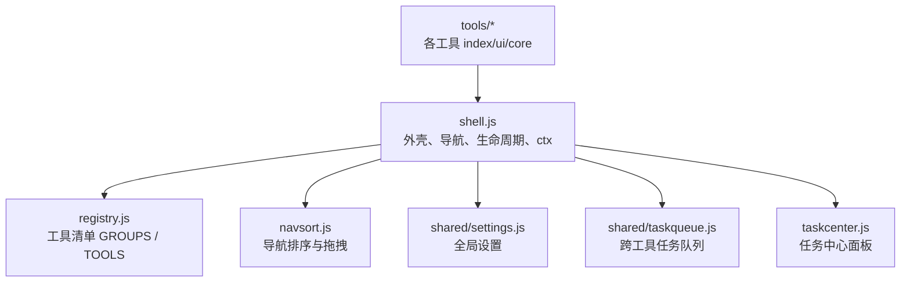
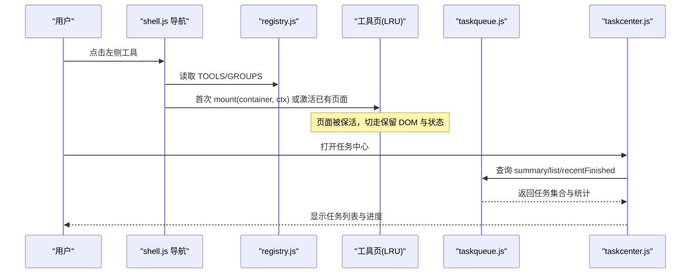
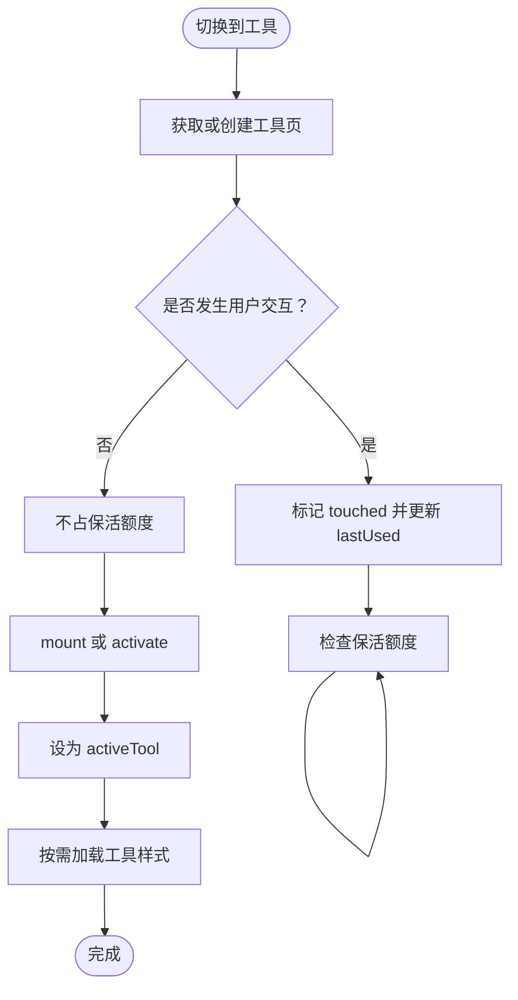
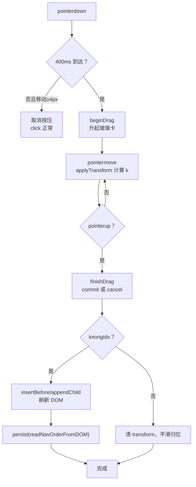
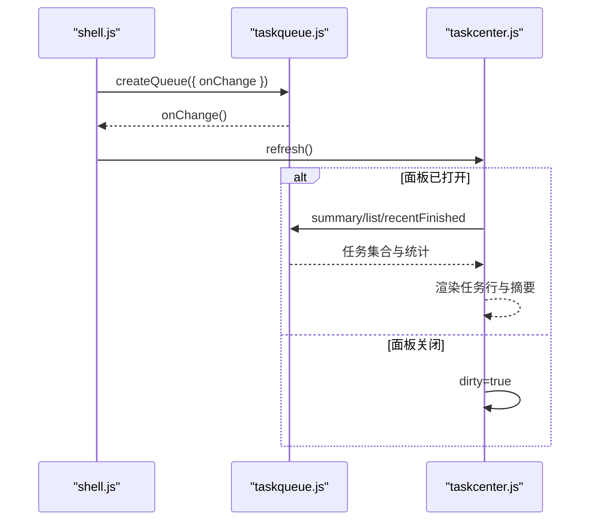
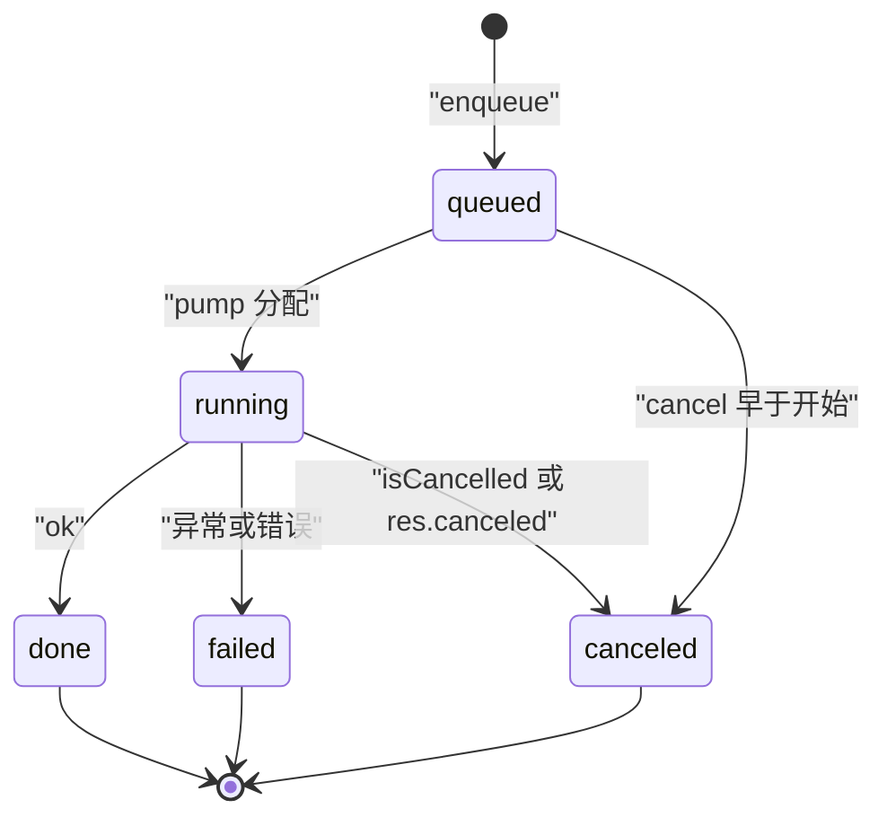
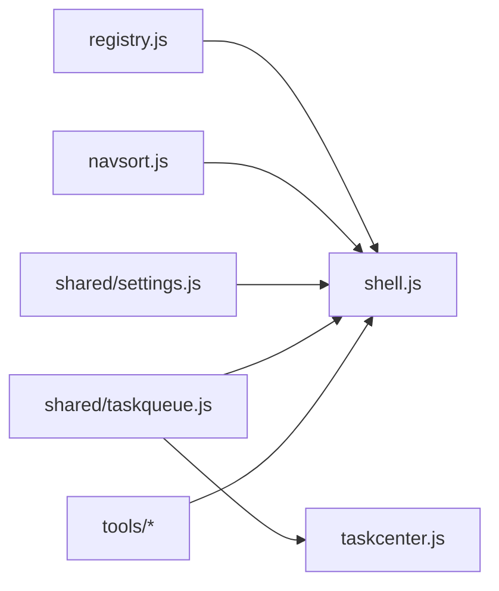

# 核心框架

<cite>
**本文引用的文件**   
- [shell.js](file://app/src/shell/shell.js)
- [registry.js](file://app/src/shell/registry.js)
- [navsort.js](file://app/src/shell/navsort.js)
- [taskcenter.js](file://app/src/shell/taskcenter.js)
- [settings.js](file://app/src/shared/settings.js)
- [taskqueue.js](file://app/src/shared/taskqueue.js)
- [新增工具指南.md](file://docs/新增工具指南.md)
- [toolkit.md](file://spec/modules/toolkit.md)
</cite>

## 目录
1. [引言](#引言)
2. [项目结构](#项目结构)
3. [核心组件](#核心组件)
4. [架构总览](#架构总览)
5. [详细组件分析](#详细组件分析)
6. [依赖关系分析](#依赖关系分析)
7. [性能与资源特性](#性能与资源特性)
8. [故障排除指南](#故障排除指南)
9. [结论](#结论)

## 引言
本文件面向“工具箱框架”的核心实现，聚焦以下目标：
- 解释 shell.js 中的工具注册、导航管理与生命周期控制。
- 文档化 registry.js 的工具注册机制与工具元数据结构。
- 说明 navsort.js 的导航排序算法与长按拖拽交互。
- 介绍 taskcenter.js 的任务中心展示与调度协作关系。
- 给出注册新工具、处理事件和状态管理的实践示例。
- 解释工具层与共享模块（settings、taskqueue）之间的依赖关系。
- 提供常见框架级问题的定位与修复建议。

## 项目结构
框架位于 app/src/shell 下，围绕“左侧导航 + 右侧工具页容器 + 任务中心 + 设置 + 任务队列”组织：
- shell.js：应用外壳，负责主题、任务队列实例、ctx 上下文、工具挂载与 LRU 保活、分组折叠与导航渲染。
- registry.js：唯一的工具清单与分组定义。
- navsort.js：导航手动排序的纯逻辑与长按拖拽控制器。
- taskcenter.js：任务中心侧滑面板，只负责展示与操作转发。
- shared/settings.js：全局设置加载、读写与默认值。
- shared/taskqueue.js：跨工具任务队列，按通道并发调度。

**图表来源**
- [shell.js:1-20](file://app/src/shell/shell.js#L1-L20)
- [registry.js:1-67](file://app/src/shell/registry.js#L1-L67)
- [navsort.js:1-20](file://app/src/shell/navsort.js#L1-L20)
- [taskcenter.js:1-20](file://app/src/shell/taskcenter.js#L1-L20)
- [settings.js:1-20](file://app/src/shared/settings.js#L1-L20)
- [taskqueue.js:1-20](file://app/src/shared/taskqueue.js#L1-L20)

**章节来源**
- [shell.js:1-40](file://app/src/shell/shell.js#L1-L40)
- [registry.js:1-67](file://app/src/shell/registry.js#L1-L67)
- [navsort.js:1-20](file://app/src/shell/navsort.js#L1-L20)
- [taskcenter.js:1-20](file://app/src/shell/taskcenter.js#L1-L20)
- [settings.js:1-20](file://app/src/shared/settings.js#L1-L20)
- [taskqueue.js:1-20](file://app/src/shared/taskqueue.js#L1-L20)

## 核心组件
- 工具注册表（registry.js）：集中导出 GROUPS 与 TOOLS，是左侧导航与工具列表的唯一数据源。
- 外壳与上下文（shell.js）：创建任务队列、暴露 ctx、管理工具页保活与 LRU、分组折叠、样式加载、主题切换。
- 导航排序（navsort.js）：计算渲染顺序、选择启动工具、长按拖拽排序并持久化。
- 任务中心（taskcenter.js）：基于 taskqueue 的视图层，提供取消、重试、清空等交互。
- 设置（settings.js）：默认值、异步加载、合并更新、落盘。
- 任务队列（taskqueue.js）：通道并发、任务状态机、进度上报、历史最近完成记录。

**章节来源**
- [registry.js:1-67](file://app/src/shell/registry.js#L1-L67)
- [shell.js:1-220](file://app/src/shell/shell.js#L1-L220)
- [navsort.js:1-200](file://app/src/shell/navsort.js#L1-L200)
- [taskcenter.js:1-120](file://app/src/shell/taskcenter.js#L1-L120)
- [settings.js:1-83](file://app/src/shared/settings.js#L1-L83)
- [taskqueue.js:1-120](file://app/src/shared/taskqueue.js#L1-L120)

## 架构总览
框架采用“声明式工具 + 框架驱动”的结构：工具通过 registry.js 声明，shell.js 负责挂载、切换、保活与清理；任务由工具经 ctx.tasks 提交到 taskqueue.js，taskcenter.js 仅做展示与控制转发。

**图表来源**
- [shell.js:1-220](file://app/src/shell/shell.js#L1-L220)
- [registry.js:1-67](file://app/src/shell/registry.js#L1-L67)
- [taskcenter.js:1-120](file://app/src/shell/taskcenter.js#L1-L120)
- [taskqueue.js:1-120](file://app/src/shared/taskqueue.js#L1-L120)

## 详细组件分析

### 工具注册与生命周期（shell.js）
shell.js 是框架中枢，职责包括：
- 从 registry.js 导入 TOOLS 与 GROUPS。
- 创建任务队列实例，并通过 ctx.tasks 暴露给所有工具。
- 维护已挂载工具页 Map，实现“动过的页保活 + LRU 回收”。
- 管理分组折叠、导航高亮、样式加载与主题切换。
- 提供 ctx：状态提示、信息栏、进度遮罩、文件对话框、设置与版本信息等。

关键要点：
- 工具生命周期约定：mount(container, ctx) 首次进入调用一次；activate()/deactivate() 可选，用于切入/切出时的全局交互让位；unmount() 在页面被销毁或被 LRU 回收时调用。
- “动过”判定：pointerdown/click/keydown/input/change/drop/paste 任一事件触发后，该页才计入保活额度。
- LRU 上限 MAX_ALIVE_PAGES = 5，当前页永不淘汰；超过上限时淘汰最久未用的“动过”页，否则优先静默释放“没动过”的页。
- ctx.isActive() 必须用于判断是否当前页，避免后台页抢占快捷键等全局交互。
- 状态与进度按页记账：setStatus/setInfo/showProgress/hideProgress 会保存至当前页，切换回原页恢复。

**图表来源**
- [shell.js:220-420](file://app/src/shell/shell.js#L220-L420)

**章节来源**
- [shell.js:1-220](file://app/src/shell/shell.js#L1-L220)
- [shell.js:220-420](file://app/src/shell/shell.js#L220-L420)

### 工具注册机制（registry.js）
registry.js 是全软件唯一的工具清单：
- GROUPS：定义左侧分组顺序与名称图标，如图片、视频、音频、文档、压缩、系统。
- TOOLS：按导入顺序列出所有工具声明对象；左侧列表先按 GROUPS 分组，组内按工具的 order 升序。

工具元数据结构（每个工具声明）：
- id：唯一标识，英文小写。
- name：左侧列表显示名。
- icon：列表图标。
- group：所属分组，对应 GROUPS.id。
- order：组内排序，数字越小越靠前。
- styles：工具专属样式数组，首次进入自动加载。
- mount(container, ctx)：首次进入渲染界面。
- activate()/deactivate()：可选，切入/切出回调。
- unmount()：页面销毁或 LRU 回收时清理。

新增工具流程（参考 docs/新增工具指南.md）：
1. 复制 _template 模板到新工具目录。
2. 在 tools/<标识>/index.js 中导出工具声明。
3. 在 registry.js 增加 import 与 TOOLS 数组项。
4. 编写 ui.js 与 core/ 业务逻辑。
5. 重启软件后左侧出现入口，无需修改既有工具。

**章节来源**
- [registry.js:1-67](file://app/src/shell/registry.js#L1-L67)
- [新增工具指南.md:1-83](file://docs/新增工具指南.md#L1-L83)

### 导航排序与任务中心（navsort.js 与 taskcenter.js）

#### 导航排序算法（navsort.js）
navsort.js 分为两部分：
- 纯逻辑：computeNavPlan、pickStartupTool、readNavOrderFromDOM，不依赖 DOM，可单元测试。
- 交互控制器：createNavSort，使用 Pointer Events 实现长按拖动排序。

computeNavPlan 净化规则：
- saved 非普通对象 → 全用默认。
- saved.groups 只保留已知分组 id，去重，'other' 忽略；缺失分组按注册序追加。
- saved.tools[groupId] 只保留属于该组的合法 toolId，去重；未排过序的新工具按 order 追加。
- 最终输出包含正式分组与固定置底的「其它」组。

pickStartupTool：
- 选择计划中第一个非空分组的第一个工具；从未排序时等同于默认序的第一个分组首个工具。

readNavOrderFromDOM：
- 从渲染后的 .tool-nav 快照 groups 与 tools 映射，供 persist 写入 settings.navOrder。

长按拖拽交互要点：
- pointerdown 起 400ms 计时器，到时 beginDrag；移动 ≥4px 或松手则放弃按压，click 照常。
- 兄弟让位偏移 shift = 被拖块高度 + 间距，与兄弟自身高度无关。
- dragEndedAt 后 500ms 内拦截 click，防止拖完后误触切换工具或折叠分组。
- 拖拽中自动滚动列表边缘；松开后进行 mini-FLIP 动画归位。
- 成功落盘完整快照，失败不影响界面。

**图表来源**
- [navsort.js:1-200](file://app/src/shell/navsort.js#L1-L200)
- [navsort.js:201-388](file://app/src/shell/navsort.js#L201-L388)

#### 任务中心（taskcenter.js）
taskcenter.js 是一个右侧侧滑抽屉，职责单一：
- 订阅 queue.summary/list/recentFinished 进行渲染。
- 提供“全部取消”“清空已完成”“单个任务取消/重试”等操作。
- 面板开关不影响任务执行；任务归属 shared/taskqueue.js。

渲染内容：
- 头部标题、关闭按钮。
- 总体摘要（进行中/排队/完成/失败数量）。
- 整体进度条（百分比）。
- 活动任务区与最近完成区。
- 空态提示。

交互行为：
- 点击遮罩、Esc、关闭按钮关闭面板。
- 打开时延迟渲染（dirty 标志），关闭时不再渲染以节省开销。
- 所有操作直接转发到 queue 实例，完成后刷新视图。

**图表来源**
- [taskcenter.js:1-120](file://app/src/shell/taskcenter.js#L1-L120)
- [taskcenter.js:201-256](file://app/src/shell/taskcenter.js#L201-L256)
- [taskqueue.js:1-120](file://app/src/shared/taskqueue.js#L1-L120)

**章节来源**
- [navsort.js:1-200](file://app/src/shell/navsort.js#L1-L200)
- [navsort.js:201-388](file://app/src/shell/navsort.js#L201-L388)
- [taskcenter.js:1-120](file://app/src/shell/taskcenter.js#L1-L120)
- [taskcenter.js:201-256](file://app/src/shell/taskcenter.js#L201-L256)

### 任务调度系统（taskqueue.js）
taskqueue.js 是跨工具任务队列，核心契约：
- 入队后的任务归属队列，不归属工具页；工具 unmount() 不得取消队列任务。
- 支持通道并发：cpu 通道串行，io 通道并行（默认分别为 1 与 2）。
- 任务终态：done/failed/canceled，并记录 startedAt/endedAt/progress/stepText/output/error。
- 最近完成记录保持有限长度，便于 UI 展示与重试。

主要接口：
- enqueue(job)：提交单任务，返回 taskId。
- runBatch(batch)：批量提交同工具任务，返回 Promise，等待全部终态。
- cancel(id)/cancelAll()：请求取消。
- retry(id)：重试失败或取消的任务。
- list()/summary()/recentFinished(limit)：查询任务与统计。
- waitFor(id)：Promise 风格等待任务终态。

**图表来源**
- [taskqueue.js:1-120](file://app/src/shared/taskqueue.js#L1-L120)
- [taskqueue.js:120-200](file://app/src/shared/taskqueue.js#L120-L200)

**章节来源**
- [taskqueue.js:1-120](file://app/src/shared/taskqueue.js#L1-L120)
- [taskqueue.js:120-200](file://app/src/shared/taskqueue.js#L120-L200)

### 设置与配置（settings.js）
settings.js 提供：
- DEFAULT_SETTINGS：默认值，含 collapsedGroups、navOrder、theme 等。
- loadSettings/reloadSettings：从主进程读取设置，失败回退默认。
- getSettings/updateSettings/resetSettings：同步读取、合并更新并落盘。

与框架的关系：
- shell.js 通过 ctx.settings 暴露给工具，用于读写通用设置。
- navsort.js 持久化 settings.navOrder；分组折叠状态保存在 settings.collapsedGroups。

**章节来源**
- [settings.js:1-83](file://app/src/shared/settings.js#L1-L83)
- [shell.js:1-220](file://app/src/shell/shell.js#L1-L220)

## 依赖关系分析
- shell.js 依赖：
  - registry.js：TOOLS/GROUPS。
  - navsort.js：computeNavPlan、pickStartupTool、createNavSort。
  - shared/settings.js：设置读写。
  - shared/taskqueue.js：任务队列实例。
  - taskcenter.js：任务中心面板。
  - shared/htmlescape.js：HTML 转义。
- taskcenter.js 依赖：
  - shared/taskqueue.js：只读访问与操作转发。
- navsort.js 依赖：
  - 无运行时 DOM 之外的业务依赖；交互函数通过选项注入 persist/resetOrder/onStatus。
- 工具层依赖：
  - 通过 ctx 访问文件 IO、设置、任务队列、版本信息等；禁止工具之间互相 import。

**图表来源**
- [shell.js:1-40](file://app/src/shell/shell.js#L1-L40)
- [registry.js:1-67](file://app/src/shell/registry.js#L1-L67)
- [navsort.js:1-20](file://app/src/shell/navsort.js#L1-L20)
- [taskcenter.js:1-20](file://app/src/shell/taskcenter.js#L1-L20)
- [taskqueue.js:1-20](file://app/src/shared/taskqueue.js#L1-L20)
- [settings.js:1-20](file://app/src/shared/settings.js#L1-L20)

**章节来源**
- [shell.js:1-40](file://app/src/shell/shell.js#L1-L40)
- [registry.js:1-67](file://app/src/shell/registry.js#L1-L67)
- [navsort.js:1-20](file://app/src/shell/navsort.js#L1-L20)
- [taskcenter.js:1-20](file://app/src/shell/taskcenter.js#L1-L20)
- [taskqueue.js:1-20](file://app/src/shared/taskqueue.js#L1-L20)
- [settings.js:1-20](file://app/src/shared/settings.js#L1-L20)

## 性能与资源特性
- 工具样式懒加载：同一样式只加载一次，避免重复 <link>。
- 工具页保活：最多 5 个“动过”的页驻留，超出 LRU 回收；“没动过”的页切走即释放，不占额度。
- 导航渲染复用：切换工具时仅更新 is-active，不重建导航，减少闪烁。
- 分组折叠动画：max-height 过渡 + 超时兜底，兼容“减少动态效果”系统设置。
- 任务队列通道并发：cpu 串行、io 并行，避免同时打满 CPU。
- 任务中心延迟渲染：面板关闭时仅标记脏，打开时再渲染，降低开销。

**章节来源**
- [shell.js:420-600](file://app/src/shell/shell.js#L420-L600)
- [taskqueue.js:1-120](file://app/src/shared/taskqueue.js#L1-L120)
- [taskcenter.js:201-256](file://app/src/shell/taskcenter.js#L201-L256)

## 故障排除指南

常见问题与解决方案：
- 左侧没有新工具：
  - 确认已在 registry.js 增加 import 与 TOOLS 项；id 不要重复。
  - 检查工具声明中的 group 是否在 GROUPS 中存在；不存在将归入「其它」。
- 样式不生效：
  - 检查 styles 路径相对 src/shell/index.html；应为 ../tools/<标识>/styles.css。
- 切换工具后报错：
  - 多半是 unmount 未清理定时器/事件，或界面残留对旧 DOM 引用。
  - 若使用了 window/document 全局交互，确保在 deactivate 让位、activate 恢复，或在回调中使用 ctx.isActive() 判断。
- 导航排序异常：
  - 检查 settings.navOrder 是否损坏；computeNavPlan 会在渲染前净化非法形状，但可能导致意外回退默认。
  - 长按拖动后误触切换工具：dragEndedAt 后 500ms 内拦截 click，属预期行为。
- 任务被意外取消：
  - 工具 unmount() 不应取消队列任务；如需取消，应显式调用 queue.cancel(id)。
  - 任务状态为 canceled 可能是 onCancel 或 res.canceled 导致。
- 进度条卡住或错页：
  - showProgress/hideProgress 按页记账；确保仅在当前页调用 hideProgress，或通过 ctx.isActive() 判断。
  - 页面被 LRU 回收后，shell 会兜底关闭遮罩，但仍应避免后台页长期持有遮罩。
- 分组折叠行为不符合预期：
  - collapsedGroups=null 表示从未设置过，默认全部收起；展开某个分组不会改变用户偏好。
  - 切换工具时会自动瞬时展开所在分组，但不写入设置。

**章节来源**
- [新增工具指南.md:40-83](file://docs/新增工具指南.md#L40-L83)
- [toolkit.md:1-83](file://spec/modules/toolkit.md#L1-L83)
- [shell.js:220-420](file://app/src/shell/shell.js#L220-L420)
- [navsort.js:201-388](file://app/src/shell/navsort.js#L201-L388)
- [taskqueue.js:120-200](file://app/src/shared/taskqueue.js#L120-L200)

## 结论
核心框架通过 registry.js 统一声明工具，shell.js 负责导航、生命周期与资源管理，navsort.js 提供稳定的导航排序能力，taskcenter.js 与 taskqueue.js 共同构建跨工具任务可视化与调度体系。配合 settings.js 的全局设置，框架实现了“低接入成本、强扩展性、稳定保活与可控内存占用”的目标。新增工具只需复制模板并在 registry.js 登记一行，即可在左侧导航中呈现，并与框架其他能力无缝集成。