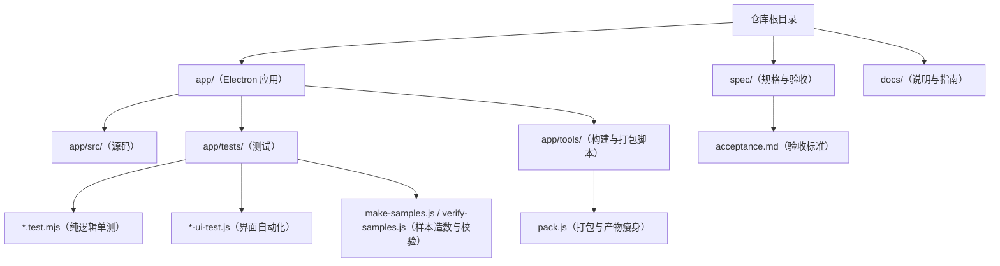
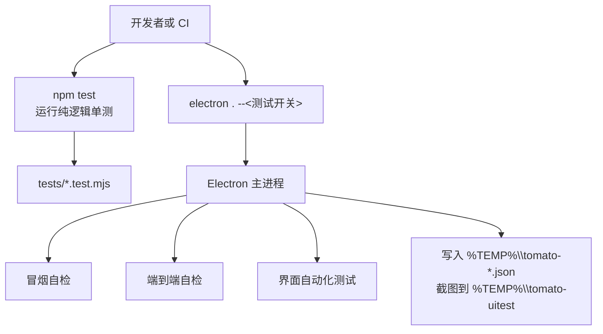
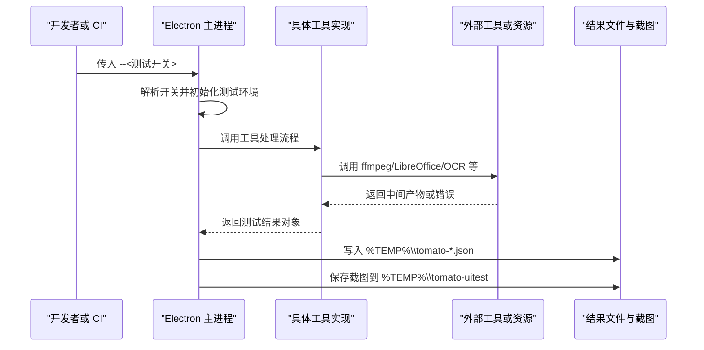
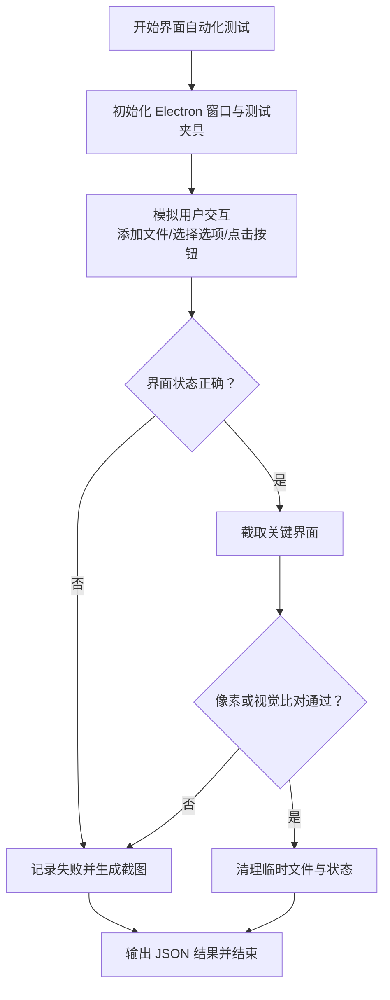
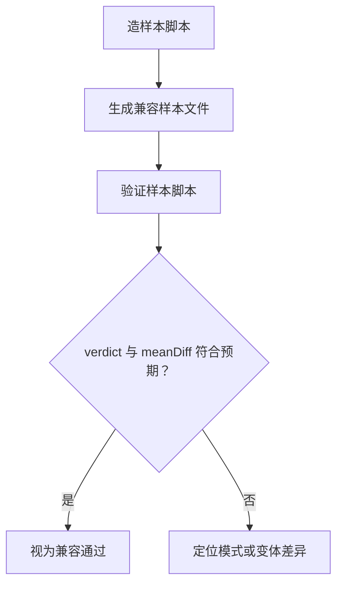
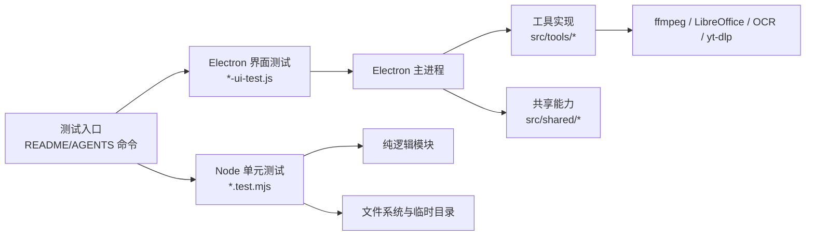

# 测试与质量保证

<cite>
**本文引用的文件**   
- [README.md](file://README.md)
- [AGENTS.md](file://AGENTS.md)
- [acceptance.md](file://spec/acceptance.md)
- [package.json](file://app/package.json)
- [engine.test.mjs](file://app/tests/engine.test.mjs)
- [taskqueue.test.mjs](file://app/tests/taskqueue.test.mjs)
- [archive.test.mjs](file://app/tests/archive.test.mjs)
- [imghide.test.mjs](file://app/tests/imghide.test.mjs)
- [navorder.test.mjs](file://app/tests/navorder.test.mjs)
- [uninstall.test.mjs](file://app/tests/uninstall.test.mjs)
- [settingsschema.test.mjs](file://app/tests/settingsschema.test.mjs)
- [uniquepath.test.mjs](file://app/tests/uniquepath.test.mjs)
- [videodl.test.mjs](file://app/tests/videodl.test.mjs)
- [docconvert.test.mjs](file://app/tests/docconvert.test.mjs)
- [ui-test.js](file://app/tests/ui-test.js)
- [pdf-ui-test.js](file://app/tests/pdf-ui-test.js)
- [media-ui-test.js](file://app/tests/media-ui-test.js)
- [audio-ui-test.js](file://app/tests/audio-ui-test.js)
- [asr-ui-test.js](file://app/tests/asr-ui-test.js)
- [player-ui-test.js](file://app/tests/player-ui-test.js)
- [videodl-ui-test.js](file://app/tests/videodl-ui-test.js)
- [archive-ui-test.js](file://app/tests/archive-ui-test.js)
- [make-samples.js](file://app/tests/make-samples.js)
- [verify-samples.js](file://app/tests/verify-samples.js)
- [pack.js](file://app/tools/pack.js)
</cite>

## 目录
1. [引言](#引言)
2. [项目结构](#项目结构)
3. [核心组件](#核心组件)
4. [架构总览](#架构总览)
5. [详细组件分析](#详细组件分析)
6. [依赖关系分析](#依赖关系分析)
7. [性能考量](#性能考量)
8. [故障排查指南](#故障排查指南)
9. [结论](#结论)
10. [附录：测试编写指南与质量门禁](#附录测试编写指南与质量门禁)

## 引言
本项目是一个基于 Electron 的桌面工具箱应用，提供图片、视频、音频、文档、压缩与系统工具。测试体系围绕“纯逻辑单测 + 冒烟自检 + 端到端自检 + 界面自动化”四层展开，并通过命令行开关驱动 Electron 主进程执行不同测试场景。验收标准以 `spec/acceptance.md` 为权威依据，强调可量化、可复现、附带证据（脚本输出、截图、JSON 结果）。

## 项目结构
测试相关代码集中在仓库根目录下的 `app/tests/` 子目录，并配合 Electron 主进程通过命令行参数触发；构建与打包脚本 `app/tools/pack.js` 负责把测试文件纳入产物白名单，保证交付包内也能运行测试。

**图示来源**
- [README.md:40-120](file://README.md#L40-L120)
- [AGENTS.md:20-98](file://AGENTS.md#L20-L98)
- [acceptance.md:1-190](file://spec/acceptance.md#L1-L190)
- [package.json:8-20](file://app/package.json#L8-L20)

**章节来源**
- [README.md:40-120](file://README.md#L40-L120)
- [AGENTS.md:20-98](file://AGENTS.md#L20-L98)
- [package.json:8-20](file://app/package.json#L8-L20)

## 核心组件
本项目的测试体系由以下关键部分组成：

| 类别 | 主要职责 | 对应文件或命令 |
|---|---|---|
| 纯逻辑单元测试 | 验证算法、任务队列、压缩解压、文件藏图、导航排序、卸载、设置模式、文件名分配、视频下载引擎、文档格式转换等逻辑 | `npm test`；各 `*.test.mjs` |
| 冒烟自检 | 检查工具数量、注册表一致性等硬断言 | `electron . --smoke-test` |
| 端到端自检 | 真实编解码、算法往返、媒体转码、OCR 闸门等 | `--self-test`、`--ocr-poc`、`--av-test`、`--imgbatch-test` 等 |
| 界面自动化测试 | 模拟用户操作、点击、输入、截图与像素级比对 | `--ui-test`、`--pdf-ui-test`、`--media-ui-test` 等 |
| 验收标准 | 定义可量化验收项、判据与证据要求 | `spec/acceptance.md` |
| 打包与产物约束 | 将测试文件加入产物白名单，保证交付包可自测 | `app/tools/pack.js` |

**章节来源**
- [README.md:40-120](file://README.md#L40-L120)
- [AGENTS.md:48-98](file://AGENTS.md#L48-L98)
- [acceptance.md:1-190](file://spec/acceptance.md#L1-L190)

## 架构总览
测试执行存在两条主线：

1. **Node 层纯逻辑测试**：直接通过 Node 运行 `tests/*.test.mjs`，不启动完整 Electron UI，适合快速回归算法与业务逻辑。
2. **Electron 层端到端与界面测试**：通过 `electron . --<switch>` 启动应用主进程，由主进程解析参数后加载对应测试入口，执行真实工具链、IPC、渲染、截图和像素比对。

**图示来源**
- [README.md:60-120](file://README.md#L60-L120)
- [AGENTS.md:58-98](file://AGENTS.md#L58-L98)

## 详细组件分析

### 单元测试框架与策略
- **框架选择**：仓库未引入第三方测试框架，而是使用 Node 原生能力直接运行 `.mjs` 测试文件。每个测试模块独立执行，失败时由 Node 退出码反映。
- **覆盖范围**：当前 `npm test` 串联 10 个测试模块，合计约 297 项用例，涵盖算法、任务队列、压缩解压、文件藏图、导航排序、卸载、设置 Schema、唯一路径分配、视频下载、文档格式转换。
- **设计原则**：
  - 每个模块对应一个业务域，避免跨模块耦合。
  - 用例以“输入 → 处理 → 输出/状态”为主，结合逐字节、逐像素、回读解码等方式断言。
  - 对外部依赖（如 ffmpeg、LibreOffice、yt-dlp）通过加装包检测与降级策略进行隔离。

**章节来源**
- [package.json:8-20](file://app/package.json#L8-L20)
- [README.md:60-120](file://README.md#L60-L120)
- [AGENTS.md:58-76](file://AGENTS.md#L58-L76)

#### 单元测试模块清单与职责
| 模块 | 主要断言方向 |
|---|---|
| `engine.test.mjs` | 图片混淆/解混淆算法往返、像素一致性与边界情况 |
| `taskqueue.test.mjs` | 任务队列调度、LRU 回收、跨工具任务保活 |
| `archive.test.mjs` | ZIP/7Z/TAR/GZIP/BZIP2/XZ/ZSTANDARD/BROTLI/RAR 等双向压缩、密码、分卷、大文件与安全 |
| `imghide.test.mjs` | 动态混淆与 PRO 容器双向互通、密码、路径穿越容错 |
| `navorder.test.mjs` | 左侧导航长按拖动排序、DOM 序与设置落盘 |
| `uninstall.test.mjs` | 提权命令构造、哈希与清单权限、空跑无进程、缺失降级 |
| `settingsschema.test.mjs` | 设置导入导出结构合法性、白名单过滤、野文件拒绝 |
| `uniquepath.test.mjs` | 输出文件名原子分配与冲突处理 |
| `videodl.test.mjs` | 引擎指纹、解析、本地下载、取消清理、历史落盘、缺包降级 |
| `docconvert.test.mjs` | Office→PDF/PDF→Word 真实 IPC 转换与内容读回 |

**章节来源**
- [engine.test.mjs](file://app/tests/engine.test.mjs)
- [taskqueue.test.mjs](file://app/tests/taskqueue.test.mjs)
- [archive.test.mjs](file://app/tests/archive.test.mjs)
- [imghide.test.mjs](file://app/tests/imghide.test.mjs)
- [navorder.test.mjs](file://app/tests/navorder.test.mjs)
- [uninstall.test.mjs](file://app/tests/uninstall.test.mjs)
- [settingsschema.test.mjs](file://app/tests/settingsschema.test.mjs)
- [uniquepath.test.mjs](file://app/tests/uniquepath.test.mjs)
- [videodl.test.mjs](file://app/tests/videodl.test.mjs)
- [docconvert.test.mjs](file://app/tests/docconvert.test.mjs)

### 集成测试与端到端测试
端到端测试通过 Electron 主进程加载具体功能，驱动真实工具链：

- **冒烟测试**：检查工具数量与注册表一致性，失败时输出明确标记并返回非零退出码，适合 CI 快速阻断。
- **端到端自检**：包含 PNG 往返、算法测试、JPG 处理、方块填充等；用于验证应用整体链路。
- **媒体与音视频**：视频压缩、音频剪辑、HEIC 与老图片格式、视频↔动图真实转码。
- **OCR 引擎闸门**：离线中文召回、耗时上限、零网络请求三项判据。
- **PDF 工作流**：PDF 转格式、编辑整理、文字识别、渲染与往返校验。

**图示来源**
- [README.md:60-120](file://README.md#L60-L120)
- [AGENTS.md:58-98](file://AGENTS.md#L58-L98)

**章节来源**
- [README.md:60-120](file://README.md#L60-L120)
- [AGENTS.md:58-98](file://AGENTS.md#L58-L98)

### 界面自动化测试
界面自动化测试覆盖图片混淆、PDF、媒体、音频、语音转文字、视频播放器、视频下载、压缩解压等多个工具的交互流程：

- **交互模拟**：通过 Electron 主进程注入或驱动 DOM 事件，模拟添加文件、选择格式、点击按钮、拖拽、清空等操作。
- **截图对比**：对关键界面状态截图，并进行像素级或视觉一致性校验。
- **状态验证**：检查进度条收敛、工具页状态保持、主题切换、任务中心徽标、LRU 回收提示等。
- **典型测试文件**：`ui-test.js`、`pdf-ui-test.js`、`media-ui-test.js`、`audio-ui-test.js`、`asr-ui-test.js`、`player-ui-test.js`、`videodl-ui-test.js`、`archive-ui-test.js`。

**图示来源**
- [README.md:60-120](file://README.md#L60-L120)
- [AGENTS.md:60-98](file://AGENTS.md#L60-L98)

**章节来源**
- [ui-test.js](file://app/tests/ui-test.js)
- [pdf-ui-test.js](file://app/tests/pdf-ui-test.js)
- [media-ui-test.js](file://app/tests/media-ui-test.js)
- [audio-ui-test.js](file://app/tests/audio-ui-test.js)
- [asr-ui-test.js](file://app/tests/asr-ui-test.js)
- [player-ui-test.js](file://app/tests/player-ui-test.js)
- [videodl-ui-test.js](file://app/tests/videodl-ui-test.js)
- [archive-ui-test.js](file://app/tests/archive-ui-test.js)

### 兼容性测试方案
项目使用专门的样本工具来锁定与手机版兼容的模式和变体：

- **造样本**：通过 `electron . --make-samples <目录> --mode <模式> [--key <密钥>]` 生成兼容样本。
- **验样本**：通过 `electron . --verify-samples <目录> --key <密钥>` 计算差异指标，`meanDiff` 接近 0 表示与手机版所用模式一致。
- **验收依据**：`spec/acceptance.md` 中明确要求电脑版与手机版双向兼容，并以逐像素一致或 PSNR 阈值作为判据。

**图示来源**
- [README.md:90-120](file://README.md#L90-L120)
- [AGENTS.md:76-98](file://AGENTS.md#L76-L98)
- [acceptance.md:1-190](file://spec/acceptance.md#L1-L190)

**章节来源**
- [make-samples.js](file://app/tests/make-samples.js)
- [verify-samples.js](file://app/tests/verify-samples.js)
- [acceptance.md:1-190](file://spec/acceptance.md#L1-L190)

### 持续集成与自动化流程
虽然仓库未提供 GitHub Actions 或 GitLab CI 配置，但测试命令本身已具备 CI 友好特性：

- **纯逻辑单测**：`npm test` 串行运行多个 `.mjs` 测试模块，任一失败即终止。
- **冒烟测试**：`--smoke-test` 失败时输出 `SMOKE_TEST_FAIL` 并返回退出码 1，可直接用于 CI 阻断。
- **端到端与界面测试**：通过 Electron 命令行开关驱动，结果统一写入 `%TEMP%\\tomato-*.json`，截图统一写入 `%TEMP%\\tomato-uitest`。
- **CI 建议接入点**：可在 CI 中依次执行 `npm test`、冒烟测试、端到端自检、界面自动化测试，并收集 JSON 结果与截图作为构建产物。

**章节来源**
- [README.md:60-120](file://README.md#L60-L120)
- [AGENTS.md:58-98](file://AGENTS.md#L58-L98)

### 测试覆盖率与质量门禁
- **覆盖率目标**：仓库未引入覆盖率统计工具，也未在 README 或 AGENTS 中设定硬性覆盖率百分比。
- **质量门禁**：
  - 交付前必须全绿：所有自检与界面测试通过，并按各自判定字段判断。
  - 截图需人工过目一遍。
  - 打包产物需再次运行同样项目，允许部分裁判或联网项只满足 `ok:true`。
  - 新增测试文件必须同步加入 `pack.js` 的逐文件白名单，否则产物内无法运行。

**章节来源**
- [AGENTS.md:76-98](file://AGENTS.md#L76-L98)
- [pack.js](file://app/tools/pack.js)

## 依赖关系分析
测试与实现的依赖关系如下：

**图示来源**
- [README.md:40-120](file://README.md#L40-L120)
- [AGENTS.md:20-98](file://AGENTS.md#L20-L98)

**章节来源**
- [README.md:40-120](file://README.md#L40-L120)
- [AGENTS.md:20-98](file://AGENTS.md#L20-L98)

## 性能考量
- **算法往返性能**：验收标准记录 4000×3000 图片单张混淆耗时参考值，但属于非硬性指标。
- **OCR 性能**：OCR 引擎闸门要求单张处理不超过 8 秒，且全程零网络请求。
- **媒体转码性能**：视频压缩与音频剪辑测试包含耗时记录，例如纯截取、带滤镜拼接、两遍编码降码率重跑等。
- **优化建议**：
  - 对长耗时测试增加超时控制与分段报告。
  - 对像素比对类测试提供差异可视化与区域放大。
  - 对需要外部工具的场景增加可用性检测与跳过策略，避免 CI 因环境缺失误报。

**章节来源**
- [acceptance.md:1-190](file://spec/acceptance.md#L1-L190)
- [README.md:60-120](file://README.md#L60-L120)

## 故障排查指南
- **结果文件位置**：界面类测试结果写入 `%TEMP%\\tomato-*.json`，截图写入 `%TEMP%\\tomato-uitest`。
- **关键判定字段**：
  - `pass:true` 或 `ok:true` 表示通过。
  - `verified` 字段用于区分“基本通过”和“需裁判或联网条件满足”。
  - `skipped` 字段列出被跳过的检查项，例如引擎更新全链路。
- **常见问题**：
  - 界面测试前需清空自定义导航顺序，避免 `navSort.resetHiddenInitially` 断言失败。
  - 文件藏图与视频下载在产物上预期 `verified:false`，开发树交付前应达到 `verified:true`。
  - 视频下载失败应先查看 `userdata/videodl-history.json`，获取真实链接、报错原文与失败阶段。
  - PDF 相关测试缺资源会跳过并记失败，需关注 `verified` 字段。

**章节来源**
- [README.md:60-120](file://README.md#L60-L120)
- [AGENTS.md:60-98](file://AGENTS.md#L60-L98)

## 结论
该项目的测试体系以实用为导向：用 Node 直接运行纯逻辑单测保障核心算法稳定，用 Electron 命令行开关驱动端到端与界面自动化测试保障真实用户体验。验收标准清晰、证据要求明确，并通过打包脚本确保交付包具备自测能力。未来可考虑引入覆盖率统计、更完善的 CI 配置以及更细粒度的测试分组，但现有体系已能支撑当前版本的质量门禁与发布流程。

## 附录：测试编写指南与质量门禁

### 测试用例设计
- **单一职责**：每个测试模块聚焦一个业务域，避免跨模块耦合。
- **输入-处理-输出**：明确输入夹具、处理步骤与输出断言。
- **边界与容错**：覆盖损坏文件、不支持格式、重名冲突、缺失加装包等异常路径。
- **可观测性**：输出结构化结果，便于 CI 收集与人工复核。

### Mock 数据准备
- 使用 `make-samples.js` 生成兼容样本，用 `verify-samples.js` 验证样本差异。
- 对视频下载等场景使用本地小服务器或本地文件，避免依赖外网。
- 对 OCR、媒体转码等耗时场景准备固定夹具，保证结果可复现。

### 断言最佳实践
- 优先使用逐字节、逐像素、回读解码等强断言。
- 对视觉类断言使用截图与像素比对，并对差异区域保留证据。
- 对可选能力使用 `ok` 与 `verified` 双字段表达，避免把环境缺失误判为功能失败。

### 质量门禁、代码审查与发布前检查清单
- **质量门禁**：
  - `npm test` 全绿。
  - 冒烟测试通过。
  - 端到端自检与界面自动化测试通过。
  - 截图人工过目。
  - 打包产物再跑一次相同测试。
- **代码审查重点**：
  - 是否新增或修改测试文件。
  - 是否同步更新 `pack.js` 测试白名单。
  - 是否违反安全红线（敏感信息、隐私泄露）。
- **发布前检查**：
  - 版本号、git tag、桌面快捷方式同步。
  - release 目录只保留最新版本。
  - 兼容性样本与手机侧验证证据齐备。

**章节来源**
- [AGENTS.md:76-98](file://AGENTS.md#L76-L98)
- [README.md:60-120](file://README.md#L60-L120)
- [pack.js](file://app/tools/pack.js)