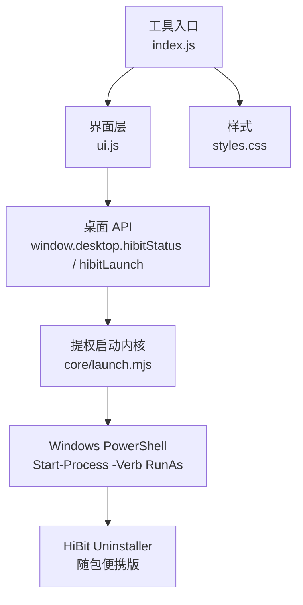
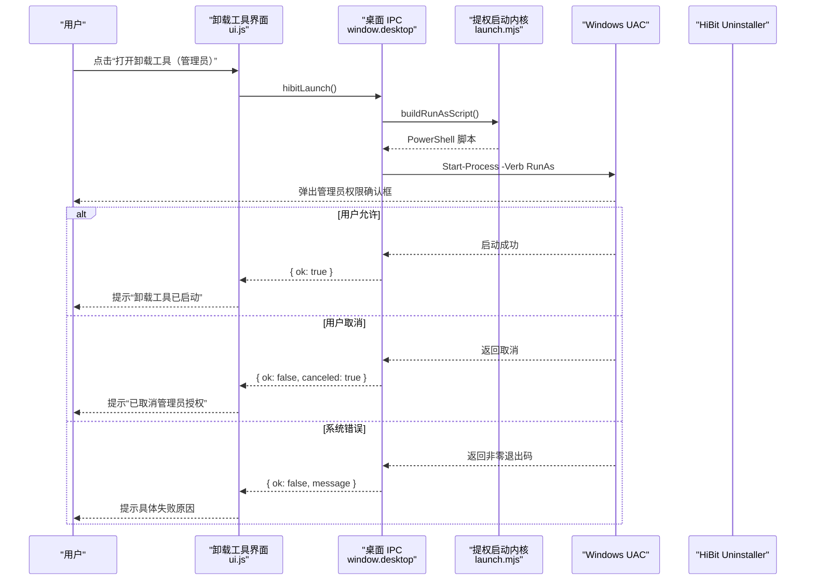
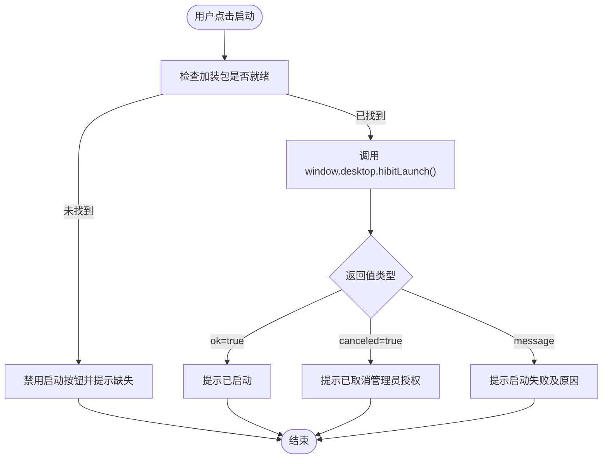
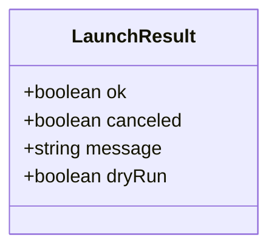
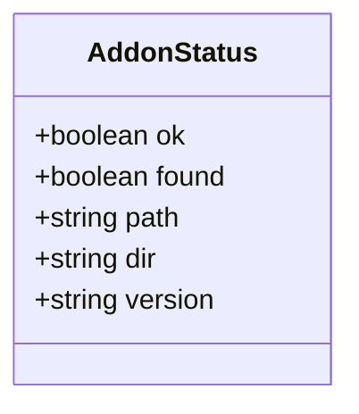
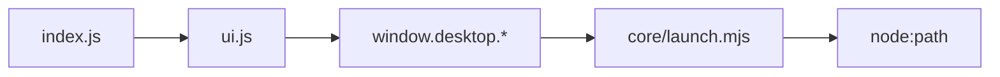
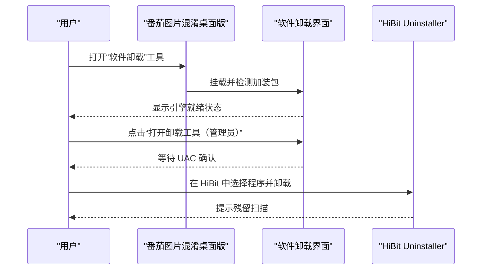
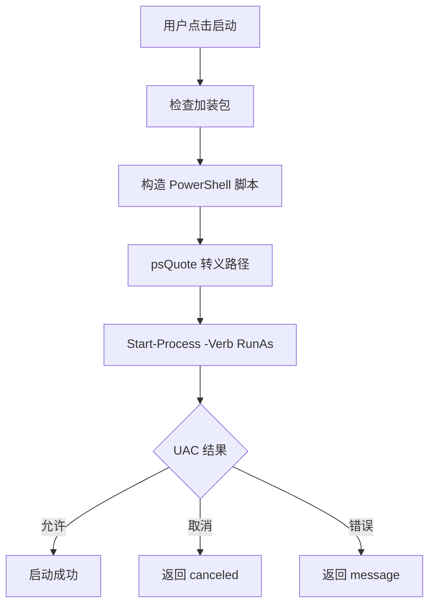

# 系统工具

<cite>
**本文引用的文件**
- [index.js](file://app/src/tools/uninstall/index.js)
- [launch.mjs](file://app/src/tools/uninstall/core/launch.mjs)
- [ui.js](file://app/src/tools/uninstall/ui.js)
- [styles.css](file://app/src/tools/uninstall/styles.css)
- [uninstall-test.js](file://app/tests/uninstall-test.js)
- [uninstall.test.mjs](file://app/tests/uninstall.test.mjs)
- [README.md](file://README.md)
</cite>

## 目录
1. [简介](#简介)
2. [项目结构](#项目结构)
3. [核心组件](#核心组件)
4. [架构总览](#架构总览)
5. [详细组件分析](#详细组件分析)
6. [依赖关系分析](#依赖关系分析)
7. [性能与行为特征](#性能与行为特征)
8. [使用示例与最佳实践](#使用示例与最佳实践)
9. [风险、权限与安全验证](#风险权限与安全验证)
10. [故障排除指南](#故障排除指南)
11. [结论](#结论)

## 简介
本模块是“软件卸载”系统工具，负责在 Windows 环境下以管理员权限启动随包内置的 HiBit Uninstaller 便携版，引导用户完成程序卸载和残留清理。该工具本身不直接读取系统注册表或自行枚举已安装程序；它把“程序列表获取”“卸载流程自动化”等能力交给 HiBit Uninstaller，自身聚焦于：

- 检测加装包是否就绪
- 构造安全的提权启动命令
- 处理 UAC 取消与失败结果
- 提供简洁的界面提示与状态反馈
- 通过测试套件校验哈希、清单权限、空跑行为与界面一致性

因此，本文关于“系统注册表扫描”“程序列表获取”的实现边界必须明确：这些逻辑属于 HiBit Uninstaller，而非本项目代码。

**章节来源**
- [README.md:1-120](file://README.md#L1-L120)

## 项目结构
软件卸载工具采用“入口 + 纯逻辑内核 + 界面层 + 样式”的分层组织方式：

| 文件 | 职责 |
|---|---|
| `index.js` | 工具注册入口，声明 ID、名称、分组、排序、样式和挂载方法 |
| `core/launch.mjs` | 纯函数内核：PowerShell 路径解析、单引号转义、RunAs 脚本拼装、执行结果解读、加装包状态描述 |
| `ui.js` | 页面渲染、按钮交互、引擎状态刷新、IPC 调用、加载与卸载生命周期 |
| `styles.css` | 工具专属样式，遵循主题变量与 `uns-` 命名约定 |
| `tests/uninstall-test.js` | Electron 端到端自检：加装包存在性、哈希、清单权限、界面走查、空跑断言 |
| `tests/uninstall.test.mjs` | Node 纯逻辑单测：PowerShell 转义、RunAs 脚本、结果三态、常量契约 |

**图表来源**
- [index.js:1-15](file://app/src/tools/uninstall/index.js#L1-L15)
- [ui.js:1-161](file://app/src/tools/uninstall/ui.js#L1-L161)
- [launch.mjs:1-61](file://app/src/tools/uninstall/core/launch.mjs#L1-L61)

**章节来源**
- [index.js:1-15](file://app/src/tools/uninstall/index.js#L1-L15)
- [ui.js:1-161](file://app/src/tools/uninstall/ui.js#L1-L161)
- [launch.mjs:1-61](file://app/src/tools/uninstall/core/launch.mjs#L1-L61)

## 核心组件
### 工具入口
`index.js` 暴露一个标准工具对象，包含：

- `id: 'uninstall'`
- `name: '软件卸载'`
- `group: 'system'`
- `order: 10`
- `mount / unmount / activate / deactivate`

它不负责业务实现，只把 UI 模块挂入工具箱框架。

**章节来源**
- [index.js:1-15](file://app/src/tools/uninstall/index.js#L1-L15)

### 提权启动内核
`core/launch.mjs` 是模块最关键的纯逻辑部分，核心导出包括：

| 导出 | 作用 |
|---|---|
| `EXE_NAME` | 固定为 `HiBitUninstaller-Portable.exe`，保持官方原名 |
| `VERSION_FILE` | 固定为 `版本.txt`，用于界面显示版本号 |
| `powershellPath(env)` | 从环境变量推导 PowerShell 绝对路径 |
| `psQuote(value)` | 对 PowerShell 参数做单引号字面量转义 |
| `buildRunAsScript({ exePath, workingDir })` | 生成 `Start-Process -Verb RunAs` 脚本 |
| `interpretLaunchResult({ status, stdout, stderr })` | 将进程结果转为成功、取消、失败三态 |
| `describeAddonStatus({ found, exePath, dir, version })` | 统一描述加装包状态 |

关键安全特性：

- 不使用 `PATH` 查找 PowerShell，而是拼接 `SystemRoot\System32\WindowsPowerShell\v1.0\powershell.exe`
- 不对目标程序传参；卸载目标由用户在 HiBit 界面选择
- 使用 `-Verb RunAs` 触发系统 UAC，不缓存凭据、不静默提权
- 对 PowerShell 参数只做最小必要转义，避免命令注入

**章节来源**
- [launch.mjs:1-61](file://app/src/tools/uninstall/core/launch.mjs#L1-L61)

### 界面与交互
`ui.js` 负责：

- 渲染说明卡片、操作按钮、引擎状态区、用法要点
- 监听“打开卸载工具（管理员）”和“重新检测”
- 调用 `window.desktop.hibitStatus()` 探测加装包
- 调用 `window.desktop.hibitLaunch()` 启动卸载工具
- 根据返回结果更新提示、顶栏状态和按钮可用性
- 在自动化测试模式下支持 `dryRun`，不真正拉起进程
- 页面激活时静默复核引擎状态，切走时清理

**章节来源**
- [ui.js:1-161](file://app/src/tools/uninstall/ui.js#L1-L161)

### 样式
`styles.css` 使用主题变量和 `uns-` 前缀类名，定义头图区、操作区、引擎状态区和提示区的布局与颜色语义。缺失加装包时使用 `is-missing` 类切换警示色。

**章节来源**
- [styles.css:1-119](file://app/src/tools/uninstall/styles.css#L1-L119)

## 架构总览
软件卸载功能在运行时分为三层：

1. **界面层**：用户点击按钮，UI 层发起 IPC 调用。
2. **主进程桥接层**：接收前端 IPC，读取加装包信息，并委托提权启动逻辑。
3. **提权启动层**：用 PowerShell 以 `RunAs` 方式启动 HiBit Uninstaller，由操作系统 UAC 决定是否授权。

**图表来源**
- [ui.js:100-161](file://app/src/tools/uninstall/ui.js#L100-L161)
- [launch.mjs:25-47](file://app/src/tools/uninstall/core/launch.mjs#L25-L47)

## 详细组件分析

### 提权启动流程
#### 流程控制

**图表来源**
- [ui.js:88-161](file://app/src/tools/uninstall/ui.js#L88-L161)

#### 算法复杂度
- `psQuote`：线性时间，按字符扫描并替换单引号
- `buildRunAsScript`：常量级字符串拼接
- `interpretLaunchResult`：线性时间，处理输出文本最后一行
- `powershellPath`：常量级路径拼接
- `describeAddonStatus`：常量级对象构造

整体空间开销极低，主要 I/O 发生在主进程侧读取加装包文件和启动外部进程。

**章节来源**
- [launch.mjs:1-61](file://app/src/tools/uninstall/core/launch.mjs#L1-L61)

### 加装包状态检测
UI 通过 `window.desktop.hibitStatus()` 获取状态，状态字段至少包含：

| 字段 | 含义 |
|---|---|
| `found` | 是否检测到 HiBit Uninstaller 便携版 |
| `path` | 可执行文件路径 |
| `dir` | 加装包目录 |
| `version` | 从 `版本.txt` 读取并去空白后的版本字符串 |

界面会据此：

- 启用或禁用“打开卸载工具”按钮
- 显示引擎名称、路径和官方来源
- 在缺失时给出放置指引
- 在顶部状态栏显示就绪或缺失提示

**章节来源**
- [ui.js:1-161](file://app/src/tools/uninstall/ui.js#L1-L161)
- [launch.mjs:49-61](file://app/src/tools/uninstall/core/launch.mjs#L49-L61)

### 自动化测试模式
测试模式下，`hibitLaunch` 返回结果中包含 `dryRun: true`，界面会：

- 显示“自动化测试模式：未真正启动卸载工具”
- 不要求用户点击 UAC
- 不实际拉起 HiBit 进程

端到端测试还会通过 `tasklist` 断言 `HiBitUninstaller-Portable.exe` 不在运行。

**章节来源**
- [ui.js:110-150](file://app/src/tools/uninstall/ui.js#L110-L150)
- [uninstall-test.js:100-200](file://app/tests/uninstall-test.js#L100-L200)

### 数据模型
#### 提权启动结果

#### 加装包状态

**图表来源**
- [ui.js:110-161](file://app/src/tools/uninstall/ui.js#L110-L161)
- [launch.mjs:49-61](file://app/src/tools/uninstall/core/launch.mjs#L49-L61)

## 依赖关系分析
### 模块依赖
- `index.js` 依赖 `ui.js`
- `ui.js` 依赖桌面 IPC `window.desktop.hibitStatus` 与 `window.desktop.hibitLaunch`
- `ui.js` 不直接依赖 `launch.mjs`，后者由主进程桥接调用
- `launch.mjs` 仅依赖 Node 的 `path` 模块

**图表来源**
- [index.js:1-15](file://app/src/tools/uninstall/index.js#L1-L15)
- [ui.js:1-161](file://app/src/tools/uninstall/ui.js#L1-L161)
- [launch.mjs:1-10](file://app/src/tools/uninstall/core/launch.mjs#L1-L10)

### 外部依赖
- Windows PowerShell：必须存在，路径来自 `SystemRoot`
- Windows UAC：管理员权限确认机制
- HiBit Uninstaller 便携版：作为外部程序启动，不在项目代码中实现卸载逻辑

**章节来源**
- [launch.mjs:11-24](file://app/src/tools/uninstall/core/launch.mjs#L11-L24)

## 性能与行为特征
- 界面渲染轻量，仅展示静态 HTML 模板和少量 DOM 查询
- 引擎状态检测频率较低：初始挂载一次，页面激活时静默复核一次
- 启动过程受外部进程和 UAC 影响，耗时不可控，UI 通过按钮禁用和状态文案缓解等待体验
- 纯逻辑层无异步 I/O，适合被主进程动态导入或被 Node 直接运行测试
- 没有批量卸载接口：每个卸载动作由用户在 HiBit 界面逐项选择

**章节来源**
- [ui.js:56-87](file://app/src/tools/uninstall/ui.js#L56-L87)
- [launch.mjs:1-10](file://app/src/tools/uninstall/core/launch.mjs#L1-L10)

## 使用示例与最佳实践

### 典型使用流程
1. 打开软件后，在左侧“系统”分组中找到“软件卸载”。
2. 首次进入时界面自动检测 HiBit Uninstaller 便携版。
3. 若检测到，按钮可用；点击后系统弹出 UAC。
4. 在 HiBit Uninstaller 中选择要卸载的程序并执行卸载。
5. 卸载完成后，根据提示扫描并清理残留文件与注册项。

**图表来源**
- [ui.js:1-161](file://app/src/tools/uninstall/ui.js#L1-L161)

### 最佳实践
- 卸载前先关闭目标程序，避免文件占用导致卸载不彻底
- 谨慎删除共享目录或公共运行库残留
- 正常能卸载的程序优先走普通卸载；损坏或缺失时再考虑强制卸载
- 不要把外部浏览器链接嵌入离线工具界面，避免窗口导航到外站无法返回
- 维护者应保证 `addons/hibit` 中的文件未被篡改，哈希与说明一致

**章节来源**
- [ui.js:20-55](file://app/src/tools/uninstall/ui.js#L20-L55)
- [uninstall-test.js:100-200](file://app/tests/uninstall-test.js#L100-L200)

### 批量卸载、静默安装与卸载结果验证
- 批量卸载：本工具不提供批量卸载 API；如需批量操作，应在 HiBit Uninstaller 内部完成，或由调用方自行编排多次启动。
- 静默安装：本工具不涉及安装流程，也不支持静默提权。
- 卸载结果验证：本工具只负责启动 HiBit；卸载是否成功、残留是否清理干净，应由 HiBit 的结果和用户判断。

[本节为概念性说明，不直接分析具体源码]

## 风险、权限与安全验证

### 权限提升需求
- 启动 HiBit Uninstaller 必须使用 `Start-Process -Verb RunAs`，由 Windows UAC 把关
- 本程序不缓存凭据，不代替用户点“是”，不静默提权
- 测试通过读取 EXE 清单中的 `requestedExecutionLevel` 断言必须要求管理员权限

### 安全性设计
- PowerShell 路径写死为绝对路径，避免 `PATH` 不完整导致的 `ENOENT`
- 所有路径参数通过 `psQuote` 单引号包裹，内部单引号翻倍，防止命令注入
- 不向目标程序传递任何额外参数，降低攻击面
- 结果解析区分“用户取消”和“真实失败”，避免把 UAC 拒绝误报为系统错误
- 测试套件校验 SHA-256 哈希、体积范围、版本文件格式和清单权限

**图表来源**
- [launch.mjs:11-47](file://app/src/tools/uninstall/core/launch.mjs#L11-L47)
- [uninstall-test.js:100-180](file://app/tests/uninstall-test.js#L100-L180)

**章节来源**
- [launch.mjs:11-47](file://app/src/tools/uninstall/core/launch.mjs#L11-L47)
- [uninstall.test.mjs:1-72](file://app/tests/uninstall.test.mjs#L1-72)
- [uninstall-test.js:100-180](file://app/tests/uninstall-test.js#L100-L180)

## 故障排除指南

### 权限不足或 UAC 被取消
**现象**
- 点击启动后提示“已取消管理员授权”
- 任务管理器中没有 `HiBitUninstaller-Portable.exe`
- 界面按钮恢复可用

**处理**
- 重新点击“打开卸载工具（管理员）”
- 在 UAC 弹窗中点击“是”
- 确认当前账户具有管理员权限
- 如果企业策略禁止提权，需要联系管理员调整策略

**章节来源**
- [ui.js:110-150](file://app/src/tools/uninstall/ui.js#L110-L150)
- [launch.mjs:37-47](file://app/src/tools/uninstall/core/launch.mjs#L37-L47)

### 未检测到软件卸载加装包
**现象**
- 引擎状态显示缺失
- 启动按钮被禁用
- 顶栏提示“未检测到软件卸载加装包”

**处理**
- 将 HiBit Uninstaller 便携版放入 `addons/hibit`
- 文件名必须为 `HiBitUninstaller-Portable.exe`
- 可选添加 `版本.txt`，内容以数字开头，例如 `4.x.y`
- 点击“重新检测”或重启工具

**章节来源**
- [ui.js:60-110](file://app/src/tools/uninstall/ui.js#L60-L110)
- [uninstall-test.js:180-232](file://app/tests/uninstall-test.js#L180-L232)

### 启动失败
**现象**
- 界面提示“启动失败：xxx”
- 可能是 PowerShell 路径不存在、外部程序崩溃或系统返回非零退出码

**处理**
- 检查 `C:\Windows\System32\WindowsPowerShell\v1.0\powershell.exe` 是否存在
- 检查杀毒软件是否拦截启动
- 查看失败消息末尾一行，通常包含最近一条错误信息
- 在非测试模式下确认是否真的弹出了 UAC

**章节来源**
- [launch.mjs:11-47](file://app/src/tools/uninstall/core/launch.mjs#L11-L47)
- [uninstall.test.mjs:33-55](file://app/tests/uninstall.test.mjs#L33-L55)

### 系统兼容性
- 该工具依赖 Windows PowerShell 和 UAC，不适合非 Windows 环境
- 对于企业环境，需确保 PowerShell 可执行路径稳定且 UAC 策略允许提权
- 自动化测试依赖 `tasklist` 查询进程，若命令行环境受限，相关断言可能跳过

**章节来源**
- [launch.mjs:11-24](file://app/src/tools/uninstall/core/launch.mjs#L11-L24)
- [uninstall-test.js:40-90](file://app/tests/uninstall-test.js#L40-L90)

## 结论
软件卸载工具是一个面向 Windows 的安全启动桥接器。它不实现卸载逻辑本身，而是通过严格约束的 PowerShell 提权路径，把用户引导至官方原版 HiBit Uninstaller。其核心价值在于：

- 明确权限边界：始终通过 UAC 提权，不静默、不代填凭据
- 明确职责边界：程序列表和卸载流程由 HiBit 负责，本工具负责发现、启动与反馈
- 明确安全边界：路径转义、参数最小化、哈希校验、清单权限校验
- 明确测试边界：纯逻辑单测与 Electron 端到端测试共同覆盖启动脚本、结果解释、界面行为和空跑红线

对于后续扩展，建议继续坚持“外部卸载工具负责卸载，本工具负责提权与状态反馈”的设计原则，避免在本项目内直接读写注册表或直接调用系统卸载接口，以降低权限滥用风险和兼容性问题。