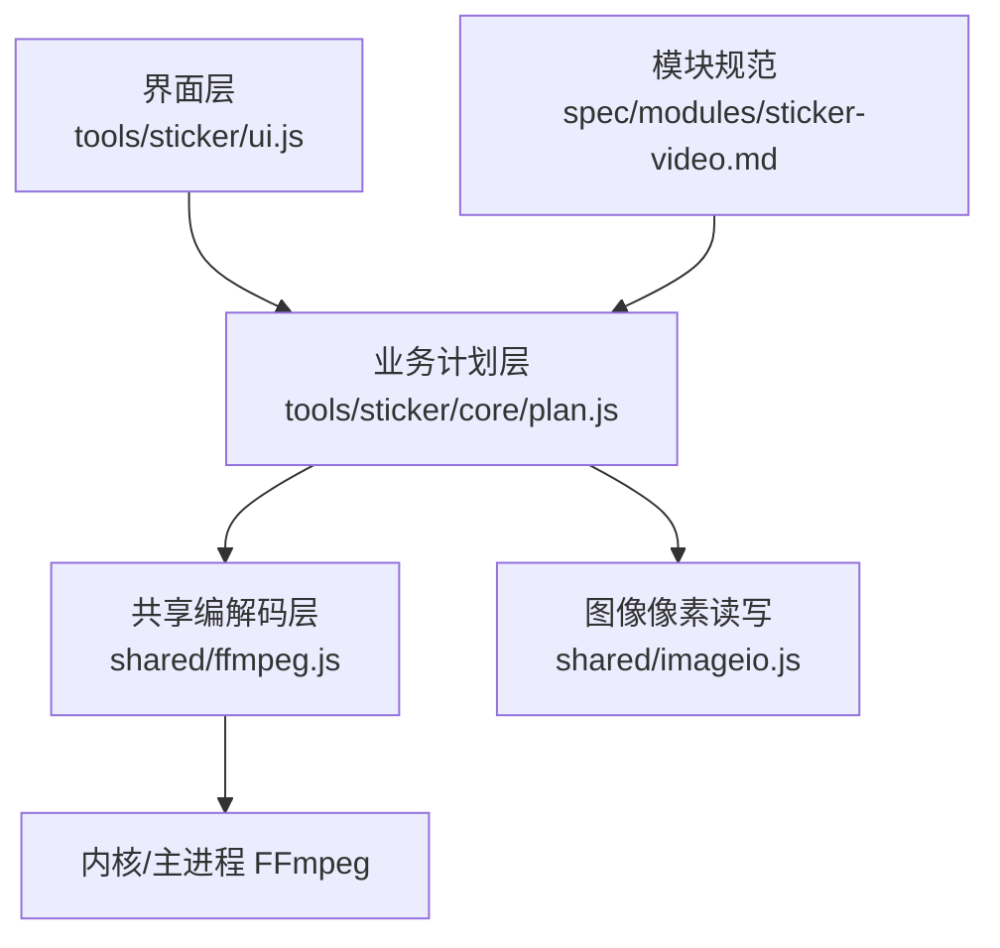
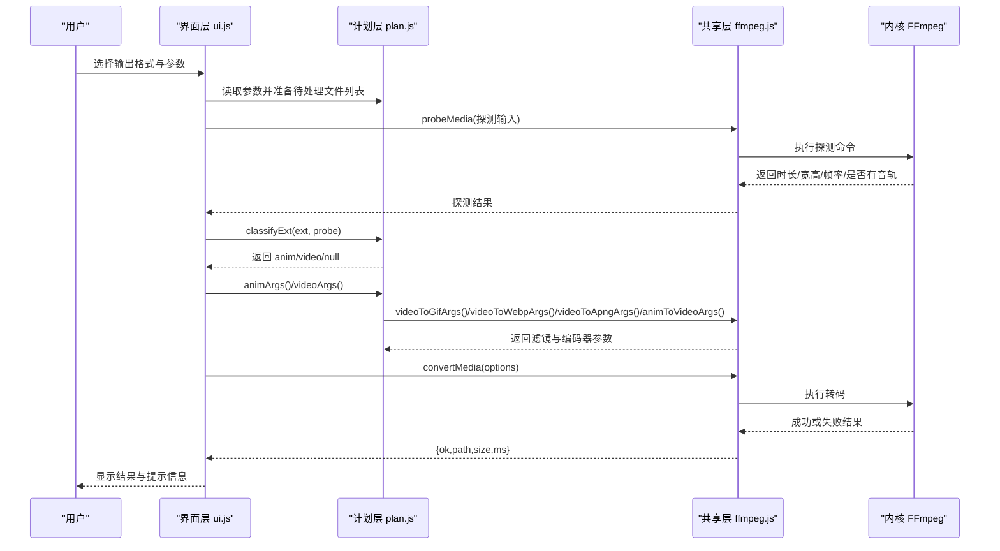
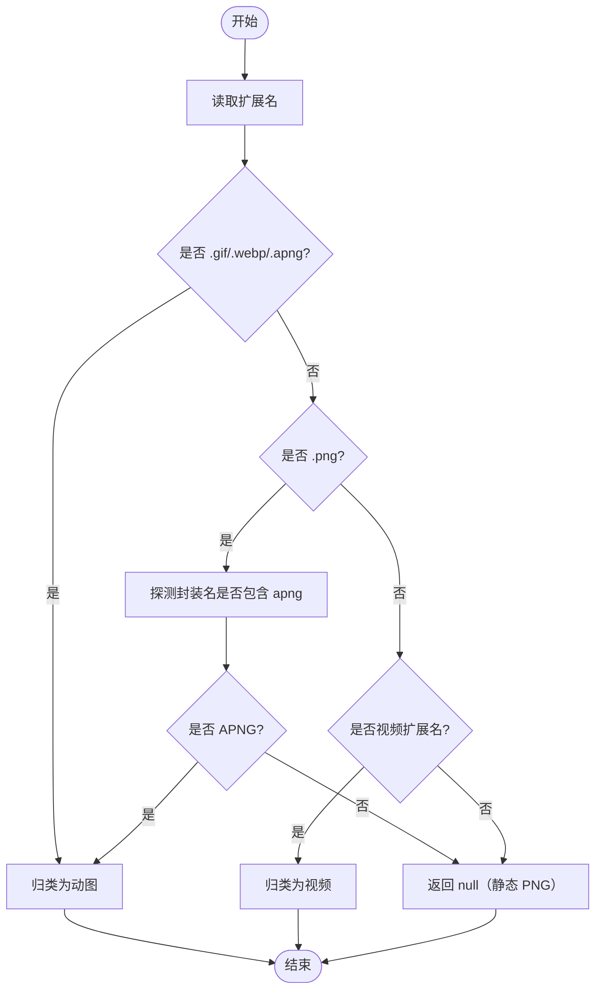
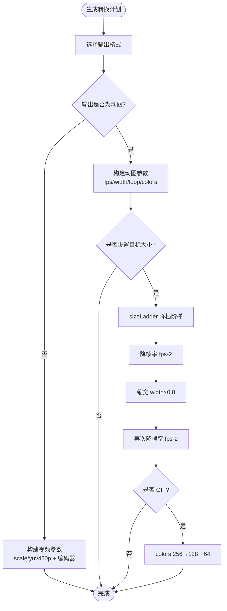
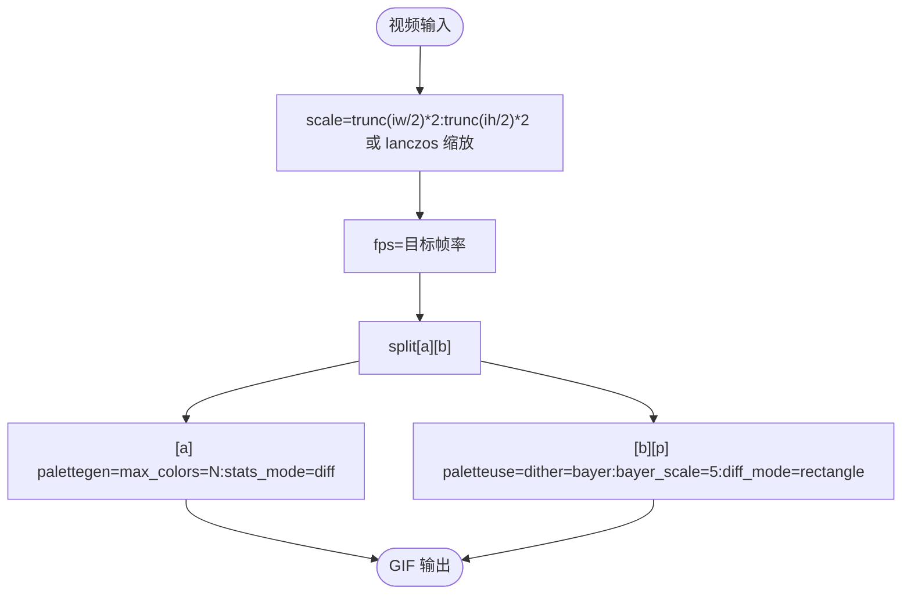
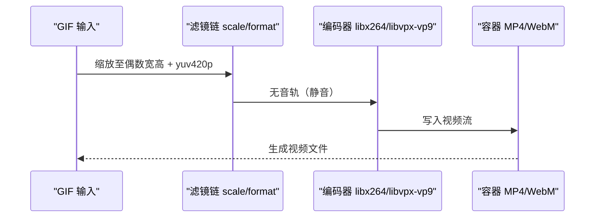
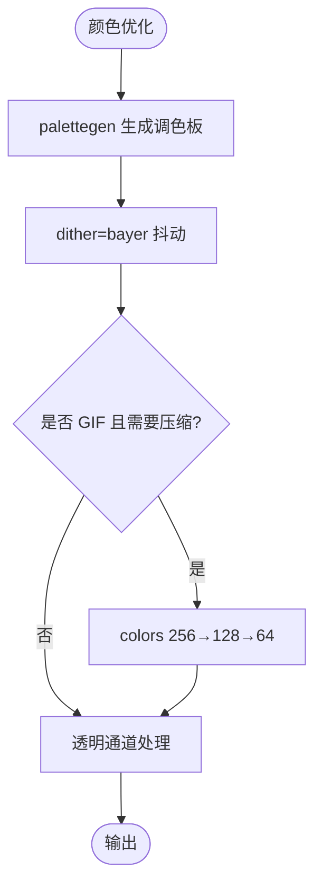
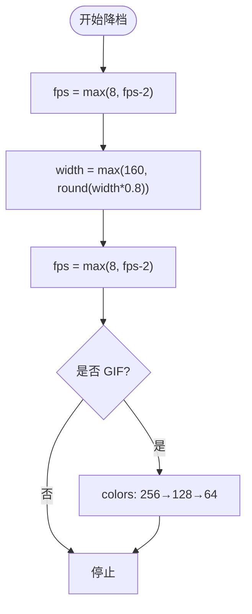
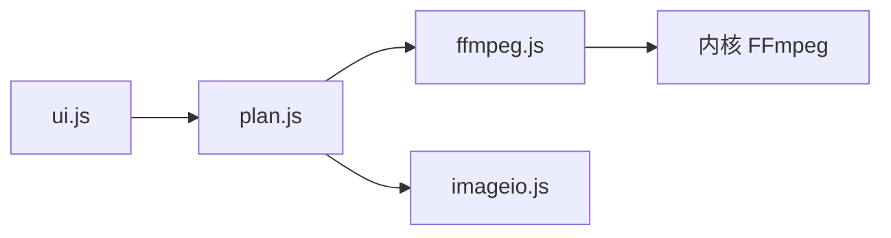

# 动图与视频互转

<cite>
**本文引用的文件**   
- [ffmpeg.js](file://app/src/shared/ffmpeg.js)
- [imageio.js](file://app/src/shared/imageio.js)
- [plan.js](file://app/src/tools/sticker/core/plan.js)
- [ui.js](file://app/src/tools/sticker/ui.js)
- [index.js](file://app/src/tools/sticker/index.js)
- [sticker-video.md](file://spec/modules/sticker-video.md)
</cite>

## 目录
1. [引言](#引言)
2. [项目结构](#项目结构)
3. [核心组件](#核心组件)
4. [架构总览](#架构总览)
5. [详细组件分析](#详细组件分析)
6. [依赖关系分析](#依赖关系分析)
7. [性能与质量优化](#性能与质量优化)
8. [故障排查](#故障排查)
9. [结论](#结论)

## 引言
本模块“动图与视频互转”提供 GIF、WebP 动图、APNG 与 MP4/WebM 等视频格式之间的双向转换能力，并针对聊天表情场景给出尺寸、帧率与目标大小的预设。其设计目标是：
- 自动判定输入类型，支持动图与视频混合列表处理。
- 视频 → 动图：按帧率、宽度、循环次数和目标大小生成高质量动图。
- 动图 → 视频：将无音轨的动图转为通用视频容器，透明背景铺白底。
- 动图 → 动图：在已有动图上调整尺寸、帧率和压缩强度，用于压小表情包。

该文档从系统架构、数据流、FFmpeg 集成、颜色量化与抖动策略、转换计划生成和质量优化等方面展开说明，帮助开发者理解实现细节并提供排障建议。

## 项目结构
本工具位于 `src/tools/sticker`，由以下层次组成：
- 工具注册层：声明工具 ID、名称、图标和挂载入口。
- 界面交互层：负责参数区显隐、用户操作、进度反馈与结果展示。
- 业务计划层：负责输入分类、输出映射、参数拼装与目标大小降档策略。
- 共享编解码层：封装 FFmpeg 调用、媒体探测、编码参数拼装、图像像素读写等。

**图表来源**
- [ui.js:1-100](file://app/src/tools/sticker/ui.js#L1-L100)
- [plan.js:1-135](file://app/src/tools/sticker/core/plan.js#L1-L135)
- [ffmpeg.js:1-200](file://app/src/shared/ffmpeg.js#L1-L200)
- [sticker-video.md:1-51](file://spec/modules/sticker-video.md#L1-L51)

**章节来源**
- [index.js:1-14](file://app/src/tools/sticker/index.js#L1-L14)
- [ui.js:1-200](file://app/src/tools/sticker/ui.js#L1-L200)
- [plan.js:1-135](file://app/src/tools/sticker/core/plan.js#L1-L135)
- [ffmpeg.js:1-200](file://app/src/shared/ffmpeg.js#L1-L200)
- [sticker-video.md:1-51](file://spec/modules/sticker-video.md#L1-L51)

## 核心组件
- 工具注册：定义工具标识、分组与挂载函数，使壳应用可加载该工具。
- 界面层：管理用户选择（输出格式、帧率、宽度、循环、目标大小、分辨率等），根据输出格式自动显示对应参数区；调用共享层进行探测与转码。
- 计划层：
  - 输入分类：根据扩展名与 FFmpeg 探测结果判断是动图还是视频。
  - 输出映射：GIF/WebP/APNG 归为动图输出；MP4/WebM 归为视频输出。
  - 参数拼装：复用共享层的视频→动图、动图→视频和视频编码参数函数。
  - 目标大小降档：当输出超过目标大小时，按“降帧率→缩宽→再降帧率→（仅 GIF）降色数”的阶梯逐步重试。
- 共享编解码层：
  - FFmpeg 封装：探测、单遍/多遍转码、取消任务、进度订阅。
  - 编码参数：视频编码器参数、缩放与偶数化、视频→动图参数（含调色板两遍方案）、WebP 动图与 APNG 参数。
- 图像像素层：基于浏览器内核的图片解码、编码与缩略图生成，避免不必要的全图内存占用。

**章节来源**
- [index.js:1-14](file://app/src/tools/sticker/index.js#L1-L14)
- [ui.js:1-200](file://app/src/tools/sticker/ui.js#L1-L200)
- [plan.js:1-135](file://app/src/tools/sticker/core/plan.js#L1-L135)
- [ffmpeg.js:1-200](file://app/src/shared/ffmpeg.js#L1-L200)
- [imageio.js:1-141](file://app/src/shared/imageio.js#L1-L141)

## 架构总览
整体流程围绕“用户选择输出格式 → 输入分类 → 参数拼装 → FFmpeg 转码 → 结果校验与提示”。

**图表来源**
- [ui.js:1-200](file://app/src/tools/sticker/ui.js#L1-L200)
- [plan.js:1-135](file://app/src/tools/sticker/core/plan.js#L1-L135)
- [ffmpeg.js:1-200](file://app/src/shared/ffmpeg.js#L1-L200)

## 详细组件分析

### 输入分类与输出映射
计划层对输入进行类型判定：
- `.gif`、`.webp`、`.apng` 直接视为动图。
- `.png` 需通过 FFmpeg 探测出的封装名是否为 APNG 来区分静态 PNG 与 APNG 动图。
- 常见视频扩展名归为视频；其他扩展返回 null，表示不支持。

输出方向：
- 输出选 GIF/WebP/APNG 时，统一走“视频→动图”或“动图→动图”的参数拼装逻辑。
- 输出选 MP4/WebM 时，走“动图→视频”，并将音频静音。

**图表来源**
- [plan.js:1-135](file://app/src/tools/sticker/core/plan.js#L1-L135)

**章节来源**
- [plan.js:1-135](file://app/src/tools/sticker/core/plan.js#L1-L135)

### 转换计划生成：帧率、尺寸与质量控制
计划层把用户参数映射到共享层的编码参数：
- 视频→动图：调用 `videoToGifArgs`、`videoToWebpArgs`、`videoToApngArgs`，传入帧率、宽度、循环次数等。
- 动图→视频：调用 `animToVideoArgs` 做尺寸与像素格式处理，再拼接 `videoEncodeArgs` 的视频编码器参数，并静音。

关键参数：
- 帧率：动图模式提供 10/12/15/20/24 帧选项；动图→视频支持保持原始或 30 帧。
- 宽度：动图模式提供 240/320/480/720/保持原始；视频→动图使用 Lanczos 缩放，同时保证偶数宽高。
- 循环：无限或只播放一次。
- 目标大小：不限制/≤5MB/≤2MB/≤1MB；超出时触发降档。

**图表来源**
- [plan.js:1-135](file://app/src/tools/sticker/core/plan.js#L1-L135)
- [ui.js:1-200](file://app/src/tools/sticker/ui.js#L1-L200)

**章节来源**
- [plan.js:1-135](file://app/src/tools/sticker/core/plan.js#L1-L135)
- [ui.js:1-200](file://app/src/tools/sticker/ui.js#L1-L200)

### FFmpeg 集成：视频到 GIF 的编码流程
视频到 GIF 采用两遍调色板的高质量方案：
- 第一遍生成调色板：`palettegen=max_colors=...:stats_mode=diff`。
- 第二遍使用调色板并启用 Bayer 抖动：`paletteuse=dither=bayer:bayer_scale=5:diff_mode=rectangle`。
- 同时应用缩放与帧率过滤：先按宽度等比缩放（Lanczos），再 `fps=...`。

**图表来源**
- [ffmpeg.js:1-200](file://app/src/shared/ffmpeg.js#L1-L200)

**章节来源**
- [ffmpeg.js:1-200](file://app/src/shared/ffmpeg.js#L1-L200)

### FFmpeg 集成：GIF 到视频的解码与编码流程
动图→视频的流程要点：
- 尺寸与像素格式：`scale=trunc(iw/2)*2:trunc(ih/2)*2,format=yuv420p`，确保偶数宽高且兼容 H.264/AAC。
- 透明通道处理：H.264 不支持透明，因此会铺白底。
- 编码器选择：MP4 默认 H.264+AAC，WebM 默认 VP9+Opus；动图无音轨，统一静音。

**图表来源**
- [ffmpeg.js:1-200](file://app/src/shared/ffmpeg.js#L1-L200)
- [sticker-video.md:1-51](file://spec/modules/sticker-video.md#L1-L51)

**章节来源**
- [ffmpeg.js:1-200](file://app/src/shared/ffmpeg.js#L1-L200)
- [sticker-video.md:1-51](file://spec/modules/sticker-video.md#L1-L51)

### 颜色优化策略：调色板、抖动与透明通道
- 调色板生成：通过 `palettegen` 统计差异模式，减少颜色失真。
- 抖动算法：Bayer 抖动配合矩形差分模式，缓解 GIF 渐变中的色带问题。
- 色数控制：GIF 最多 256 色；当目标大小仍过大时，按 256→128→64 逐级降低。
- 透明通道：GIF 支持透明但视频容器不支持，因此动图→视频会铺白底；WebP 动图与 APNG 在各自容器中对透明的支持取决于解码器与平台。

**图表来源**
- [ffmpeg.js:1-200](file://app/src/shared/ffmpeg.js#L1-L200)
- [plan.js:1-135](file://app/src/tools/sticker/core/plan.js#L1-L135)

**章节来源**
- [ffmpeg.js:1-200](file://app/src/shared/ffmpeg.js#L1-L200)
- [plan.js:1-135](file://app/src/tools/sticker/core/plan.js#L1-L135)

### 转换质量控制与文件大小控制
- 帧率：10/12/15/20/24 帧；默认 15 帧。
- 宽度：240/320/480/720/保持原始；默认 480 宽。
- 目标大小：≤5MB/≤2MB/≤1MB；未命中则自动降档。
- 降档顺序：
  1. 帧率减 2（最低不低于 8）。
  2. 宽度乘以 0.8（最低不低于 160）。
  3. 帧率再减 2。
  4. GIF 额外降低色数：256→128→64。
- 结果文案：描述实际档位（例如“240 宽 / 12 帧”或“480 宽 / 15 帧 / 128 色”）。

**图表来源**
- [plan.js:1-135](file://app/src/tools/sticker/core/plan.js#L1-L135)

**章节来源**
- [plan.js:1-135](file://app/src/tools/sticker/core/plan.js#L1-L135)

## 依赖关系分析
模块间的依赖关系如下：
- 界面层依赖计划层：获取输出格式枚举、输入分类、参数拼装函数与格式化辅助函数。
- 计划层依赖共享层：调用 FFmpeg 封装函数与编码参数生成函数。
- 共享层依赖内核：通过 IPC 调用主进程的 FFmpeg 能力。
- 图像像素层独立于 FFmpeg：提供图片解码、编码与缩略图生成，避免全图内存压力。

**图表来源**
- [ui.js:1-200](file://app/src/tools/sticker/ui.js#L1-L200)
- [plan.js:1-135](file://app/src/tools/sticker/core/plan.js#L1-L135)
- [ffmpeg.js:1-200](file://app/src/shared/ffmpeg.js#L1-L200)
- [imageio.js:1-141](file://app/src/shared/imageio.js#L1-L141)

**章节来源**
- [ui.js:1-200](file://app/src/tools/sticker/ui.js#L1-L200)
- [plan.js:1-135](file://app/src/tools/sticker/core/plan.js#L1-L135)
- [ffmpeg.js:1-200](file://app/src/shared/ffmpeg.js#L1-L200)
- [imageio.js:1-141](file://app/src/shared/imageio.js#L1-L141)

## 性能与质量优化
- 文件大小控制：
  - 优先降低帧率，再缩小宽度，最后针对 GIF 降低色数。
  - 合理设置目标大小上限，避免长视频转 GIF 产生过大文件。
- 播放流畅度：
  - 帧率 12~15 帧在聊天场景中平衡了流畅度与体积。
  - 动图→视频可选择保持原始帧率或固定 30 帧，兼顾清晰度与兼容性。
- 视觉效果：
  - 使用 Lanczos 缩放提升画质。
  - Bayer 抖动缓解色带；必要时提高颜色数量（GIF 不超过 256）。
  - 注意透明通道：视频容器不支持透明，会铺白底。
- 内存与吞吐：
  - 图像像素处理尽量使用 `makeThumbnailFromBytes` 等路径，避免整图 RGBA 缓冲。
  - 大图上限保护：超过 4000 万像素时明确报错，防止崩溃。

**章节来源**
- [ffmpeg.js:1-200](file://app/src/shared/ffmpeg.js#L1-L200)
- [imageio.js:1-141](file://app/src/shared/imageio.js#L1-L141)
- [plan.js:1-135](file://app/src/tools/sticker/core/plan.js#L1-L135)

## 故障排查
常见问题与处理方法：
- 转换后文件大小过大：
  - 降低帧率（15→12→10）。
  - 缩小宽度（480→320→240）。
  - GIF 降低色数（256→128→64）。
  - 设置目标大小上限，让自动降档生效。
- 颜色失真或出现明显色带：
  - 确认使用两遍调色板与 Bayer 抖动。
  - 适当增加颜色数量（GIF 最高 256）。
  - 避免过度降低帧率与宽度导致细节丢失。
- 播放卡顿或掉帧：
  - 检查帧率是否过低。
  - 动图→视频时选择合适的编码器（H.264/AAC 或 VP9/Opus）。
  - 确认尺寸与像素格式已偶数化且为 yuv420p。
- 透明背景异常：
  - 视频容器不支持透明，动图→视频会自动铺白底。
  - 如需保留透明，考虑 WebP 动图或 APNG 动图。
- FFmpeg 未检测到：
  - 确认安装包中包含 FFmpeg，并按提示放置到 addons/ffmpeg 目录后重启。
- 超长视频转 GIF 体积仍然很大：
  - 限制截取时长（默认 6 秒），避免全程转 GIF。
  - 降低帧率与宽度，并结合目标大小自动降档。

**章节来源**
- [ffmpeg.js:1-200](file://app/src/shared/ffmpeg.js#L1-L200)
- [plan.js:1-135](file://app/src/tools/sticker/core/plan.js#L1-L135)
- [ui.js:1-200](file://app/src/tools/sticker/ui.js#L1-L200)
- [sticker-video.md:1-51](file://spec/modules/sticker-video.md#L1-L51)

## 结论
“动图与视频互转”模块以计划层与共享层解耦的方式，实现了稳定、可扩展的动图与视频双向转换能力。其关键优势包括：
- 统一的 FFmpeg 参数拼装，保证不同工具产出一致。
- 完善的输入分类与输出映射，支持混合列表处理。
- 高质量的视频→动图方案（两遍调色板与 Bayer 抖动）。
- 可控的目标大小降档策略，便于在体积与质量之间取得平衡。
- 明确的透明通道处理与偶数尺寸约束，保障跨平台兼容性。

在实际使用中，建议根据具体场景调整帧率、宽度与目标大小，并优先使用内置预设以获得较好的效果与体积平衡。若遇到极端情况，可按故障排查指南逐项优化。