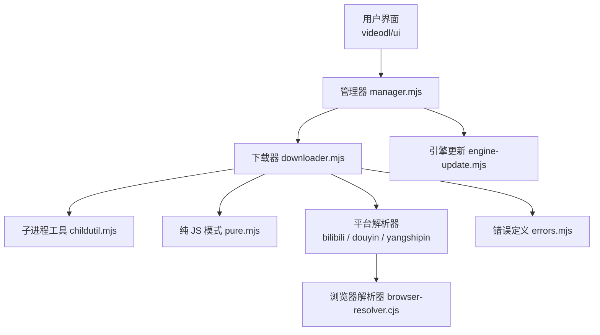
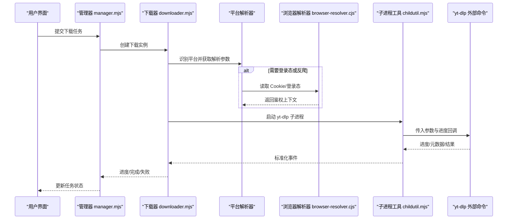
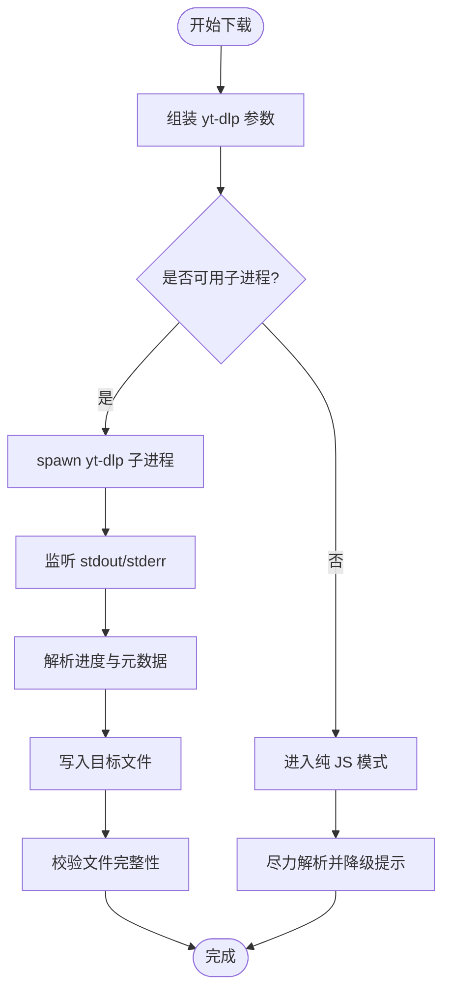
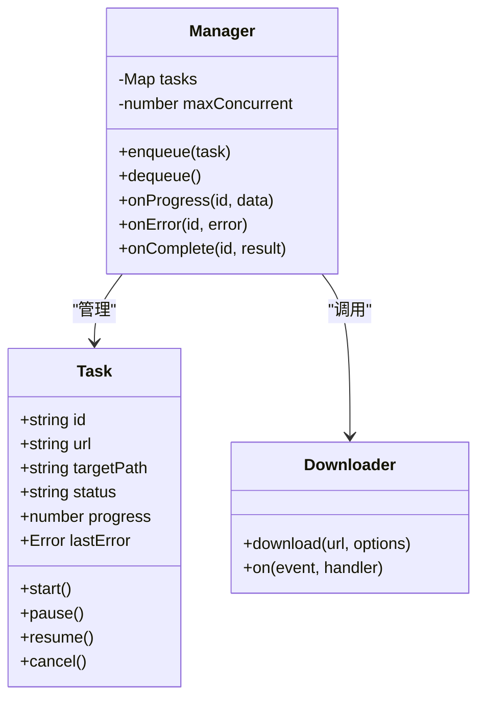
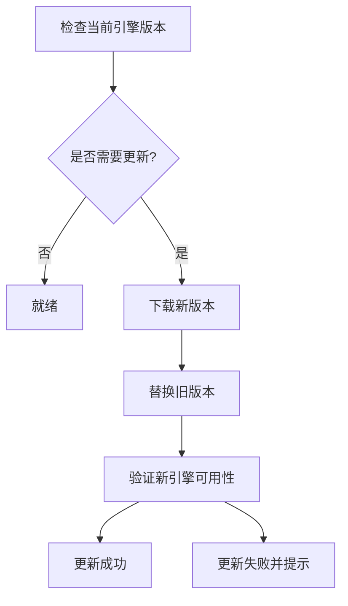
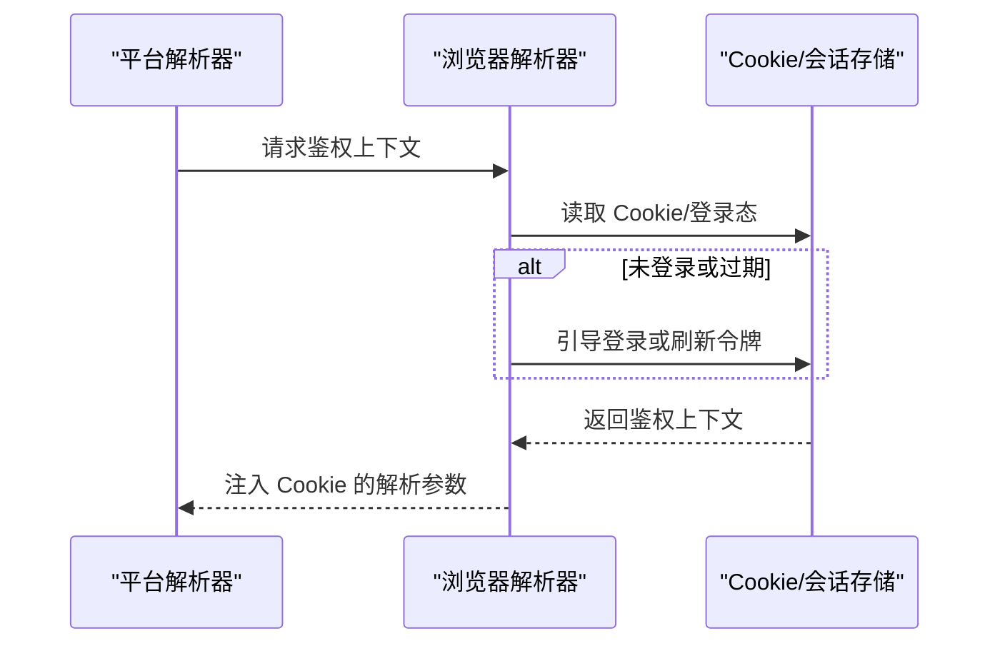
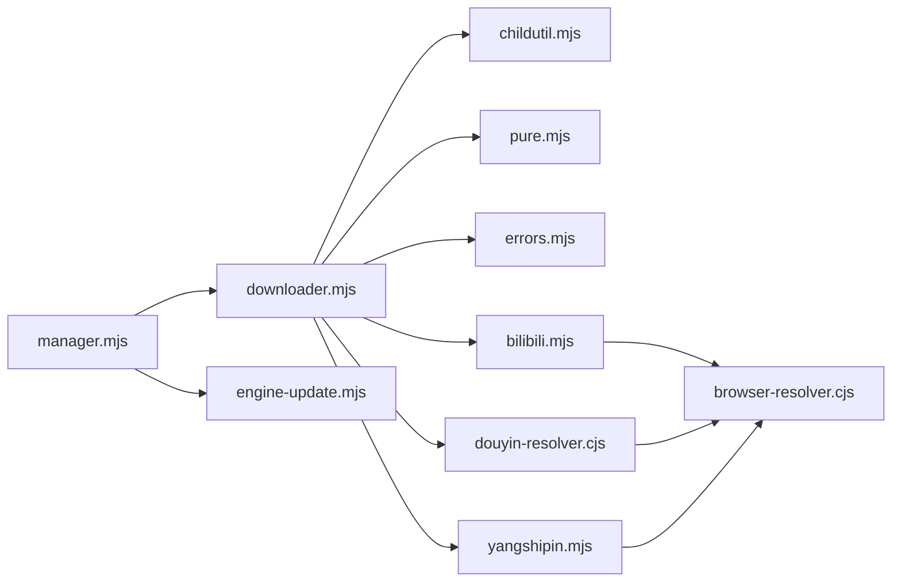

# 视频下载工具

<cite>
**本文引用的文件**   
- [app/app/src/tools/videodl/core/downloader.mjs](file://app/app/src/tools/videodl/core/downloader.mjs)
- [app/app/src/tools/videodl/core/manager.mjs](file://app/app/src/tools/videodl/core/manager.mjs)
- [app/app/src/tools/videodl/core/engine-update.mjs](file://app/app/src/tools/videodl/core/engine-update.mjs)
- [app/app/src/tools/videodl/core/pure.mjs](file://app/app/src/tools/videodl/core/pure.mjs)
- [app/app/src/tools/videodl/core/errors.mjs](file://app/app/src/tools/videodl/core/errors.mjs)
- [app/app/src/tools/videodl/core/bilibili.mjs](file://app/app/src/tools/videodl/core/bilibili.mjs)
- [app/app/src/tools/videodl/core/douyin-resolver.cjs](file://app/app/src/tools/videodl/core/douyin-resolver.cjs)
- [app/app/src/tools/videodl/core/yangshipin.mjs](file://app/app/src/tools/videodl/core/yangshipin.mjs)
- [app/app/src/tools/videodl/core/browser-resolver.cjs](file://app/app/src/tools/videodl/core/browser-resolver.cjs)
- [app/app/src/tools/videodl/core/childutil.mjs](file://app/app/src/tools/videodl/core/childutil.mjs)
- [app/app/tests/videodl.test.mjs](file://app/app/tests/videodl.test.mjs)
- [spec/spec/modules/videodl.md](file://spec/spec/modules/videodl.md)
</cite>

## 目录
1. [引言](#引言)
2. [项目结构](#项目结构)
3. [核心组件](#核心组件)
4. [架构总览](#架构总览)
5. [详细组件分析](#详细组件分析)
6. [依赖关系分析](#依赖关系分析)
7. [性能与资源占用](#性能与资源占用)
8. [故障排查指南](#故障排查指南)
9. [结论](#结论)
10. [附录：API 与配置约定](#附录api-与配置约定)

## 引言
本技术文档面向“视频下载工具”这一子模块，聚焦基于 yt-dlp 的下载架构。文档从系统架构、模块职责、数据流、平台解析器实现、浏览器解析器、纯 JavaScript 解析模式与外部命令调用模式的切换策略，到错误处理、进度监控、网络异常恢复和常见问题排查进行系统化说明。目标读者既包括需要理解内部实现的开发者，也包括需要配置与排障的使用者。

该工具围绕以下关键能力展开：
- 统一的下载入口与管理器，负责任务编排、状态同步与结果输出。
- 可插拔的平台解析器（Bilibili、抖音、央视频等），将站点特定逻辑与通用下载流程解耦。
- 两种执行路径：在 Node.js 环境中通过子进程调用外部 yt-dlp；在纯 JavaScript 模式下尝试绕过外部命令限制。
- 浏览器解析器：借助浏览器 Cookie 与登录态，解决需要鉴权或反爬保护的视频源。
- 引擎更新机制：自动检测并升级 yt-dlp 引擎版本，提升兼容性。

## 项目结构
视频下载工具位于应用内工具的 videodl 子目录中，采用“核心 + 平台解析器 + 运行时适配”的分层组织方式：
- core/downloader.mjs：下载器核心，封装 yt-dlp 调用、参数组装、进度回调、结果落盘。
- core/manager.mjs：管理器，负责任务调度、并发控制、状态广播、重试与回退。
- core/engine-update.mjs：引擎更新逻辑，检测当前 yt-dlp 版本并触发升级。
- core/pure.mjs：纯 JavaScript 解析模式，不依赖外部 yt-dlp 二进制。
- core/errors.mjs：统一错误类型与诊断信息。
- 平台解析器：bilibili.mjs、douyin-resolver.cjs、yangshipin.mjs。
- browser-resolver.cjs：浏览器解析器，提供 Cookie 注入与登录态管理。
- childutil.mjs：子进程工具，用于安全地调用外部 yt-dlp。

**图表来源**
- [app/app/src/tools/videodl/core/manager.mjs](file://app/app/src/tools/videodl/core/manager.mjs)
- [app/app/src/tools/videodl/core/downloader.mjs](file://app/app/src/tools/videodl/core/downloader.mjs)
- [app/app/src/tools/videodl/core/engine-update.mjs](file://app/app/src/tools/videodl/core/engine-update.mjs)
- [app/app/src/tools/videodl/core/pure.mjs](file://app/app/src/tools/videodl/core/pure.mjs)
- [app/app/src/tools/videodl/core/errors.mjs](file://app/app/src/tools/videodl/core/errors.mjs)
- [app/app/src/tools/videodl/core/bilibili.mjs](file://app/app/src/tools/videodl/core/bilibili.mjs)
- [app/app/src/tools/videodl/core/douyin-resolver.cjs](file://app/app/src/tools/videodl/core/douyin-resolver.cjs)
- [app/app/src/tools/videodl/core/yangshipin.mjs](file://app/app/src/tools/videodl/core/yangshipin.mjs)
- [app/app/src/tools/videodl/core/browser-resolver.cjs](file://app/app/src/tools/videodl/core/browser-resolver.cjs)
- [app/app/src/tools/videodl/core/childutil.mjs](file://app/app/src/tools/videodl/core/childutil.mjs)

**章节来源**
- [spec/spec/modules/videodl.md](file://spec/spec/modules/videodl.md)

## 核心组件
本节概述各核心模块的职责与交互关系，便于读者建立整体认知。

- 下载器（downloader.mjs）
  - 职责：构建 yt-dlp 命令行参数、处理标准输出与错误输出、解析元数据、写入目标路径、上报进度与完成事件。
  - 关键点：对外暴露统一的 download(url, options) 接口；内部根据环境选择子进程模式或纯 JS 模式。

- 管理器（manager.mjs）
  - 职责：任务队列、并发控制、失败重试、降级策略（如平台解析失败时回退到通用解析）、状态同步与结果聚合。
  - 关键点：对上层屏蔽底层差异，保证一致的任务生命周期语义。

- 引擎更新（engine-update.mjs）
  - 职责：检测 yt-dlp 版本，必要时触发更新流程；记录更新日志，支持回滚与失败提示。
  - 关键点：避免阻塞主流程，使用异步检查与后台更新。

- 纯 JS 模式（pure.mjs）
  - 职责：在不具备外部命令执行权限的环境（如受限浏览器 Worker）中，尽可能用纯 JS 解析 URL 并获取媒体链接。
  - 关键点：能力受限，需明确降级提示；通常作为备用路径。

- 错误定义（errors.mjs）
  - 职责：定义结构化错误类型、错误码与诊断字段，便于上层分类处理与用户提示。
  - 关键点：区分网络错误、平台解析错误、格式不支持、权限与路径错误等。

- 子进程工具（childutil.mjs）
  - 职责：安全启动 yt-dlp 子进程，捕获 stdout/stderr，处理超时、信号与退出码。
  - 关键点：隔离外部依赖，避免主进程崩溃。

**章节来源**
- [app/app/src/tools/videodl/core/downloader.mjs](file://app/app/src/tools/videodl/core/downloader.mjs)
- [app/app/src/tools/videodl/core/manager.mjs](file://app/app/src/tools/videodl/core/manager.mjs)
- [app/app/src/tools/videodl/core/engine-update.mjs](file://app/app/src/tools/videodl/core/engine-update.mjs)
- [app/app/src/tools/videodl/core/pure.mjs](file://app/app/src/tools/videodl/core/pure.mjs)
- [app/app/src/tools/videodl/core/errors.mjs](file://app/app/src/tools/videodl/core/errors.mjs)
- [app/app/src/tools/videodl/core/childutil.mjs](file://app/app/src/tools/videodl/core/childutil.mjs)

## 架构总览
下图展示一次典型下载请求从 UI 到最终落盘的调用链，以及平台解析器与浏览器解析器的参与位置。

**图表来源**
- [app/app/src/tools/videodl/core/manager.mjs](file://app/app/src/tools/videodl/core/manager.mjs)
- [app/app/src/tools/videodl/core/downloader.mjs](file://app/app/src/tools/videodl/core/downloader.mjs)
- [app/app/src/tools/videodl/core/browser-resolver.cjs](file://app/app/src/tools/videodl/core/browser-resolver.cjs)
- [app/app/src/tools/videodl/core/childutil.mjs](file://app/app/src/tools/videodl/core/childutil.mjs)

## 详细组件分析

### 下载器核心（downloader.mjs）
下载器是连接平台解析器、浏览器解析器与 yt-dlp 的关键枢纽。它负责：
- 参数拼装：将 URL、目标路径、质量/格式偏好、字幕选项、Cookie 等转为 yt-dlp 参数。
- 进度采集：解析 yt-dlp 的标准输出，转换为统一的进度事件（百分比、速度、已下载大小）。
- 结果落盘：校验文件完整性，移动/重命名到目标目录，生成元数据文件（可选）。
- 模式选择：优先使用子进程模式；若不可用则回退到纯 JS 模式。

**图表来源**
- [app/app/src/tools/videodl/core/downloader.mjs](file://app/app/src/tools/videodl/core/downloader.mjs)
- [app/app/src/tools/videodl/core/pure.mjs](file://app/app/src/tools/videodl/core/pure.mjs)
- [app/app/src/tools/videodl/core/childutil.mjs](file://app/app/src/tools/videodl/core/childutil.mjs)

**章节来源**
- [app/app/src/tools/videodl/core/downloader.mjs](file://app/app/src/tools/videodl/core/downloader.mjs)
- [app/app/src/tools/videodl/core/pure.mjs](file://app/app/src/tools/videodl/core/pure.mjs)

### 管理器（manager.mjs）
管理器承担任务级协调职责：
- 任务生命周期：创建、暂停、继续、取消、重试。
- 并发控制：限制同时运行的下载数，避免带宽与 I/O 拥塞。
- 降级与回退：当平台解析器失败时，尝试通用解析；当子进程模式失败时，切换到纯 JS 模式。
- 状态广播：向 UI 推送进度、错误、完成事件。

**图表来源**
- [app/app/src/tools/videodl/core/manager.mjs](file://app/app/src/tools/videodl/core/manager.mjs)
- [app/app/src/tools/videodl/core/downloader.mjs](file://app/app/src/tools/videodl/core/downloader.mjs)

**章节来源**
- [app/app/src/tools/videodl/core/manager.mjs](file://app/app/src/tools/videodl/core/manager.mjs)

### 引擎更新机制（engine-update.mjs）
引擎更新模块负责 yt-dlp 的版本管理与升级：
- 版本探测：读取当前 yt-dlp 版本或安装路径。
- 升级触发：对比目标版本，必要时发起下载与替换。
- 失败处理：记录日志、提示用户、提供回滚方案。

**图表来源**
- [app/app/src/tools/videodl/core/engine-update.mjs](file://app/app/src/tools/videodl/core/engine-update.mjs)

**章节来源**
- [app/app/src/tools/videodl/core/engine-update.mjs](file://app/app/src/tools/videodl/core/engine-update.mjs)

### 平台解析器

#### Bilibili 解析器（bilibili.mjs）
- 特点：处理 BV/AV 号、分 P 列表、清晰度与弹幕/字幕相关参数。
- 鉴权：可选择携带 Cookie 以访问会员内容或高清资源。
- 降级：当 API 或页面结构变更时，回退到通用解析或提示用户更新引擎。

**章节来源**
- [app/app/src/tools/videodl/core/bilibili.mjs](file://app/app/src/tools/videodl/core/bilibili.mjs)

#### 抖音解析器（douyin-resolver.cjs）
- 特点：处理短链、分享页、视频 ID 提取与签名参数。
- 反爬：必要时结合浏览器解析器获取必要 Cookie 或临时令牌。
- 兼容：针对移动端与桌面端不同返回结构做适配。

**章节来源**
- [app/app/src/tools/videodl/core/douyin-resolver.cjs](file://app/app/src/tools/videodl/core/douyin-resolver.cjs)

#### 央视频解析器（yangshipin.mjs）
- 特点：处理央视频特有 URL 结构与播放地址。
- 鉴权：部分频道或内容可能需要登录态。
- 回退：解析失败时交由通用解析器处理。

**章节来源**
- [app/app/src/tools/videodl/core/yangshipin.mjs](file://app/app/src/tools/videodl/core/yangshipin.mjs)

### 浏览器解析器（browser-resolver.cjs）
浏览器解析器为需要鉴权或存在强反爬的平台提供 Cookie 与登录态管理能力：
- Cookie 管理：读取、注入、刷新 Cookie，确保下游解析或 yt-dlp 能携带鉴权信息。
- 登录态：在支持的运行环境中，复用已登录会话，减少重复登录。
- 安全边界：仅在受信任上下文内操作 Cookie，避免泄露敏感信息。

**图表来源**
- [app/app/src/tools/videodl/core/browser-resolver.cjs](file://app/app/src/tools/videodl/core/browser-resolver.cjs)

**章节来源**
- [app/app/src/tools/videodl/core/browser-resolver.cjs](file://app/app/src/tools/videodl/core/browser-resolver.cjs)

### 纯 JavaScript 解析模式（pure.mjs）
纯 JS 模式适用于无法执行外部命令的场景：
- 能力范围：解析公开可获取的媒体直链，不进行复杂解密或签名计算。
- 降级策略：当无法解析或格式不受限时，返回明确错误码与提示信息。
- 适用场景：快速预览、轻量抓取、受限环境下的最小可用体验。

**章节来源**
- [app/app/src/tools/videodl/core/pure.mjs](file://app/app/src/tools/videodl/core/pure.mjs)

### 子进程工具（childutil.mjs）
子进程工具负责 yt-dlp 的安全调用：
- 启动与清理：管理子进程生命周期，防止僵尸进程。
- 输入输出：捕获标准输出与错误输出，映射为统一事件。
- 超时与信号：设置超时时间，处理中断信号，保障稳定性。

**章节来源**
- [app/app/src/tools/videodl/core/childutil.mjs](file://app/app/src/tools/videodl/core/childutil.mjs)

## 依赖关系分析
视频下载工具的核心依赖如下：
- 外部依赖：yt-dlp（通过子进程调用）。
- 运行时依赖：Node.js 子进程能力；在纯 JS 模式下无需外部命令。
- 平台依赖：各站点的页面/API 结构变化会影响解析器。

**图表来源**
- [app/app/src/tools/videodl/core/manager.mjs](file://app/app/src/tools/videodl/core/manager.mjs)
- [app/app/src/tools/videodl/core/downloader.mjs](file://app/app/src/tools/videodl/core/downloader.mjs)
- [app/app/src/tools/videodl/core/childutil.mjs](file://app/app/src/tools/videodl/core/childutil.mjs)
- [app/app/src/tools/videodl/core/pure.mjs](file://app/app/src/tools/videodl/core/pure.mjs)
- [app/app/src/tools/videodl/core/errors.mjs](file://app/app/src/tools/videodl/core/errors.mjs)
- [app/app/src/tools/videodl/core/bilibili.mjs](file://app/app/src/tools/videodl/core/bilibili.mjs)
- [app/app/src/tools/videodl/core/douyin-resolver.cjs](file://app/app/src/tools/videodl/core/douyin-resolver.cjs)
- [app/app/src/tools/videodl/core/yangshipin.mjs](file://app/app/src/tools/videodl/core/yangshipin.mjs)
- [app/app/src/tools/videodl/core/browser-resolver.cjs](file://app/app/src/tools/videodl/core/browser-resolver.cjs)
- [app/app/src/tools/videodl/core/engine-update.mjs](file://app/app/src/tools/videodl/core/engine-update.mjs)

**章节来源**
- [app/app/tests/videodl.test.mjs](file://app/app/tests/videodl.test.mjs)

## 性能与资源占用
- 并发控制：管理器应限制同时运行的下载任务数量，避免带宽饱和与磁盘 I/O 抖动。
- 内存占用：纯 JS 模式尽量避免大对象缓存；子进程模式将主要计算压力交给 yt-dlp。
- 进度上报：建议增量上报而非全量重建，降低 UI 渲染开销。
- 文件写入：启用流式写入与缓冲策略，减少频繁 I/O。
- 引擎更新：建议在空闲时段进行，避免影响用户下载体验。

[本节为通用指导，不直接分析具体文件]

## 故障排查指南

### 网络超时
- 现象：yt-dlp 子进程长时间无响应或频繁中断。
- 可能原因：网络不稳定、代理配置不当、CDN 节点不可达。
- 排查步骤：
  1. 检查网络连通性与代理设置。
  2. 查看子进程错误输出与退出码。
  3. 调整超时参数与重试次数。
  4. 在浏览器解析器模式下尝试携带 Cookie 后重试。

**章节来源**
- [app/app/src/tools/videodl/core/childutil.mjs](file://app/app/src/tools/videodl/core/childutil.mjs)
- [app/app/src/tools/videodl/core/errors.mjs](file://app/app/src/tools/videodl/core/errors.mjs)

### 格式不支持
- 现象：目标格式或清晰度不可选，或下载结果为空。
- 可能原因：yt-dlp 版本过旧、站点加密策略变化、平台限制。
- 排查步骤：
  1. 升级 yt-dlp 引擎。
  2. 更换平台解析器或尝试通用解析。
  3. 检查目标 URL 是否为受保护内容。
  4. 查看错误码与诊断信息。

**章节来源**
- [app/app/src/tools/videodl/core/engine-update.mjs](file://app/app/src/tools/videodl/core/engine-update.mjs)
- [app/app/src/tools/videodl/core/errors.mjs](file://app/app/src/tools/videodl/core/errors.mjs)

### 平台反爬限制
- 现象：解析失败、频繁验证码、返回空内容。
- 可能原因：站点启用了反爬策略或要求登录态。
- 排查步骤：
  1. 使用浏览器解析器注入 Cookie。
  2. 确认登录态有效且未过期。
  3. 降低请求频率，避免触发风控。
  4. 关注平台解析器的更新日志。

**章节来源**
- [app/app/src/tools/videodl/core/browser-resolver.cjs](file://app/app/src/tools/videodl/core/browser-resolver.cjs)
- [app/app/src/tools/videodl/core/bilibili.mjs](file://app/app/src/tools/videodl/core/bilibili.mjs)
- [app/app/src/tools/videodl/core/douyin-resolver.cjs](file://app/app/src/tools/videodl/core/douyin-resolver.cjs)
- [app/app/src/tools/videodl/core/yangshipin.mjs](file://app/app/src/tools/videodl/core/yangshipin.mjs)

### 路径与权限问题
- 现象：无法写入目标路径、文件名非法、空间不足。
- 可能原因：目标目录无写权限、路径过长、磁盘容量不足。
- 排查步骤：
  1. 检查目标路径是否存在且可写。
  2. 校验文件名是否符合操作系统规范。
  3. 确保磁盘有足够剩余空间。
  4. 查看错误信息中的路径相关提示。

**章节来源**
- [app/app/src/tools/videodl/core/errors.mjs](file://app/app/src/tools/videodl/core/errors.mjs)

## 结论
视频下载工具以 yt-dlp 为核心执行引擎，通过管理器与下载器实现任务编排与下载流程标准化，并通过平台解析器与浏览器解析器增强多站点兼容性与鉴权能力。纯 JS 模式提供受限环境的最低可用能力，引擎更新机制保障长期兼容性。完善的错误分类、进度上报与子进程管理使系统在复杂网络与站点环境下仍保持稳健。

[本节为总结性内容，不直接分析具体文件]

## 附录：API 与配置约定
- 统一下载接口
  - 输入：URL、目标路径、格式/质量偏好、字幕选项、Cookie 等。
  - 输出：进度事件、完成事件、错误事件。
- 管理器配置
  - 最大并发数、重试次数、超时时间、降级策略开关。
- 浏览器解析器
  - Cookie 来源、登录态有效期、刷新策略。
- 引擎更新
  - 目标版本、自动更新开关、回滚策略。

[本节为概念性说明，不直接分析具体文件]