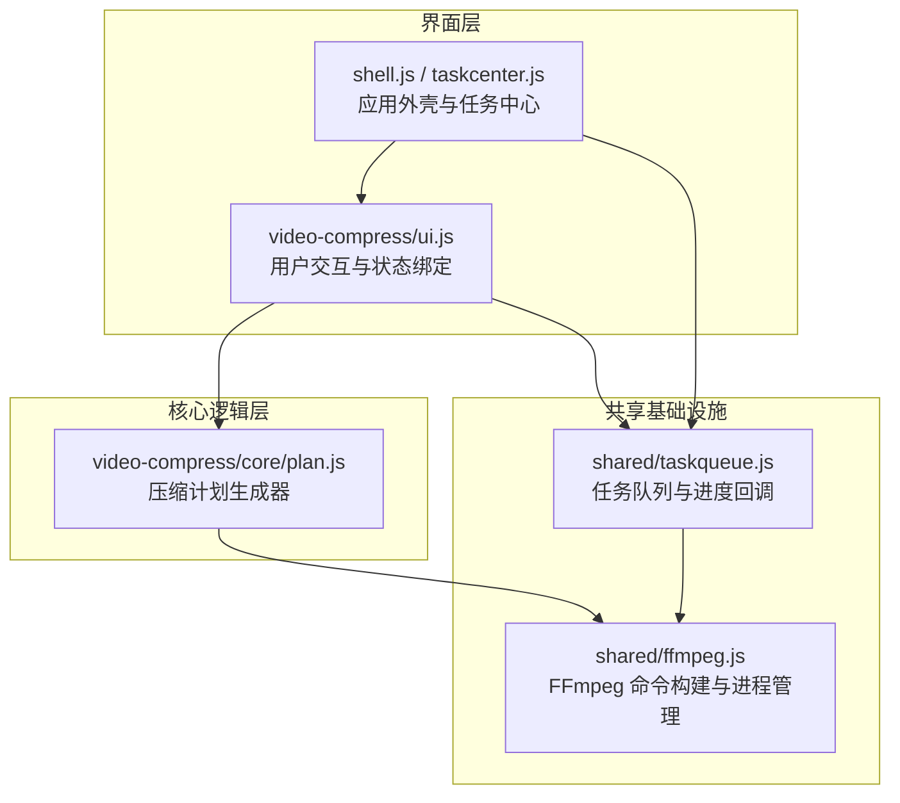
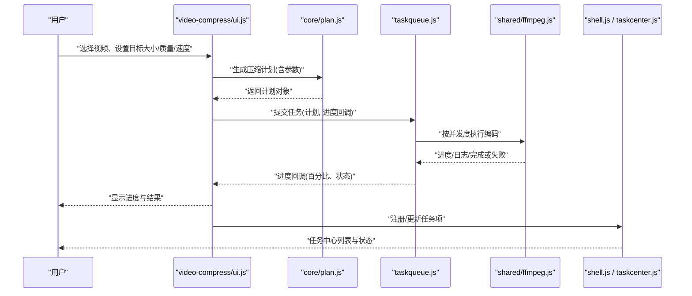
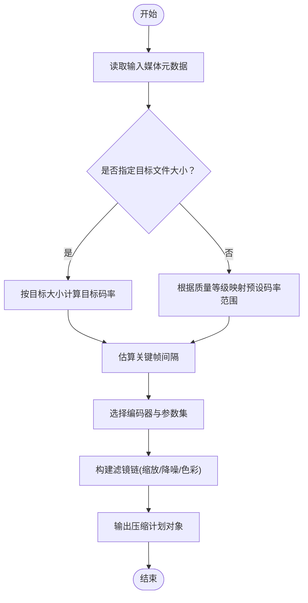
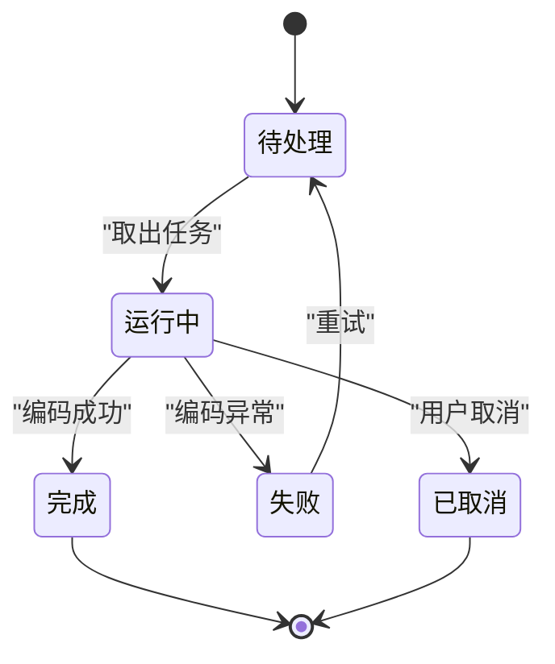
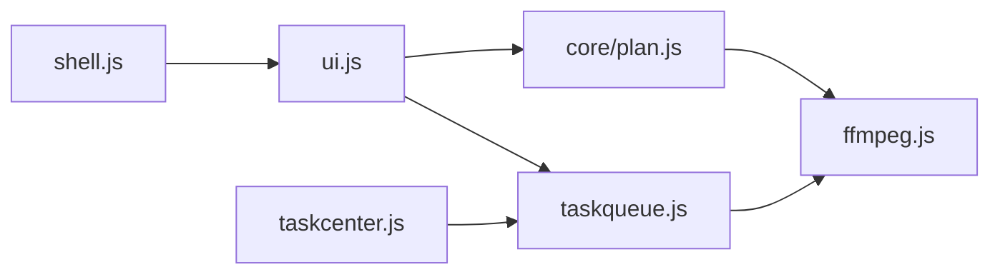

# 视频压缩工具

<cite>
**本文引用的文件**   
- [video-compress/index.js](file://app/app/src/tools/video-compress/index.js)
- [video-compress/ui.js](file://app/app/src/tools/video-compress/ui.js)
- [video-compress/core/plan.js](file://app/app/src/tools/video-compress/core/plan.js)
- [ffmpeg.js](file://app/app/src/shared/ffmpeg.js)
- [taskqueue.js](file://app/app/src/shared/taskqueue.js)
- [shell.js](file://app/app/src/shell/shell.js)
- [taskcenter.js](file://app/app/src/shell/taskcenter.js)
- [video-compress-test.js](file://app/app/tests/video-compress-test.js)
- [压缩格式性能对比.md](file://docs/docs/压缩格式性能对比.md)
</cite>

## 目录
1. [简介](#简介)
2. [项目结构](#项目结构)
3. [核心组件](#核心组件)
4. [架构总览](#架构总览)
5. [详细组件分析](#详细组件分析)
6. [依赖关系分析](#依赖关系分析)
7. [性能与优化策略](#性能与优化策略)
8. [任务队列与进度反馈](#任务队列与进度反馈)
9. [FFmpeg 集成与参数构建](#ffmpeg-集成与参数构建)
10. [压缩效果评估](#压缩效果评估)
11. [常见问题与排障](#常见问题与排障)
12. [结论](#结论)

## 简介
本技术文档面向“视频压缩工具”的实现与使用，聚焦以下目标：
- 解析并实现视频压缩的核心算法与优化策略，包括码率控制、关键帧间隔调整、编码器选择。
- 说明压缩参数的配置方法，包括目标文件大小、质量等级、压缩速度等选项。
- 文档化与 FFmpeg 的集成方式，包括命令行参数构建和进程管理。
- 解释批量压缩的任务队列管理与进度反馈机制。
- 提供压缩效果评估方法，包括文件大小对比、画质测试与性能基准。
- 总结常见问题的定位思路与优化技巧。

该工具位于前端桌面应用的“视频压缩”工具模块中，采用“UI 层 + 核心计划层 + 共享基础设施（FFmpeg、任务队列）”的分层结构，便于扩展和维护。

## 项目结构
视频压缩功能由三个层次组成：
- UI 层：负责用户交互、参数表单、结果展示与错误提示。
- 核心计划层：将用户意图转化为可执行的压缩计划，计算目标码率、关键帧间距、输出格式与质量档位。
- 共享基础设施：通过 FFmpeg 封装执行编码任务；通过任务队列并发处理批量任务；Shell 层统一调度任务中心。

**图示来源**
- [video-compress/ui.js](file://app/app/src/tools/video-compress/ui.js)
- [video-compress/core/plan.js](file://app/app/src/tools/video-compress/core/plan.js)
- [ffmpeg.js](file://app/app/src/shared/ffmpeg.js)
- [taskqueue.js](file://app/app/src/shared/taskqueue.js)
- [shell.js](file://app/app/src/shell/shell.js)
- [taskcenter.js](file://app/app/src/shell/taskcenter.js)

**章节来源**
- [video-compress/index.js](file://app/app/src/tools/video-compress/index.js)
- [video-compress/ui.js](file://app/app/src/tools/video-compress/ui.js)
- [video-compress/core/plan.js](file://app/app/src/tools/video-compress/core/plan.js)
- [ffmpeg.js](file://app/app/src/shared/ffmpeg.js)
- [taskqueue.js](file://app/app/src/shared/taskqueue.js)
- [shell.js](file://app/app/src/shell/shell.js)
- [taskcenter.js](file://app/app/src/shell/taskcenter.js)

## 核心组件
- 视频压缩 UI 控制器：接收用户输入的视频路径、目标大小、质量等级、速度偏好、输出格式等参数，触发压缩流程并渲染进度与结果。
- 压缩计划生成器：根据输入元数据（分辨率、时长、原始码率、音视频流信息）与用户约束，生成具体压缩计划，包括编码器、目标码率、关键帧间隔、缩放、滤镜链等。
- FFmpeg 集成层：封装命令构建、进程启动、日志解析、进度提取、错误捕获与资源清理。
- 任务队列：维护待处理任务集合，支持并发度限制、优先级、取消、重试与进度回调。
- Shell 任务中心：统一管理任务生命周期，向 UI 推送状态变更，并提供全局错误处理与日志记录。

**章节来源**
- [video-compress/ui.js](file://app/app/src/tools/video-compress/ui.js)
- [video-compress/core/plan.js](file://app/app/src/tools/video-compress/core/plan.js)
- [ffmpeg.js](file://app/app/src/shared/ffmpeg.js)
- [taskqueue.js](file://app/app/src/shared/taskqueue.js)
- [taskcenter.js](file://app/app/src/shell/taskcenter.js)

## 架构总览
视频压缩的整体调用序列如下：

**图示来源**
- [video-compress/ui.js](file://app/app/src/tools/video-compress/ui.js)
- [video-compress/core/plan.js](file://app/app/src/tools/video-compress/core/plan.js)
- [taskqueue.js](file://app/app/src/shared/taskqueue.js)
- [ffmpeg.js](file://app/app/src/shared/ffmpeg.js)
- [shell.js](file://app/app/src/shell/shell.js)
- [taskcenter.js](file://app/app/src/shell/taskcenter.js)

## 详细组件分析

### 压缩计划生成器（core/plan.js）
压缩计划是连接“用户意图”与“FFmpeg 命令”的桥梁，其职责包括：
- 读取输入媒体元数据（如分辨率、时长、原始码率、是否包含音频）。
- 根据目标文件大小推导目标平均码率。
- 根据质量等级与视频复杂度估算关键帧间隔。
- 选择合适的编码器（考虑硬件加速、兼容性、速度与质量权衡）。
- 构造缩放、去块、降噪、色彩空间转换等滤镜链。
- 输出可执行的计划对象，供 FFmpeg 层直接消费。

典型决策流程如下：

**图示来源**
- [video-compress/core/plan.js](file://app/app/src/tools/video-compress/core/plan.js)

**章节来源**
- [video-compress/core/plan.js](file://app/app/src/tools/video-compress/core/plan.js)

### FFmpeg 集成层（shared/ffmpeg.js）
该模块负责：
- 将压缩计划转换为 FFmpeg 命令行参数。
- 启动子进程执行编码，并实时解析标准输出/标准错误以获取进度。
- 将进度、日志、异常事件向上抛出给任务队列与 UI。
- 管理临时文件、超时、信号终止与资源释放。

关键关注点：
- 参数转义与路径安全，防止注入与非法路径。
- 进度解析鲁棒性，兼容不同 FFmpeg 版本输出格式。
- 内存与 CPU 占用监控，避免长期阻塞主线程。
- 失败重试与降级策略（例如回退软件编码）。

**章节来源**
- [ffmpeg.js](file://app/app/src/shared/ffmpeg.js)

### 任务队列（shared/taskqueue.js）
任务队列用于批量压缩场景，提供：
- 任务入队/出队、并发度控制、优先级排序。
- 任务状态机：待处理、运行中、完成、失败、已取消。
- 进度回调聚合，向 UI 推送每个任务的百分比、当前步骤与耗时。
- 错误隔离：单个任务失败不影响其他任务，同时支持批量重试。

典型状态流转如下：

**图示来源**
- [taskqueue.js](file://app/app/src/shared/taskqueue.js)

**章节来源**
- [taskqueue.js](file://app/app/src/shared/taskqueue.js)

### UI 控制器（video-compress/ui.js）
UI 层承担以下职责：
- 渲染输入框（视频文件、目标大小、质量等级、速度偏好、输出格式）。
- 校验输入合法性，给出即时反馈。
- 调用计划生成器与任务队列，订阅进度回调。
- 渲染最终结果（输出路径、文件大小、时长、码率、缩略图预览）。
- 暴露“重新压缩”“导出参数”“查看日志”等便捷操作。

**章节来源**
- [video-compress/ui.js](file://app/app/src/tools/video-compress/ui.js)

### Shell 与任务中心（shell.js / taskcenter.js）
- shell.js 初始化应用外壳，加载工具模块与主题。
- taskcenter.js 提供任务中心视图，集中展示所有正在进行的任务及其状态，支持全局暂停、继续与取消。

**章节来源**
- [shell.js](file://app/app/src/shell/shell.js)
- [taskcenter.js](file://app/app/src/shell/taskcenter.js)

## 依赖关系分析
- video-compress/ui.js 依赖 core/plan.js 与 shared/taskqueue.js。
- core/plan.js 依赖输入媒体元数据（通常通过 FFprobe 或 FFmpeg 获取）与预设策略。
- shared/ffmpeg.js 被 plan.js 与 taskqueue.js 共同依赖。
- shell.js 与 taskcenter.js 作为宿主环境，协调各工具的生命周期。

**图示来源**
- [video-compress/ui.js](file://app/app/src/tools/video-compress/ui.js)
- [video-compress/core/plan.js](file://app/app/src/tools/video-compress/core/plan.js)
- [ffmpeg.js](file://app/app/src/shared/ffmpeg.js)
- [taskqueue.js](file://app/app/src/shared/taskqueue.js)
- [shell.js](file://app/app/src/shell/shell.js)
- [taskcenter.js](file://app/app/src/shell/taskcenter.js)

**章节来源**
- [video-compress/ui.js](file://app/app/src/tools/video-compress/ui.js)
- [video-compress/core/plan.js](file://app/app/src/tools/video-compress/core/plan.js)
- [ffmpeg.js](file://app/app/src/shared/ffmpeg.js)
- [taskqueue.js](file://app/app/src/shared/taskqueue.js)
- [shell.js](file://app/app/src/shell/shell.js)
- [taskcenter.js](file://app/app/src/shell/taskcenter.js)

## 性能与优化策略
本节从算法与工程实践两个维度讨论优化要点。

- 码率控制
  - 基于目标文件大小反推平均码率时，需扣除容器开销、字幕与音轨体积，避免高估视频可用码率。
  - 对长视频建议启用两遍编码：第一遍统计复杂度，第二遍按复杂度分配码率。
  - 动态码率（VBR）适合变化剧烈的画面，恒定码率（CBR）更适合直播或网络传输。

- 关键帧间隔
  - 关键帧密度越高，随机访问越灵活，但体积越大。
  - 对短视频可采用较小间隔，对超长视频可适当增大间隔以减少 I/O 与编码压力。

- 编码器选择
  - 优先尝试硬件加速编码器（如 h264_videotoolbox、h264_nvenc），若不可用则回退到软件编码器。
  - 在兼容性与体积之间平衡，必要时切换 H.264/H.265 与 AAC/Opus。

- 预处理与后处理
  - 适度降噪、去块与锐化可在低码率下提升主观观感。
  - 合理缩放分辨率，避免过度降质；对移动端适配建议降低至 1080p 或更低。

- 批量化与并发
  - 根据 CPU/GPU 能力设定并发度，避免系统级资源争抢。
  - 对大文件进行分片或异步预热，减少首帧等待时间。

[本节为通用指导，不直接分析具体源码文件]

## 任务队列与进度反馈
- 任务生命周期
  - 入队后立即获得唯一任务 ID，UI 可通过 ID 查询状态。
  - 运行中任务周期性上报进度（百分比、当前阶段、耗时、预估剩余时间）。
  - 失败任务附带错误码与诊断信息，支持重试与降级。

- 进度反馈
  - 任务队列将 FFmpeg 输出的进度事件聚合为标准化事件模型。
  - UI 侧监听事件并更新进度条、日志面板与结果区。

- 取消与恢复
  - 支持单任务取消与批量取消。
  - 支持中断后断点续编（视编码器与封装格式支持情况而定）。

**章节来源**
- [taskqueue.js](file://app/app/src/shared/taskqueue.js)
- [taskcenter.js](file://app/app/src/shell/taskcenter.js)

## FFmpeg 集成与参数构建
- 参数构建原则
  - 将计划对象的字段映射为 FFmpeg 参数，确保顺序正确且无冲突。
  - 对用户输入进行白名单校验与转义，防止非法参数注入。
  - 自动添加必要的复用器与封装参数，保证跨平台兼容性。

- 进程管理
  - 使用非阻塞方式启动 FFmpeg，避免阻塞主线程。
  - 实时读取标准输出与标准错误，解析进度与错误信息。
  - 优雅关闭进程，清理临时文件与锁。

- 日志与诊断
  - 保留关键阶段的 FFmpeg 日志片段，便于问题回溯。
  - 提供“复制命令”功能，方便用户在终端复现与调试。

**章节来源**
- [ffmpeg.js](file://app/app/src/shared/ffmpeg.js)

## 压缩效果评估
- 文件大小对比
  - 比较原文件与压缩后文件的字节数，计算压缩比与节省空间。
  - 针对多段视频，汇总整体压缩效果，识别异常任务。

- 画质测试
  - 客观指标：PSNR、SSIM、VMAF（如有工具支持）。
  - 主观评测：抽样播放、快速拖动跳转、暗场与运动剧烈片段检查。
  - 一致性检查：关键帧位置、色彩空间、HDR/SDR 转换是否正确。

- 性能基准
  - 编码耗时、CPU/GPU 占用、内存峰值、I/O 吞吐。
  - 不同质量等级与编码器组合下的单位时长成本曲线。

- 回归与自动化
  - 建立样本集，定期跑批，比较历史结果，发现退化。
  - 将评估指标纳入持续集成，确保质量基线稳定。

[本节为通用指导，不直接分析具体源码文件]

## 常见问题与排障
- 压缩后画质下降明显
  - 检查目标码率是否过低，适当提高质量等级或放宽目标大小。
  - 检查关键帧间隔是否过大导致快进卡顿。
  - 确认未误开启过度降噪或锐化滤镜。

- 体积减小不明显
  - 检查输入是否为高码率源，必要时先做有损重编码再二次压缩。
  - 确认音频轨道未被忽略，或按需降低音频码率。
  - 检查是否错误地使用了无损或接近无损的参数。

- 编码时间过长
  - 降低并发度，避免系统资源争抢。
  - 启用硬件加速编码器，或切换到更快的预设档。
  - 缩短关键帧间隔、减少预处理滤镜数量。

- 进度不更新或卡住
  - 检查 FFmpeg 版本与输出格式兼容性。
  - 查看任务日志，确认是否存在解析失败或死锁。
  - 重启任务中心或重置任务队列。

- 输出文件无法播放
  - 检查封装格式与解码器是否匹配。
  - 验证色彩空间与 HDR/SDR 转换是否正确。
  - 尝试更换容器或编码器，定位问题根因。

**章节来源**
- [video-compress-test.js](file://app/app/tests/video-compress-test.js)
- [压缩格式性能对比.md](file://docs/docs/压缩格式性能对比.md)

## 结论
视频压缩工具通过“UI + 计划 + FFmpeg + 任务队列”的分层架构，实现了从用户意图到实际编码产物的完整链路。其核心价值在于：
- 将复杂的 FFmpeg 参数抽象为用户友好的质量、大小与速度选项。
- 通过计划生成器实现码率控制、关键帧间隔与编码器选择的自动化。
- 借助任务队列支撑批量压缩与稳定的进度反馈。
- 结合测试与文档，形成可重复、可评估、可优化的工程闭环。

在实际使用中，建议以目标质量为优先，逐步微调目标大小与速度偏好，并结合样本集的回归测试持续优化参数策略。