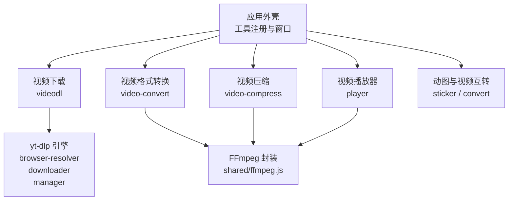
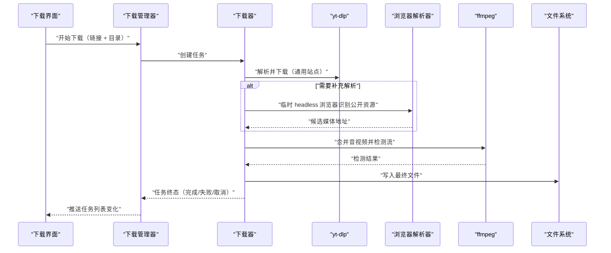
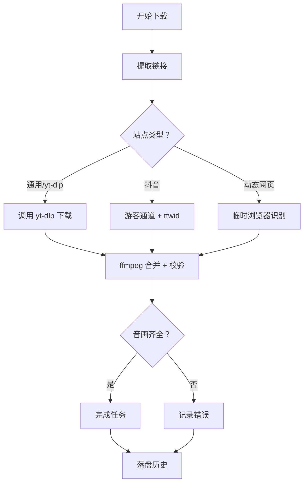
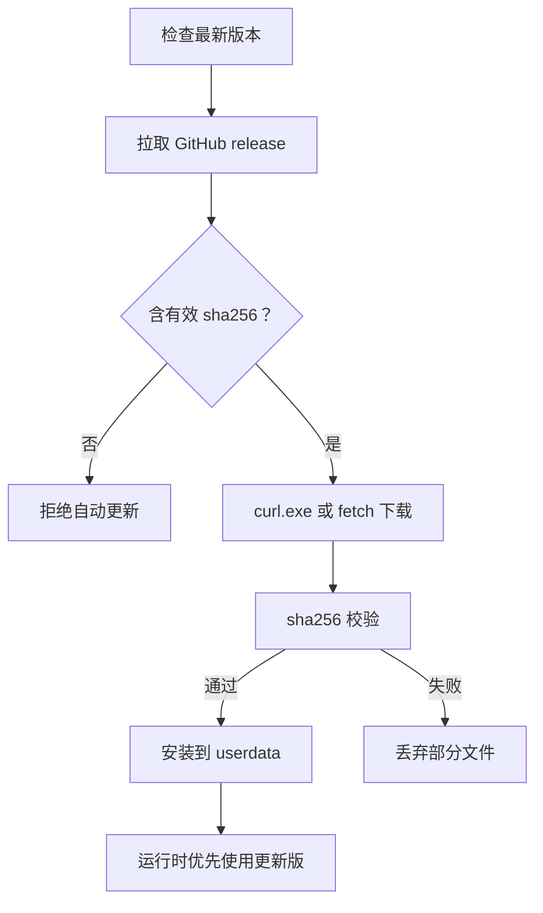
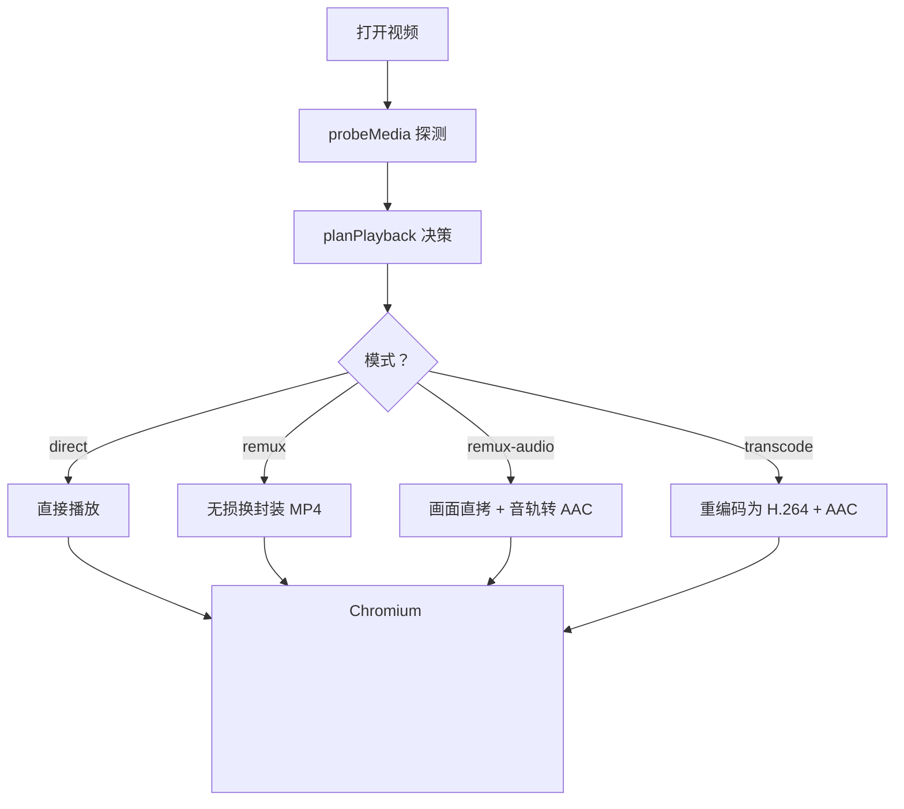
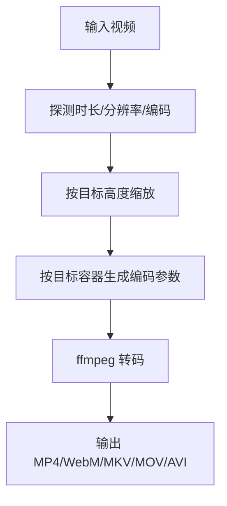
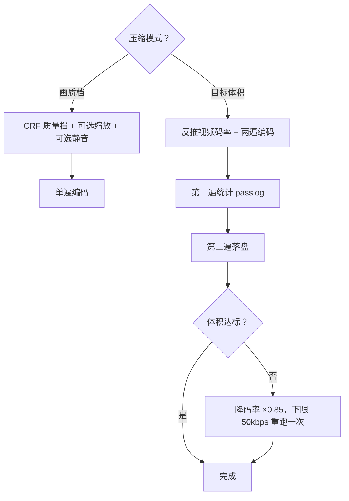
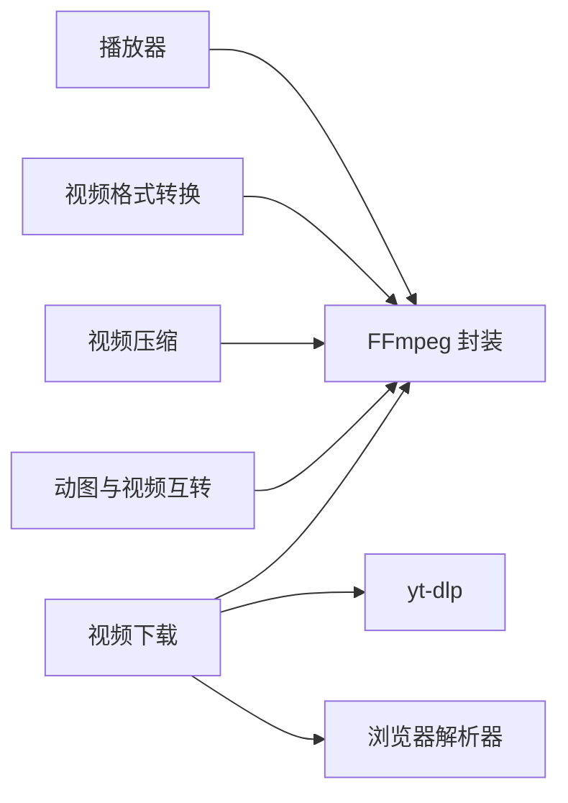

# 视频处理工具

<cite>
**本文引用的文件 **
- [app/src/tools/videodl/index.js](file://app/src/tools/videodl/index.js)
- [app/src/tools/videodl/ui.js](file://app/src/tools/videodl/ui.js)
- [app/src/tools/videodl/core/downloader.mjs](file://app/src/tools/videodl/core/downloader.mjs)
- [app/src/tools/videodl/core/manager.mjs](file://app/src/tools/videodl/core/manager.mjs)
- [app/src/tools/videodl/core/engine-update.mjs](file://app/src/tools/videodl/core/engine-update.mjs)
- [app/src/tools/videodl/core/errors.mjs](file://app/src/tools/videodl/core/errors.mjs)
- [app/src/tools/videodl/core/browser-resolver.cjs](file://app/src/tools/videodl/core/browser-resolver.cjs)
- [app/src/tools/videodl/core/pure.mjs](file://app/src/tools/videodl/core/pure.mjs)
- [app/src/tools/player/index.js](file://app/src/tools/player/index.js)
- [app/src/tools/player/ui.js](file://app/src/tools/player/ui.js)
- [app/src/tools/player/core/plan.js](file://app/src/tools/player/core/plan.js)
- [app/src/tools/video-convert/index.js](file://app/src/tools/video-convert/index.js)
- [app/src/tools/video-convert/core/plan.js](file://app/src/tools/video-convert/core/plan.js)
- [app/src/tools/video-compress/index.js](file://app/src/tools/video-compress/index.js)
- [app/src/tools/video-compress/core/plan.js](file://app/src/tools/video-compress/core/plan.js)
- [app/src/shared/ffmpeg.js](file://app/src/shared/ffmpeg.js)
- [spec/modules/videodl.md](file://spec/modules/videodl.md)
- [spec/modules/player.md](file://spec/modules/player.md)
- [spec/modules/video-convert.md](file://spec/modules/video-convert.md)
- [spec/modules/video-compress.md](file://spec/modules/video-compress.md)
</cite>

## 目录
1. [简介](#简介)
2. [项目结构](#项目结构)
3. [核心组件](#核心组件)
4. [架构总览](#架构总览)
5. [详细组件分析](#详细组件分析)
6. [依赖关系分析](#依赖关系分析)
7. [性能与质量特性](#性能与质量特性)
8. [故障排除指南](#故障排除指南)
9. [结论](#结论)

## 简介
本技术文档聚焦本项目中的五个视频相关工具：视频下载、视频播放器、视频格式转换、视频压缩和动图与视频互转。其中「视频下载」是软件中唯一涉及联网能力的工具，其余工具均设计为离线可用。文档重点说明：

- 视频下载模块的架构：yt-dlp 引擎集成、站点解析器（抖音、小红书、B站、央视频）、浏览器兜底解析、代理探测与 yt-dlp 自更新。
- FFmpeg 封装层 shared/ffmpeg.js：媒体探测、转码、两遍编码、动图参数、音频参数等统一实现。
- 播放器的工作原理：Chromium `<video>` 内核、tomato-media:// 协议、四档播放策略与自动升档。
- 视频格式转换与压缩的参数体系、质量档位、目标体积控制及性能优化。
- 常见问题的排查路径：编码不兼容、容器不支持、网络下载失败、代理与地区限制等。

## 项目结构
视频工具组位于 `app/src/tools` 下，按功能分目录组织；FFmpeg 公共能力放在 `app/src/shared/ffmpeg.js`。每个工具通常包含：

- index.js：工具声明（id、名称、分组、排序、样式）。
- ui.js：界面与交互逻辑。
- core/plan.js 或 core/*.mjs：纯业务逻辑与参数拼装。
- styles.css：工具样式。

图表来源
- [app/src/tools/videodl/index.js:1-16](file://app/src/tools/videodl/index.js#L1-L16)
- [app/src/tools/player/index.js:1-16](file://app/src/tools/player/index.js#L1-L16)
- [app/src/tools/video-convert/index.js:1-14](file://app/src/tools/video-convert/index.js#L1-L14)
- [app/src/tools/video-compress/index.js:1-14](file://app/src/tools/video-compress/index.js#L1-L14)
- [app/src/shared/ffmpeg.js:1-20](file://app/src/shared/ffmpeg.js#L1-L20)

章节来源
- [app/src/tools/videodl/index.js:1-16](file://app/src/tools/videodl/index.js#L1-L16)
- [app/src/tools/player/index.js:1-16](file://app/src/tools/player/index.js#L1-L16)
- [app/src/tools/video-convert/index.js:1-14](file://app/src/tools/video-convert/index.js#L1-L14)
- [app/src/tools/video-compress/index.js:1-14](file://app/src/tools/video-compress/index.js#L1-L14)
- [app/src/shared/ffmpeg.js:1-20](file://app/src/shared/ffmpeg.js#L1-L20)

## 核心组件
本节概览五个工具的职责边界与协作方式：

| 工具 | 主要职责 | 关键依赖 | 是否联网 |
|---|---|---|---|
| 视频下载 | 粘贴链接后下载网络视频；任务管理；引擎自更新 | yt-dlp、ffmpeg、浏览器解析器、GitHub API | 是 |
| 视频播放器 | 打开本地视频并播放；必要时准备可播放副本 | Chromium `<video>`、ffmpeg、自定义协议 | 否 |
| 视频格式转换 | 把视频转成 MP4/WebM/MKV/MOV/AVI | ffmpeg | 否 |
| 视频压缩 | 按画质档或目标体积压缩视频 | ffmpeg | 否 |
| 动图与视频互转 | 视频转 GIF/WebP/APNG、GIF 转视频 | ffmpeg | 否 |

章节来源
- [spec/modules/videodl.md:1-64](file://spec/modules/videodl.md#L1-L64)
- [spec/modules/player.md:1-59](file://spec/modules/player.md#L1-L59)
- [spec/modules/video-convert.md:1-45](file://spec/modules/video-convert.md#L1-L45)
- [spec/modules/video-compress.md:1-46](file://spec/modules/video-compress.md#L1-L46)

## 架构总览
视频下载是唯一联网工具，其架构分为三层：

- 界面层：用户输入链接、选择保存目录、查看任务进度、检查引擎状态。
- 主进程管理层：任务编排、历史落盘、代理探测、yt-dlp 自更新、IPC 推送。
- 下载执行层：调用 yt-dlp、ffmpeg、浏览器解析器，完成解析、下载、合并、校验。

图表来源
- [app/src/tools/videodl/ui.js:1-200](file://app/src/tools/videodl/ui.js#L1-L200)
- [app/src/tools/videodl/core/manager.mjs:1-200](file://app/src/tools/videodl/core/manager.mjs#L1-L200)
- [app/src/tools/videodl/core/downloader.mjs:1-200](file://app/src/tools/videodl/core/downloader.mjs#L1-L200)
- [app/src/tools/videodl/core/browser-resolver.cjs:1-194](file://app/src/tools/videodl/core/browser-resolver.cjs#L1-L194)

章节来源
- [app/src/tools/videodl/core/manager.mjs:1-200](file://app/src/tools/videodl/core/manager.mjs#L1-L200)
- [app/src/tools/videodl/core/downloader.mjs:1-200](file://app/src/tools/videodl/core/downloader.mjs#L1-L200)

## 详细组件分析

### 视频下载模块
#### 设计要点
- 唯一联网工具：通过 GitHub API 检查 yt-dlp 最新版本，并通过 curl.exe 或 Node fetch 下载。
- 多站点通道：通用站点走 yt-dlp；抖音优先游客通道，再退到匿名浏览器会话；小红书、B站、央视频有增强逻辑；动态网页用临时浏览器兜底。
- 安全边界：只下载公开内容，不绕过登录、DRM、验证码；对私有、受保护、地区限制给出明确中文提示。
- 可靠性：下载产物经 ffmpeg 检测音视频流；HLS 实为 TS 时尝试无损换封装为 MP4；历史任务持久化；支持取消与重试。

图表来源
- [app/src/tools/videodl/core/downloader.mjs:1-200](file://app/src/tools/videodl/core/downloader.mjs#L1-L200)
- [app/src/tools/videodl/core/errors.mjs:1-25](file://app/src/tools/videodl/core/errors.mjs#L1-L25)
- [app/src/tools/videodl/core/pure.mjs:1-132](file://app/src/tools/videodl/core/pure.mjs#L1-L132)

#### 引擎自更新
- 随包版本：addons/ytdlp/yt-dlp.exe，锁定 nightly 版本与 SHA-256。
- 更新版：userdata/videodl-engine/yt-dlp-<version>.exe，manifest.json 记录版本与指纹。
- 更新流程：查 GitHub release → 取 asset digest → 下载 → sha256File 校验 → 安装 → 启动时优先使用更新版。
- 回退：校验失败不替换现有引擎；更新失败不影响已存在的随包引擎。

图表来源
- [app/src/tools/videodl/core/engine-update.mjs:1-137](file://app/src/tools/videodl/core/engine-update.mjs#L1-L137)
- [app/src/tools/videodl/core/manager.mjs:1-200](file://app/src/tools/videodl/core/manager.mjs#L1-L200)

#### 浏览器解析器
- 目的：当 yt-dlp 无法解析动态网页时，使用临时 headless Chrome/Edge 通过 CDP 抓取页面公开媒体资源。
- 安全：不接管已打开浏览器；不读取用户资料；只接受公开 http/https；对 DRM、验证码、私有内容直接拒绝。
- 超时与并发：单次解析约 22 秒超时；最多排队 3 个任务。

章节来源
- [app/src/tools/videodl/core/browser-resolver.cjs:1-194](file://app/src/tools/videodl/core/browser-resolver.cjs#L1-L194)
- [spec/modules/videodl.md:1-64](file://spec/modules/videodl.md#L1-L64)

### 视频播放器模块
#### 工作原理
- 内核：Electron 内置 Chromium `<video>`，不引入额外播放器库。
- 本地访问：通过主进程注册的 tomato-media:// 协议，支持 HTTP Range，避免沙箱限制与大文件内存占用。
- 探测与计划：先用 ffmpeg probeMedia 获取编码信息，再由 planPlayback 决定 direct/remux/remux-audio/transcode。
- 自动升档：直放失败时逐步升级方案，直到最重档；超过最重档则判定不可播。
- 缓存：准备副本保存在 userdata/player-cache/，命中缓存秒开，切走工具页清理。

图表来源
- [app/src/tools/player/ui.js:1-200](file://app/src/tools/player/ui.js#L1-L200)
- [app/src/tools/player/core/plan.js:1-195](file://app/src/tools/player/core/plan.js#L1-L195)
- [app/src/shared/ffmpeg.js:1-20](file://app/src/shared/ffmpeg.js#L1-L20)

#### 编解码支持与播放控制
- 原生容器：mp4/m4v/mov/webm/ogv。
- 原生视频编码：h264/avc1/vp8/vp9/av1/hevc/h265（HEVC 取决于系统解码器）。
- 原生音频编码：aac/mp3/opus/vorbis/flac。
- 控制：播放/暂停、进度条、音量、全屏；快捷键空格、方向键、M、F。

章节来源
- [app/src/tools/player/core/plan.js:1-195](file://app/src/tools/player/core/plan.js#L1-L195)
- [spec/modules/player.md:1-59](file://spec/modules/player.md#L1-L59)

### 视频格式转换模块
#### 参数配置
- 输出容器：MP4、WebM、MKV、MOV、AVI。
- 视频编码：MP4/MKV/MOV 使用 libx264 CRF；WebM 使用 libvpx-vp9；AVI 使用 mpeg4。
- 音频编码：AAC、Opus、MP3 对应不同容器。
- 分辨率：保持原样或降低到指定高度，奇数边偶数化。
- 质量档：高质量 CRF 20、标准 CRF 23、小体积 CRF 28。
- 静音：可选去掉声音。

图表来源
- [app/src/tools/video-convert/core/plan.js:1-70](file://app/src/tools/video-convert/core/plan.js#L1-L70)
- [app/src/shared/ffmpeg.js:1-200](file://app/src/shared/ffmpeg.js#L1-L200)

章节来源
- [app/src/tools/video-convert/index.js:1-14](file://app/src/tools/video-convert/index.js#L1-L14)
- [app/src/tools/video-convert/core/plan.js:1-70](file://app/src/tools/video-convert/core/plan.js#L1-L70)
- [spec/modules/video-convert.md:1-45](file://spec/modules/video-convert.md#L1-L45)

### 视频压缩模块
#### 两种模式
- 画质档模式：单遍 CRF 编码，保留原容器或输出 MP4，适合“先保证画质”。
- 目标体积模式：固定输出 MP4，先反推视频码率，两遍编码；压完实测体积，超出目标容差自动降码率重跑一次。

图表来源
- [app/src/tools/video-compress/core/plan.js:1-115](file://app/src/tools/video-compress/core/plan.js#L1-L115)
- [app/src/shared/ffmpeg.js:201-399](file://app/src/shared/ffmpeg.js#L201-L399)

章节来源
- [app/src/tools/video-compress/index.js:1-14](file://app/src/tools/video-compress/index.js#L1-L14)
- [app/src/tools/video-compress/core/plan.js:1-115](file://app/src/tools/video-compress/core/plan.js#L1-L115)
- [spec/modules/video-compress.md:1-46](file://spec/modules/video-compress.md#L1-L46)

### 动图与视频互转
动图与视频互转由共享 FFmpeg 封装提供参数拼装，包括：

- 视频转 GIF：两遍调色板生成，可调 fps、颜色数、循环次数。
- 视频转 WebP 动图：libwebp_anim，可调质量与帧率。
- 视频转 APNG：显式 -f apng，注意 .png 后缀。
- 动图转视频：scale + yuv420p，可选 fps。

章节来源
- [app/src/shared/ffmpeg.js:1-399](file://app/src/shared/ffmpeg.js#L1-L399)

## 依赖关系分析
工具之间的依赖以 FFmpeg 为中心，下载模块额外依赖 yt-dlp 与浏览器解析器。

图表来源
- [app/src/shared/ffmpeg.js:1-20](file://app/src/shared/ffmpeg.js#L1-L20)
- [app/src/tools/videodl/core/downloader.mjs:1-200](file://app/src/tools/videodl/core/downloader.mjs#L1-L200)
- [app/src/tools/videodl/core/browser-resolver.cjs:1-194](file://app/src/tools/videodl/core/browser-resolver.cjs#L1-L194)

章节来源
- [app/src/shared/ffmpeg.js:1-399](file://app/src/shared/ffmpeg.js#L1-L399)
- [app/src/tools/videodl/core/downloader.mjs:1-200](file://app/src/tools/videodl/core/downloader.mjs#L1-L200)

## 性能与质量特性
- 播放器：
  - 直放零等待；无损换封装秒级；重编码按时长与分辨率计算，界面显示百分比与速度。
  - 缓存命中可跳过准备阶段。
- 视频格式转换：
  - 统一使用 CPU 编码，跨平台稳定；默认 preset medium 或 veryfast（播放器重编码）。
  - 输出带 faststart，利于网页或社交场景边下边播。
- 视频压缩：
  - 两遍编码更贴近目标体积；自动降码率重跑一次提升命中率。
  - 目标体积是目标而非严格上限，复杂内容可能略超。
- 视频下载：
  - 并发任务有限制；临时浏览器解析有超时；yt-dlp 与 ffmpeg 子进程可被取消。

[本节为通用性能讨论，不直接分析具体代码行]

## 故障排除指南

### 播放器无法播放
- 现象：直接播放失败，界面提示需准备副本。
- 原因：容器不被 Chromium 原生支持，或音频编码不能进入 MP4，或视频编码不在原生解码列表。
- 解决：
  - 让播放器自动选择 remux 或 transcode 模式。
  - 确认 ffmpeg 加装包存在；缺失时仅原生 MP4/WebM/MOV 可直接播放。
  - HEVC/HEVC 是否可直放取决于系统解码器，失败会自动降级重编码。

章节来源
- [app/src/tools/player/core/plan.js:1-195](file://app/src/tools/player/core/plan.js#L1-L195)
- [spec/modules/player.md:1-59](file://spec/modules/player.md#L1-L59)

### 视频格式转换失败
- 现象：转码报错或输出文件无法播放。
- 原因：输入格式 ffmpeg 不支持、编码参数非法、目标容器与编码不兼容。
- 解决：
  - 确认输入扩展名在 VIDEO_EXTS 范围内。
  - 调整目标容器或质量档；例如 AVI 使用 MPEG-4 + MP3。
  - 若仅需换封装，优先使用播放器 remux 模式。

章节来源
- [app/src/tools/video-convert/core/plan.js:1-70](file://app/src/tools/video-convert/core/plan.js#L1-L70)
- [spec/modules/video-convert.md:1-45](file://spec/modules/video-convert.md#L1-L45)

### 视频压缩未达目标体积
- 现象：目标体积模式结果仍大于目标 MB。
- 原因：VBR 波动、内容复杂度差异、两遍编码误差。
- 解决：
  - 降低目标 MB 或提高音频码率预留空间。
  - 允许自动降码率重跑一次；仍不达标时可手动切换到更小质量档。
  - 将目标视为“接近值”，不是绝对上限。

章节来源
- [app/src/tools/video-compress/core/plan.js:1-115](file://app/src/tools/video-compress/core/plan.js#L1-L115)
- [spec/modules/video-compress.md:1-46](file://spec/modules/video-compress.md#L1-L46)

### 视频下载失败
- 地区限制：提示 geo restriction 或 not available in your country。
  - 解决：启用代理后再试；国内访问 YouTube 通常需要代理。
- 需要登录或会员：提示 login required、members only、premium。
  - 解决：仅支持公开可访问内容；不提供账号登录或 Cookie 导出。
- 地区或平台风控：HTTP 403、Too many requests。
  - 解决：重新复制分享链接，稍后重试。
- 链接无效或下架：HTTP 404、video unavailable。
  - 解决：检查分享链接是否正确。
- 动态网页无法解析：浏览器兜底超时或多资源歧义。
  - 解决：确保打开的是具体视频页；本机安装 Chrome 或 Edge；关闭验证码或先在网站完成正常访问。
- 抖音游客通道失败：没有 ttwid 或 `_ROUTER_DATA` 无 video。
  - 解决：重试游客通道；必要时退到匿名浏览器会话。
- 下载引擎缺失或损坏：未检测到 yt-dlp 或 SHA-256 不一致。
  - 解决：点击“检查更新”或“更新引擎”；将 addons/ytdlp 放回正确位置。

章节来源
- [app/src/tools/videodl/core/errors.mjs:1-25](file://app/src/tools/videodl/core/errors.mjs#L1-L25)
- [app/src/tools/videodl/core/downloader.mjs:1-200](file://app/src/tools/videodl/core/downloader.mjs#L1-L200)
- [app/src/tools/videodl/core/engine-update.mjs:1-137](file://app/src/tools/videodl/core/engine-update.mjs#L1-L137)
- [spec/modules/videodl.md:1-64](file://spec/modules/videodl.md#L1-L64)

### FFmpeg 相关问题
- 现象：转码、压缩、播放器准备副本时报错或缺失。
- 原因：ffmpeg 安装包未放入 addons/ffmpeg。
- 解决：解压 ffmpeg 加装包到 addons/ffmpeg；重启工具后重新尝试。

章节来源
- [app/src/shared/ffmpeg.js:1-20](file://app/src/shared/ffmpeg.js#L1-L20)
- [spec/modules/video-convert.md:1-45](file://spec/modules/video-convert.md#L1-L45)
- [spec/modules/player.md:1-59](file://spec/modules/player.md#L1-L59)

## 结论
视频处理工具组围绕 FFmpeg 构建统一的媒体处理能力，并以 yt-dlp 作为唯一联网入口完成网络视频下载。播放器通过四档策略在不引入额外解码器的情况下覆盖更多 Windows 环境下的格式；视频格式转换与压缩提供一致的质量与体积控制；动图互转复用同一参数体系。整体设计强调离线可用性、错误可读性、可取消性与产物校验，便于用户在本地环境中完成从下载到观看再到处理的完整工作流。