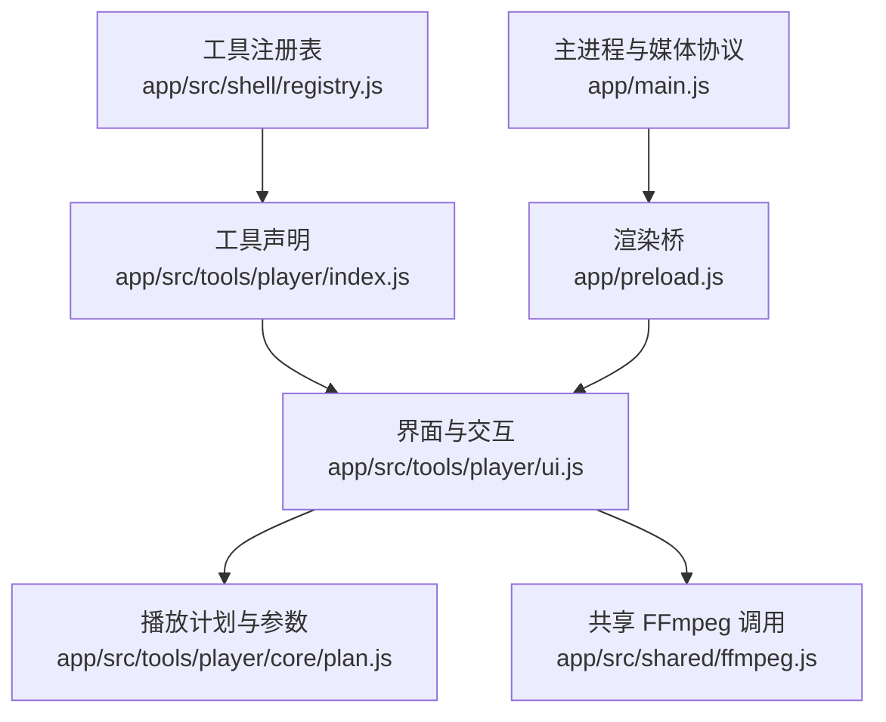
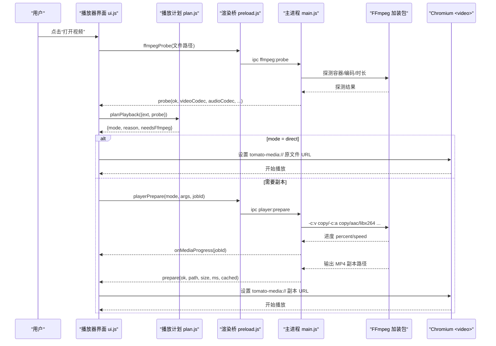
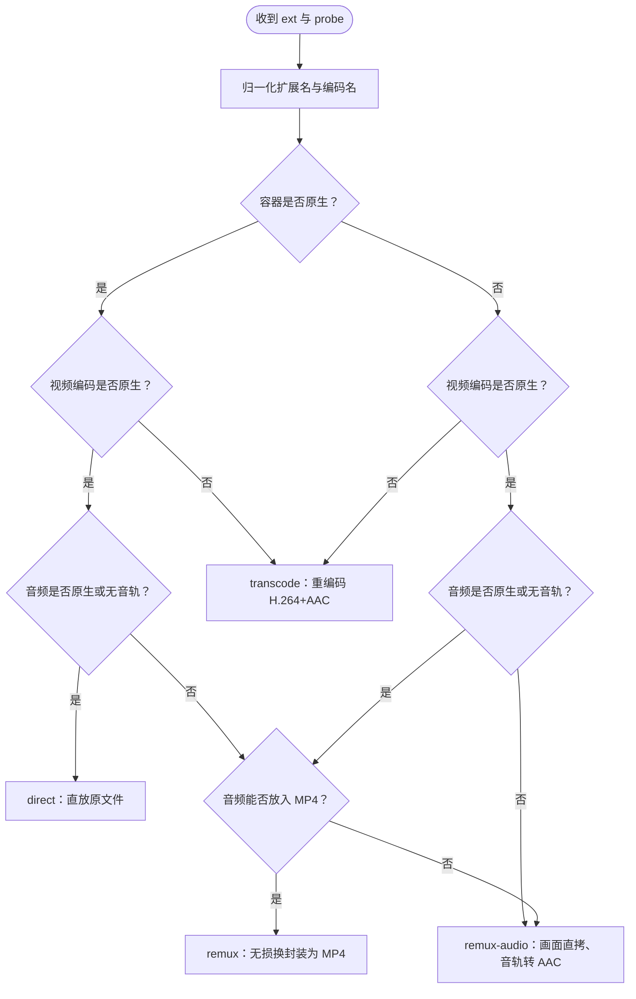
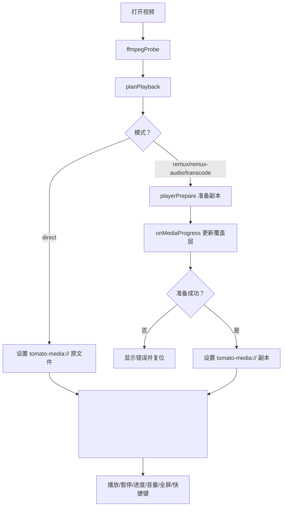
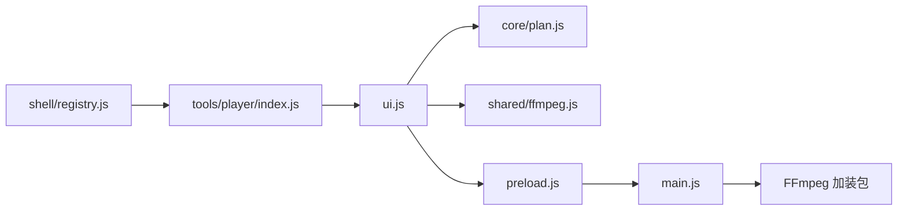

# 视频播放器

<cite>
**本文引用的文件**   
- [player.md](file://spec/modules/player.md)
- [index.js](file://app/src/tools/player/index.js)
- [ui.js](file://app/src/tools/player/ui.js)
- [plan.js](file://app/src/tools/player/core/plan.js)
- [registry.js](file://app/src/shell/registry.js)
- [preload.js](file://app/preload.js)
- [main.js](file://app/main.js)
- [player-test.js](file://app/tests/player-test.js)
- [player-ui-test.js](file://app/tests/player-ui-test.js)
</cite>

## 目录
1. [简介](#简介)
2. [项目结构](#项目结构)
3. [核心组件](#核心组件)
4. [架构总览](#架构总览)
5. [详细组件分析](#详细组件分析)
6. [依赖关系分析](#依赖关系分析)
7. [性能与缓冲策略](#性能与缓冲策略)
8. [故障排除指南](#故障排除指南)
9. [结论](#结论)

## 简介
本技术文档围绕工具箱中的「视频播放器」工具，说明其从用户选择文件到最终在 Chromium `<video>` 中播放的完整处理管道。该播放器不引入外部播放器内核，而是复用 Electron/Chromium 原生解码能力；对 Chromium 无法直接播放的容器或编码，通过随包 FFmpeg 做无损换封装或重编码，生成可本地 Range 读取的 MP4 副本，从而实现“打开即播、拖动任意进度”的体验。

关键特性：
- 输入扩展名覆盖 MP4、MOV、MKV、AVI、WebM、FLV、WMV、M4V、TS、3GP、MPG、MPEG、VOB、RMVB、OGV。
- 四档播放计划：直放、无损换封装、画面直拷音轨转 AAC、全量重编码。
- 自定义 `tomato-media://` 协议支持 HTTP Range，避免整文件载入内存。
- 播放失败自动升档；FFmpeg 缺失时给出明确提示而非静默失败。
- 纯离线，不修改源文件，缓存副本进入工具页/切换/离开时清理。

**章节来源**
- [player.md:1-59](file://spec/modules/player.md#L1-L59)

## 项目结构
播放器以“工具模块”形式集成到工具箱左侧导航，由壳层注册表统一管理生命周期。

- `index.js`：声明播放器工具元信息（id、名称、分组、顺序）并挂载/卸载 UI。
- `ui.js`：负责 DOM、事件、播放控制条、全屏、快捷键、错误提示与准备覆盖层。
- `core/plan.js`：纯逻辑决策层，决定 direct/remux/remux-audio/transcode 档位及 FFmpeg 参数。
- `shared/ffmpeg.js`：封装探测、进度订阅、取消等 FFmpeg 通用能力。
- `shell/registry.js`：将播放器纳入工具箱全局工具列表。
- `preload.js`：向界面暴露白名单 IPC 方法，包括播放器缓存与准备接口。
- `main.js`：注册 `tomato-media://` 协议、实现 Range 分块读取与缓存管理。

**图表来源**
- [index.js:1-16](file://app/src/tools/player/index.js#L1-L16)
- [registry.js:1-67](file://app/src/shell/registry.js#L1-L67)
- [preload.js:1-193](file://app/preload.js#L1-L193)

**章节来源**
- [index.js:1-16](file://app/src/tools/player/index.js#L1-L16)
- [registry.js:1-67](file://app/src/shell/registry.js#L1-L67)

## 核心组件
- 播放计划器：根据容器、视频编码、音频编码与是否有音轨，输出最小必要处理方案。
- 界面编排器：把探测结果交给计划器，再驱动 UI 状态、控制条、全屏与快捷键。
- 媒体协议层：以 `tomato-media://` 提供流式读取，让 `<video>` 边下边播。
- FFmpeg 集成：复用现有加装包，完成探测、换封装、转码和进度上报。

**章节来源**
- [plan.js:1-195](file://app/src/tools/player/core/plan.js#L1-L195)
- [ui.js:1-200](file://app/src/tools/player/ui.js#L1-L200)
- [main.js:1-200](file://app/main.js#L1-L200)
- [player.md:1-59](file://spec/modules/player.md#L1-L59)

## 架构总览
下图展示一次典型“非原生格式”播放流程：UI 选择文件 → 探测 → 制定计划 → 调用主进程准备副本 → 设置 `tomato-media://` URL → Chromium 通过 Range 拉取并播放。

**图表来源**
- [ui.js:1-200](file://app/src/tools/player/ui.js#L1-L200)
- [plan.js:1-195](file://app/src/tools/player/core/plan.js#L1-L195)
- [preload.js:1-193](file://app/preload.js#L1-L193)
- [main.js:1-200](file://app/main.js#L1-L200)

## 详细组件分析

### 播放计划与媒体处理管道
播放计划是播放器最核心的决策点，职责单一且可单测：判断能否直放，否则给出 FFmpeg 命令片段，保证后续产物能被 Chromium 播放。

- 支持的容器与编码判定：
  - 原生容器：MP4、M4V、MOV、WebM、OGV。
  - 原生视频编码：H.264、AVC1、VP8、VP9、AV1、HEVC/H.265。
  - 原生音频编码：AAC、MP3、Opus、Vorbis、FLAC。
- 四档策略：
  - direct：容器、视频、音频均被内核支持 → 直放原文件。
  - remux：编码能播但容器不被认（如 MKV、FLV、TS）→ `-c:v copy -c:a copy` 换封装为 MP4。
  - remux-audio：画面可播但音频不能进 MP4（如 AC3、WMA）→ 画面直拷、音轨转 AAC 192k。
  - transcode：画面编码内核解不了（如 MPEG-4 ASP、WMV、RMVB）→ libx264 CRF20 + AAC 192k。
- 升档机制：播放失败时按 direct → remux → remux-audio → transcode 升级，最多一步到 null，不会死循环。
- FFmpeg 参数构建：
  - 仅映射首条视频与首条音轨，避免多音轨/字幕导致 MP4 封装失败。
  - TS 中 AAC 使用 `aac_adtstoasc` bitstream filter。
  - 所有输出启用 `+faststart`，使元数据前移，利于边下边播。
- 辅助文案：编码名统一显示为 H.264、H.265/HEVC、MPEG-4、WMV2、RealVideo 4 等，便于用户理解。

**图表来源**
- [plan.js:1-195](file://app/src/tools/player/core/plan.js#L1-L195)

**章节来源**
- [plan.js:1-195](file://app/src/tools/player/core/plan.js#L1-L195)
- [player-test.js:1-200](file://app/tests/player-test.js#L1-L200)

### 用户界面与播放控制
界面层只做两件事：呈现信息与编排流程。它不直接操作文件，也不关心具体解码细节。

- 文件选择与元信息：
  - 支持按钮选择与拖拽；文件名与解析后的分辨率、时长、编码组合显示在文件信息行。
  - 提示行根据计划结果显示“直接播放 / 无损换封装 / 已重编码”。
- 播放控制：
  - 播放/暂停按钮、进度条、音量滑块、静音按钮、全屏按钮。
  - 快捷键：空格播放/暂停、左右键前后跳转 5 秒、上下键音量 ±5%、M 静音、F 全屏。
  - 控制条在未加载文件时整体禁用，避免误触。
- 准备覆盖层：
  - 当需要换封装或重编码时，显示百分比与速度；短任务在工具内显示，长任务同时挂到框架级进度条。
  - 支持取消；取消后恢复空态并保留可读错误提示。
- 错误与降级：
  - 自动播放被浏览器策略阻止时静默忽略，让用户手动点击播放。
  - 探测失败时仍尝试直放，失败再走升档路径。

**图表来源**
- [ui.js:1-200](file://app/src/tools/player/ui.js#L1-L200)
- [plan.js:1-195](file://app/src/tools/player/core/plan.js#L1-L195)

**章节来源**
- [ui.js:1-200](file://app/src/tools/player/ui.js#L1-L200)
- [player-ui-test.js:1-200](file://app/tests/player-ui-test.js#L1-L200)

### 主进程媒体协议与 Range 分块读取
播放器不使用 `file://`，原因有两点：
- 渲染进程受沙箱与 CSP 限制，直接访问本地文件会被拦截。
- 自定义协议可以精确控制 HTTP Range 与 Content-Type，使大视频边读边播、拖动进度不断流。

主进程行为要点：
- 在应用就绪前注册 `tomato-media://` 特权协议，开启 `standard`、`secure`、`supportFetchAPI`、`stream`。
- 收到请求后按 Range 头返回对应字节范围，配合 `<video>` 的流式加载。
- 测试脚本通过 `net` 验证 200、206、Range、Content-Type、404 等行为。

**章节来源**
- [main.js:1-200](file://app/main.js#L1-L200)
- [player-test.js:1-200](file://app/tests/player-test.js#L1-L200)

### FFmpeg 集成与兼容性处理
- 探测：通过 `ffmpegProbe` 获取容器、视频编码、音频编码、分辨率、时长等，供计划器决策。
- 转换：
  - 换封装：复制音视频流，必要时加入 bitstream filter 与 `+faststart`。
  - 转码：采用与“视频格式转换”一致的高质量预设，确保各工具产物一致性。
- 进度：通过 IPC 推送 `percent` 与 `speed`，界面据此更新覆盖层与任务中心进度。
- 缺失处理：若未检测到 FFmpeg，原生格式仍可直放；其他格式会给出放置加装包的说明，不静默失败。

**章节来源**
- [preload.js:1-193](file://app/preload.js#L1-L193)
- [player.md:1-59](file://spec/modules/player.md#L1-L59)

### 工具注册与生命周期
播放器作为第 15 个工具被注册到“视频”分组，并在左侧导航排序靠前。生命周期回调 `mount/unmount/activate/deactivate` 由壳层调用，界面在激活时绑定事件，卸载时释放监听。

**章节来源**
- [index.js:1-16](file://app/src/tools/player/index.js#L1-L16)
- [registry.js:1-67](file://app/src/shell/registry.js#L1-L67)

## 依赖关系分析
播放器依赖链清晰分层，耦合集中在少数几个 IPC 与共享模块上。

- 低耦合：`core/plan.js` 不依赖 UI、IPC 或文件系统，可独立单测。
- 高内聚：UI 负责所有交互与状态，但不直接读写文件。
- 外部依赖：Electron/Chromium 解码、FFmpeg 加装包、自定义协议。

**图表来源**
- [ui.js:1-200](file://app/src/tools/player/ui.js#L1-L200)
- [plan.js:1-195](file://app/src/tools/player/core/plan.js#L1-L195)
- [preload.js:1-193](file://app/preload.js#L1-L193)
- [main.js:1-200](file://app/main.js#L1-L200)
- [registry.js:1-67](file://app/src/shell/registry.js#L1-L67)

**章节来源**
- [ui.js:1-200](file://app/src/tools/player/ui.js#L1-L200)
- [plan.js:1-195](file://app/src/tools/player/core/plan.js#L1-L195)
- [preload.js:1-193](file://app/preload.js#L1-L193)
- [main.js:1-200](file://app/main.js#L1-L200)

## 性能与缓冲策略
- Range 分块播放：通过 `tomato-media://` 流式读取，GB 级视频不占满内存，拖动任意进度无需整文件加载。
- faststart：所有 MP4 输出启用 `+faststart`，元数据前置，利于快速起播与随机访问。
- 只取首视频与首音轨：避免多音轨/字幕造成封装失败或额外开销。
- 缓存命中：同一文件二次打开可直接命中缓存，避免重复转换。
- 缓存清理：进入工具页、切换文件、离开工具页（含 LRU 回收）触发清理；系统占用失败的副本延迟到下次清理。
- 硬件加速：自动测试模式关闭硬件加速以保证截图稳定；运行时默认走 Chromium 解码，HEVC/H.265 能力取决于系统解码器。

优化建议：
- 对于 4K HEVC 长片，优先确认系统解码器可用；不可用时考虑降低目标分辨率或码率以减少重编码耗时。
- 避免频繁切换不同工具导致缓存反复重建；尽量在同一会话内连续观看。
- 在网络受限环境，保持网络带宽稳定以提升 Range 分段下载效率。

**章节来源**
- [plan.js:1-195](file://app/src/tools/player/core/plan.js#L1-L195)
- [player.md:1-59](file://spec/modules/player.md#L1-L59)

## 故障排除指南

- 黑屏但有声音或完全无声：
  - 可能原因是当前容器/编码 Chromium 不支持。检查提示行是否为“已重编码”，等待副本准备完成后重试。
  - 若 FFmpeg 缺失，原生格式（MP4/WebM/MOV）仍可直放，非原生格式会提示安装位置。
- 卡顿或起播慢：
  - 确认是否正在执行重编码；重编码耗时与 CPU 相关，可通过任务中心查看进度。
  - 检查磁盘 IO 与缓存目录是否已满；必要时清理 `userdata/player-cache/`。
- 拖动进度卡顿：
  - 超短视频本身没有意义大的进度条；长视频应能利用 Range 分块。
  - 若使用的是本地机械盘且文件极大，可尝试切换到 SSD 或减少后台写入。
- 音画不同步：
  - 多为转码过程中的时间戳问题；确认 FFmpeg 是否正常，并检查是否为 TS 容器中 AAC 需 bitstream filter 的情况。
- 全屏无效或快捷键不生效：
  - 确认焦点不在输入框；仅在工具页可见时生效。
  - 某些测试模式下关闭硬件加速，可能导致部分渲染异常，可退出测试模式重试。
- 播放失败且无明确提示：
  - 查看主进程日志 `logs/main.log`，关注 uncaughtException 与 unhandledRejection。
  - 使用 `--player-test` 与 `--player-ui-test` 复现端到端流程，观察夹具与断言结果。

**章节来源**
- [player.md:1-59](file://spec/modules/player.md#L1-L59)
- [player-test.js:1-200](file://app/tests/player-test.js#L1-L200)
- [player-ui-test.js:1-200](file://app/tests/player-ui-test.js#L1-L200)

## 结论
视频播放器通过“计划器 + 界面编排 + 媒体协议 + FFmpeg”四层协作，实现了在不引入外部播放器内核的前提下，兼容多种常见容器与编码的本地播放体验。其设计强调：
- 以最小代价处理：优先直放与无损换封装，必要时才重编码。
- 以 Range 分块保障流畅：避免整文件内存占用，支持任意拖动。
- 以可观测性提升可用性：清晰提示档位、进度与错误原因。
- 以测试驱动质量：逻辑、传输层与界面三层自动化用例覆盖核心场景。

在后续演进中，可优先考虑：
- 更细粒度的硬件加速检测与降级策略。
- 针对超大文件的分段缓存策略与并发 Range 请求调优。
- 对特殊容器（如带复杂多音轨、字幕）的预处理与容错增强。