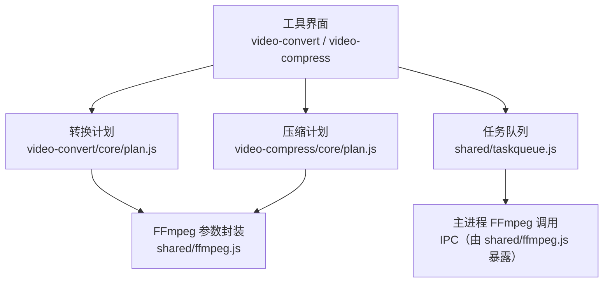
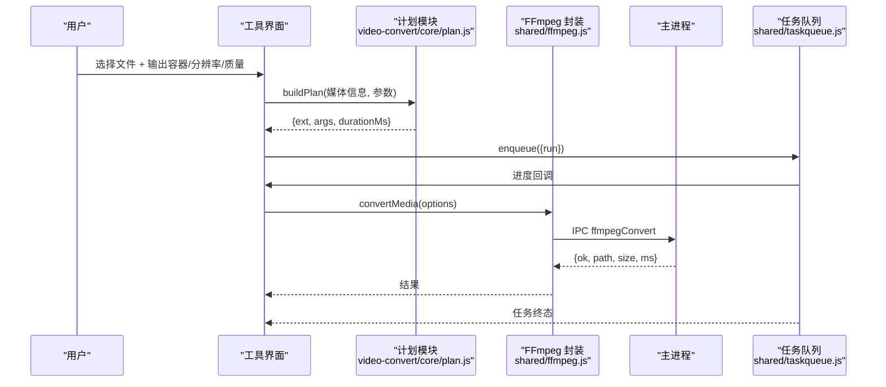
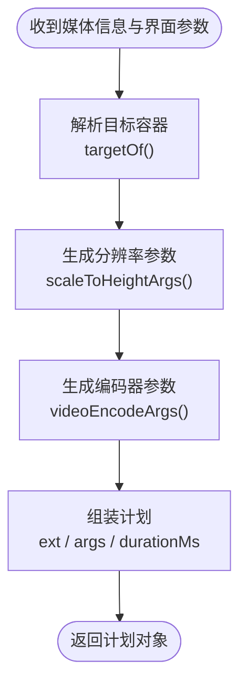
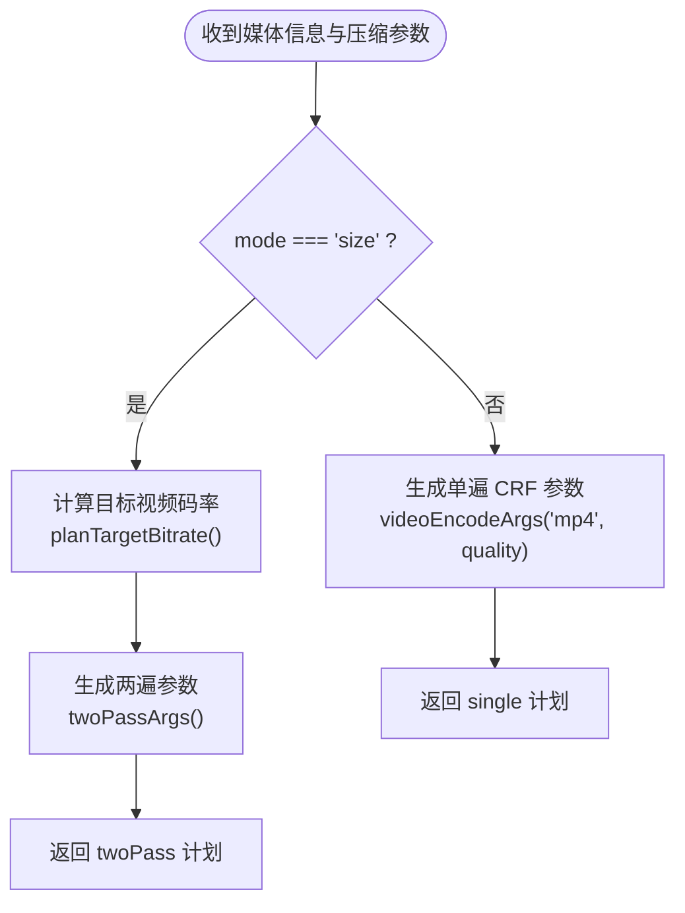
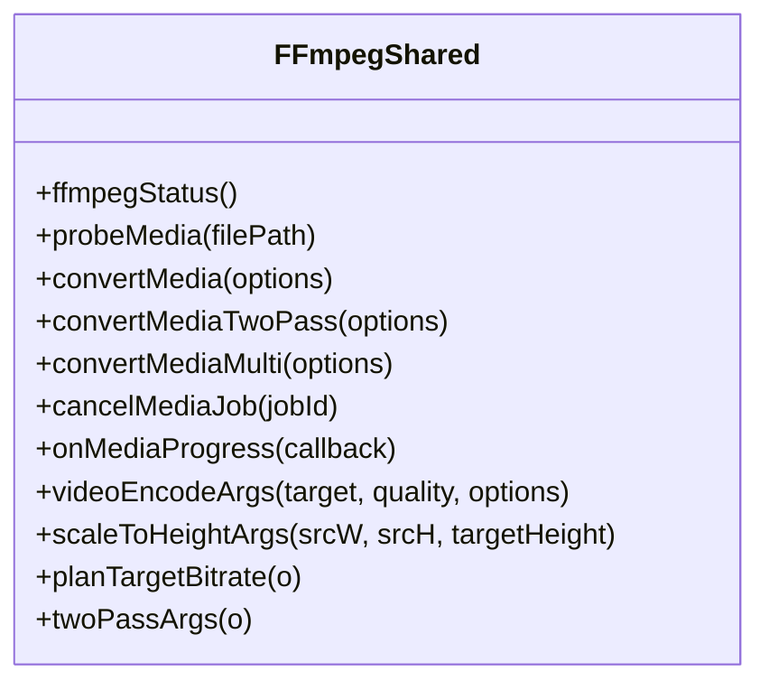
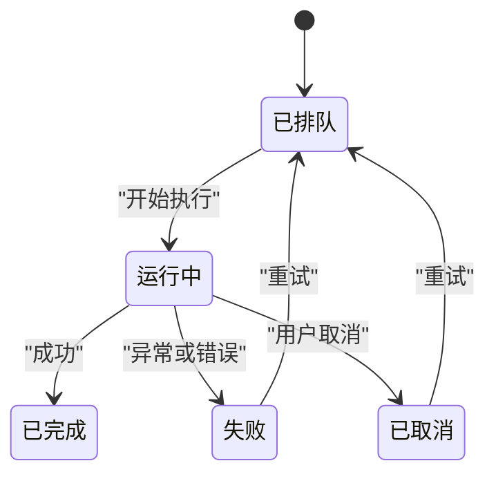
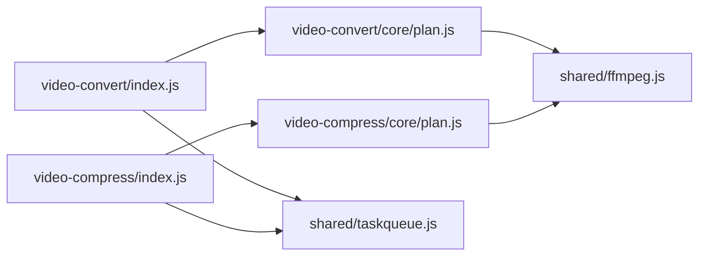

# 视频格式转换

<cite>
**本文引用的文件**   
- [video-convert/index.js](file://app/src/tools/video-convert/index.js)
- [video-convert/core/plan.js](file://app/src/tools/video-convert/core/plan.js)
- [video-compress/index.js](file://app/src/tools/video-compress/index.js)
- [video-compress/core/plan.js](file://app/src/tools/video-compress/core/plan.js)
- [ffmpeg.js](file://app/src/shared/ffmpeg.js)
- [taskqueue.js](file://app/src/shared/taskqueue.js)
- [video-convert.md](file://spec/modules/video-convert.md)
- [video-compress.md](file://spec/modules/video-compress.md)
</cite>

## 目录
1. [简介](#简介)
2. [项目结构](#项目结构)
3. [核心组件](#核心组件)
4. [架构总览](#架构总览)
5. [详细组件分析](#详细组件分析)
6. [依赖关系分析](#依赖关系分析)
7. [性能与质量优化](#性能与质量优化)
8. [故障排查指南](#故障排查指南)
9. [结论](#结论)

## 简介
本技术文档聚焦“视频格式转换”和“视频压缩”两个工具，说明其基于 FFmpeg 的转码架构、计划生成、参数配置和执行流程。内容涵盖：
- 支持的输入输出容器、编码器与质量档位；
- 分辨率、帧率、比特率、音频参数的调整方法；
- 批量转换的任务调度机制；
- 两遍编码与目标体积控制；
- 压缩比与画质的平衡策略；
- 常见问题定位与处理建议。

该实现将界面逻辑与核心业务解耦：界面只负责参数选择与展示，真正参数拼装统一委托给共享库 `shared/ffmpeg.js`，从而保证不同工具产出的 FFmpeg 参数一致。

**章节来源**
- [video-convert.md:1-45](file://spec/modules/video-convert.md#L1-L45)
- [video-compress.md:1-46](file://spec/modules/video-compress.md#L1-L46)

## 项目结构
围绕视频转码的核心代码分布在以下位置：
- 工具声明入口：`app/src/tools/video-convert/index.js`、`app/src/tools/video-compress/index.js`；
- 工具业务计划：`app/src/tools/video-convert/core/plan.js`、`app/src/tools/video-compress/core/plan.js`；
- 共享 FFmpeg 能力：`app/src/shared/ffmpeg.js`；
- 任务队列：`app/src/shared/taskqueue.js`；
- 模块规格说明：`spec/modules/video-convert.md`、`spec/modules/video-compress.md`。

**图表来源**
- [video-convert/index.js:1-14](file://app/src/tools/video-convert/index.js#L1-L14)
- [video-compress/index.js:1-14](file://app/src/tools/video-compress/index.js#L1-L14)
- [video-convert/core/plan.js:1-70](file://app/src/tools/video-convert/core/plan.js#L1-L70)
- [video-compress/core/plan.js:1-115](file://app/src/tools/video-compress/core/plan.js#L1-L115)
- [ffmpeg.js:1-399](file://app/src/shared/ffmpeg.js#L1-L399)
- [taskqueue.js:1-354](file://app/src/shared/taskqueue.js#L1-L354)

**章节来源**
- [video-convert/index.js:1-14](file://app/src/tools/video-convert/index.js#L1-L14)
- [video-compress/index.js:1-14](file://app/src/tools/video-compress/index.js#L1-L14)
- [video-convert/core/plan.js:1-70](file://app/src/tools/video-convert/core/plan.js#L1-L70)
- [video-compress/core/plan.js:1-115](file://app/src/tools/video-compress/core/plan.js#L1-L115)
- [ffmpeg.js:1-399](file://app/src/shared/ffmpeg.js#L1-L399)
- [taskqueue.js:1-354](file://app/src/shared/taskqueue.js#L1-L354)

## 核心组件
- 视频格式转换计划：根据用户选择的输出容器、分辨率档和质量档，生成 FFmpeg 单遍转码参数。
- 视频压缩计划：支持“画质档”单遍 CRF 编码与“目标体积”两遍 ABR 编码，并提供自动重跑降码率逻辑。
- FFmpeg 共享封装：统一提供媒体探测、转码、取消、进度订阅，以及各类编码器参数拼装函数。
- 任务队列：跨工具串行或并行调度任务，维护进度、失败、取消与重试状态。

关键职责边界：
- 工具 `index.js` 仅声明工具元数据并挂载界面；
- `core/plan.js` 只做“参数 → FFmpeg 参数”的纯函数映射；
- `shared/ffmpeg.js` 是真正的转码内核契约；
- `shared/taskqueue.js` 管理批量任务的执行顺序与生命周期。

**章节来源**
- [video-convert/core/plan.js:1-70](file://app/src/tools/video-convert/core/plan.js#L1-L70)
- [video-compress/core/plan.js:1-115](file://app/src/tools/video-compress/core/plan.js#L1-L115)
- [ffmpeg.js:1-399](file://app/src/shared/ffmpeg.js#L1-L399)
- [taskqueue.js:1-354](file://app/src/shared/taskqueue.js#L1-L354)

## 架构总览
下图展示一次典型批量转码从界面到 FFmpeg 的完整调用链。

**图表来源**
- [video-convert/core/plan.js:20-40](file://app/src/tools/video-convert/core/plan.js#L20-L40)
- [ffmpeg.js:18-45](file://app/src/shared/ffmpeg.js#L18-L45)
- [taskqueue.js:120-210](file://app/src/shared/taskqueue.js#L120-L210)

**章节来源**
- [video-convert/core/plan.js:20-40](file://app/src/tools/video-convert/core/plan.js#L20-L40)
- [ffmpeg.js:18-45](file://app/src/shared/ffmpeg.js#L18-L45)
- [taskqueue.js:120-210](file://app/src/shared/taskqueue.js#L120-L210)

## 详细组件分析

### 视频格式转换计划
`video-convert/core/plan.js` 负责把界面参数转换为 FFmpeg 参数，主要行为包括：
- 定义支持的输入扩展名；
- 根据目标容器查找默认输出；
- 生成单个文件的转码计划，组合缩放滤镜与编码器参数；
- 提供时长、文件大小、媒体信息的格式化辅助函数。

**图表来源**
- [video-convert/core/plan.js:12-40](file://app/src/tools/video-convert/core/plan.js#L12-L40)

关键点：
- 分辨率调整通过 `scaleToHeightArgs`，保持宽高比且只降不升，奇数边偶数化；
- 编码器参数统一来自 `videoEncodeArgs`，按输出容器选择 H.264/AAC、VP9/Opus、MPEG-4/MP3 等；
- 时长用于显示进度百分比，实际进度由 FFmpeg 子进程事件驱动。

**章节来源**
- [video-convert/core/plan.js:1-70](file://app/src/tools/video-convert/core/plan.js#L1-L70)

### 视频压缩计划
`video-compress/core/plan.js` 支持两种压缩模式：
- 画质档：单遍 CRF 编码，优先画质，体积顺其自然；
- 目标体积：两遍编码，先估算目标视频码率，再验证是否达标，必要时自动降码率重跑一次。

**图表来源**
- [video-compress/core/plan.js:17-55](file://app/src/tools/video-compress/core/plan.js#L17-L55)

补充逻辑：
- `verifyTarget`：判断产物大小是否在目标容差内（默认 5%）；
- `retryBitrate`：不达标时以 0.85 倍降码率，下限 50 kbps，最多重跑一次。

**章节来源**
- [video-compress/core/plan.js:1-115](file://app/src/tools/video-compress/core/plan.js#L1-L115)

### FFmpeg 共享封装
`shared/ffmpeg.js` 是转码能力的统一入口，对外暴露：
- 探测媒体信息；
- 单文件转码；
- 两遍编码转码；
- 多输入转码；
- 取消任务；
- 进度订阅；
- 编码器参数拼装函数。

**图表来源**
- [ffmpeg.js:1-399](file://app/src/shared/ffmpeg.js#L1-L399)

重要设计点：
- 所有工具共用同一份编码器参数函数，避免不同工具产出不一致；
- 进度与取消通过主进程 IPC 完成，界面侧只负责参数与状态展示；
- 目标体积模式的码率反推与两遍参数封装集中在此，便于测试与维护。

**章节来源**
- [ffmpeg.js:1-399](file://app/src/shared/ffmpeg.js#L1-L399)

### 任务队列
`shared/taskqueue.js` 提供跨工具的批量任务调度，核心特性：
- 通道并发：CPU 通道默认并发为 1，IO 通道默认并发为 2；
- 任务状态：queued、running、done、failed、canceled；
- 批量入队与等待全部结束；
- 取消当前任务或全部未完成任务；
- 清理已结束任务，保留最近完成记录；
- 失败或取消后可手动重试。

**图表来源**
- [taskqueue.js:1-354](file://app/src/shared/taskqueue.js#L1-L354)

对视频转码的意义：
- 视频转码属于 CPU 密集任务，默认串行执行，避免同时吃满多个 CPU 通道导致卡顿；
- 任务归属队列而非工具页，防止页面切换被 LRU 回收后任务中断；
- 进度通过 `report` 回调更新，最终汇总总进度百分比。

**章节来源**
- [taskqueue.js:1-354](file://app/src/shared/taskqueue.js#L1-L354)

## 依赖关系分析
视频转码相关模块之间的依赖方向如下：

**图表来源**
- [video-convert/index.js:1-14](file://app/src/tools/video-convert/index.js#L1-L14)
- [video-compress/index.js:1-14](file://app/src/tools/video-compress/index.js#L1-L14)
- [video-convert/core/plan.js:1-70](file://app/src/tools/video-convert/core/plan.js#L1-L70)
- [video-compress/core/plan.js:1-115](file://app/src/tools/video-compress/core/plan.js#L1-L115)
- [ffmpeg.js:1-399](file://app/src/shared/ffmpeg.js#L1-L399)
- [taskqueue.js:1-354](file://app/src/shared/taskqueue.js#L1-L354)

耦合与内聚：
- 工具声明文件高度内聚，仅负责挂载 UI；
- 计划层纯函数化，低耦合、高可测；
- FFmpeg 共享封装集中了编码器、容器、质量、分辨率等规则，提升一致性；
- 任务队列独立于工具，降低重复实现成本。

潜在风险：
- 若新增输出容器或编码器，需同步更新 `VIDEO_TARGETS`、`videoEncodeArgs` 及规格文档；
- 目标体积模式依赖 `planTargetBitrate` 与 `twoPassArgs` 的数学假设，修改时需回归测试。

**章节来源**
- [video-convert/index.js:1-14](file://app/src/tools/video-convert/index.js#L1-L14)
- [video-compress/index.js:1-14](file://app/src/tools/video-compress/index.js#L1-L14)
- [video-convert/core/plan.js:1-70](file://app/src/tools/video-convert/core/plan.js#L1-L70)
- [video-compress/core/plan.js:1-115](file://app/src/tools/video-compress/core/plan.js#L1-L115)
- [ffmpeg.js:1-399](file://app/src/shared/ffmpeg.js#L1-L399)
- [taskqueue.js:1-354](file://app/src/shared/taskqueue.js#L1-L354)

## 性能与质量优化

### 输入输出格式与编码器
- 视频格式转换支持 MP4、WebM、MKV、MOV、AVI 等主流容器；
- 默认推荐 MP4（H.264 + AAC），兼容性最好；
- WebM 使用 VP9 + Opus，适合网页与体积优先场景；
- MKV 适合归档与多轨容器；
- MOV 适合苹果设备与剪辑软件；
- AVI 使用 MPEG-4 + MP3，面向老设备与老软件。

**章节来源**
- [video-convert.md:10-22](file://spec/modules/video-convert.md#L10-L22)
- [ffmpeg.js:250-290](file://app/src/shared/ffmpeg.js#L250-L290)

### 分辨率与帧率
- 分辨率档位包括保持原样、2160p、1080p、720p、480p、360p；
- 缩放策略是等比缩放、只降不升；
- 输出像素格式统一考虑 yuv420p 要求，奇数边偶数化；
- 帧率在部分动图/视频转换路径中会显式设置，常规视频转码保持原片帧率。

**章节来源**
- [ffmpeg.js:100-170](file://app/src/shared/ffmpeg.js#L100-L170)
- [video-convert.md:14-19](file://spec/modules/video-convert.md#L14-L19)

### 质量与比特率
- 质量档位分为高质量、标准、小体积；
- 视频 CRF 值随质量变化，音频码率也随质量档位变化；
- 目标体积模式通过 `planTargetBitrate` 反推视频码率，预留音频占用与约 3% 封装余量；
- 目标体积模式固定输出 MP4（H.264 + AAC），并使用 `-movflags +faststart` 优化流式播放。

**章节来源**
- [ffmpeg.js:70-95](file://app/src/shared/ffmpeg.js#L70-L95)
- [ffmpeg.js:320-370](file://app/src/shared/ffmpeg.js#L320-L370)
- [video-compress.md:14-24](file://spec/modules/video-compress.md#L14-L24)

### 批量转换与任务调度
- 批量导入后，每个文件作为一个任务进入队列；
- CPU 通道默认串行执行，避免多个 FFmpeg 实例争抢 CPU；
- 每个任务有独立进度、步骤文本、起止时间、输出路径；
- 失败或取消的任务可手动重试，避免静默丢失工作。

**章节来源**
- [taskqueue.js:1-354](file://app/src/shared/taskqueue.js#L1-L354)

### 压缩比与画质平衡策略
- 如果追求通用性与兼容性，优先选 MP4 + 标准质量；
- 如果追求更小体积，可选 WebM 或小体积档位；
- 如果目标是发送微信或邮件，优先使用视频压缩的目标体积模式；
- 长视频建议先用“标准”质量压一遍，再观察体积与画质，必要时切换到“小体积”或提高分辨率档位；
- 目标体积不是绝对保证，复杂画面可能偏差更大，应接受 ±5% 容差。

**章节来源**
- [video-compress.md:24-36](file://spec/modules/video-compress.md#L24-L36)
- [video-convert.md:20-33](file://spec/modules/video-convert.md#L20-L33)

## 故障排查指南

### 未检测到 FFmpeg
- 现象：工具提示未检测到 FFmpeg，或无法启动转码；
- 原因：加装包缺失或系统 FFmpeg 不可用；
- 处理：按提示放置 FFmpeg 静态构建包，确保主进程能探测到；
- 依据：规格文档明确 FFmpeg 作为加装包分发，并在开发环境给出放置说明。

**章节来源**
- [video-convert.md:34-45](file://spec/modules/video-convert.md#L34-L45)

### 格式不兼容
- 现象：某些扩展名无法识别或转码失败；
- 原因：容器或 demuxer 不在支持清单中；
- 处理：使用常见容器 MP4/MKV/WebM/MOV/AVI；如需老格式，确认扩展名在 VIDEO_EXTS 中；
- 依据：video-convert 的 VIDEO_EXTS 明确列出支持扩展名，并与主进程文件对话框筛选保持一致。

**章节来源**
- [video-convert/core/plan.js:10-18](file://app/src/tools/video-convert/core/plan.js#L10-L18)

### 编码失败或参数非法
- 现象：FFmpeg 退出码异常、参数报错；
- 原因：分辨率非偶数、像素格式不支持、编码器不存在；
- 处理：检查是否使用 `scaleToHeightArgs` 与 `videoEncodeArgs`，避免手写参数；确认 FFmpeg 版本与编码器支持；
- 依据：shared/ffmpeg.js 统一封装编码器参数，避免各工具各自实现导致不一致。

**章节来源**
- [ffmpeg.js:100-170](file://app/src/shared/ffmpeg.js#L100-L170)
- [ffmpeg.js:250-330](file://app/src/shared/ffmpeg.js#L250-L330)

### 音质损失
- 现象：音频音量变小、音质变差；
- 原因：质量档位降低、音频码率下降、去掉声音；
- 处理：选择“高质量”档位，或避免勾选“去掉声音”；目标体积模式下音频码率越低，留给视频的码率越多，但整体音质会下降；
- 依据：quality presets 与 compress audio kbps 配置直接影响音频编码。

**章节来源**
- [ffmpeg.js:70-95](file://app/src/shared/ffmpeg.js#L70-L95)
- [ffmpeg.js:320-340](file://app/src/shared/ffmpeg.js#L320-L340)

### 目标体积不达标
- 现象：压缩后文件仍大于目标 MB；
- 原因：目标体积是估计值，受内容复杂度影响；
- 处理：工具会自动降码率重跑一次；若仍不达标，可降低目标体积档位或选择更低质量；
- 依据：verifyTarget 与 retryBitrate 提供了 5% 容差与 0.85 倍降码率重跑逻辑。

**章节来源**
- [video-compress/core/plan.js:57-85](file://app/src/tools/video-compress/core/plan.js#L57-L85)
- [video-compress.md:24-36](file://spec/modules/video-compress.md#L24-L36)

### 任务被意外取消
- 现象：切换工具后任务停止；
- 原因：旧实现可能在 unmount 时取消任务；
- 处理：使用 taskqueue 管理的任务，任务归属队列，工具 unmount 不会取消正在运行的任务；
- 依据：taskqueue 明确硬契约：入队后的任务归属队列，不归属工具页。

**章节来源**
- [taskqueue.js:1-40](file://app/src/shared/taskqueue.js#L1-L40)
- [taskqueue.js:210-270](file://app/src/shared/taskqueue.js#L210-L270)

### 进度显示异常
- 现象：进度不更新或百分比不合理；
- 原因：FFmpeg 进度事件未上报，或任务已进入终态后仍有迟到进度；
- 处理：检查 onMediaProgress 回调是否正常注册；确认任务状态；
- 依据：taskqueue 的 report 会在任务 running 时更新进度，终态后迟到进度会被丢弃。

**章节来源**
- [taskqueue.js:140-190](file://app/src/shared/taskqueue.js#L140-L190)
- [ffmpeg.js:45-65](file://app/src/shared/ffmpeg.js#L45-L65)

## 结论
视频格式转换与视频压缩工具通过“界面 → 计划 → 共享 FFmpeg 封装 → 主进程 → FFmpeg”的分层架构，实现了稳定、可复用、可测试的转码能力。其关键优势在于：
- 编码器与容器参数集中在 `shared/ffmpeg.js`，保证一致性；
- 计划层纯函数化，易于单测与扩展；
- 任务队列提供跨工具统一的批量调度、进度与取消语义；
- 目标体积模式采用两遍编码与自动降码率重跑，提升体积控制稳定性。

在实际使用中，建议优先选择 MP4 + 标准质量作为默认方案；需要更小体积时使用视频压缩的目标体积模式；遇到兼容性或质量问题时，优先检查 FFmpeg 安装、编码器支持与质量/码率配置。