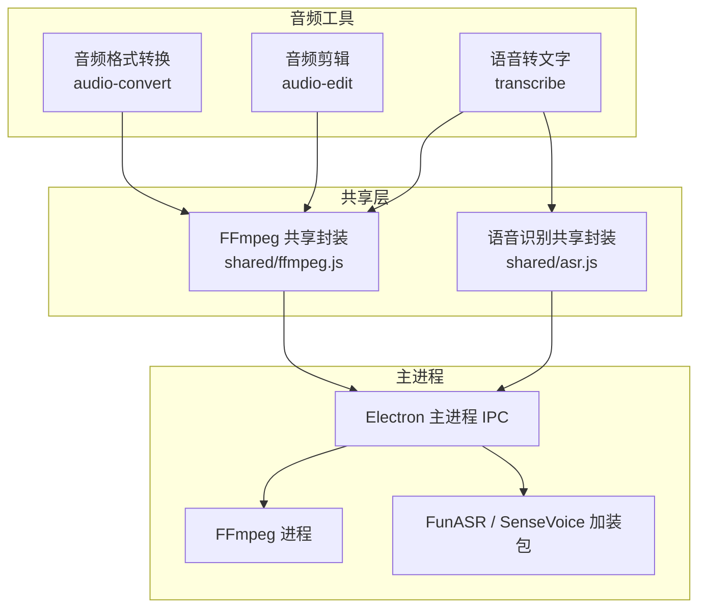
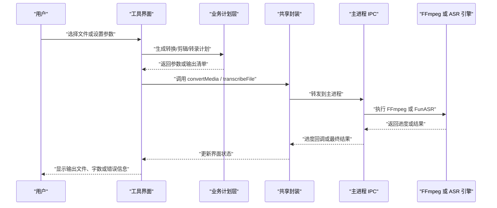
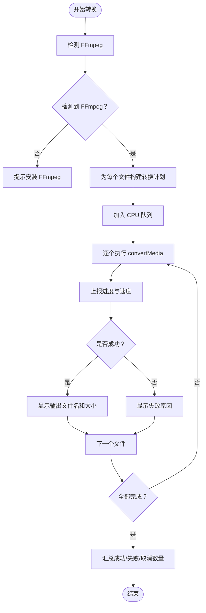
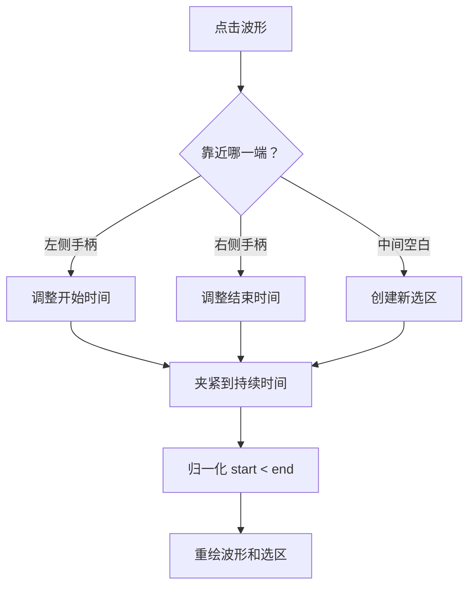
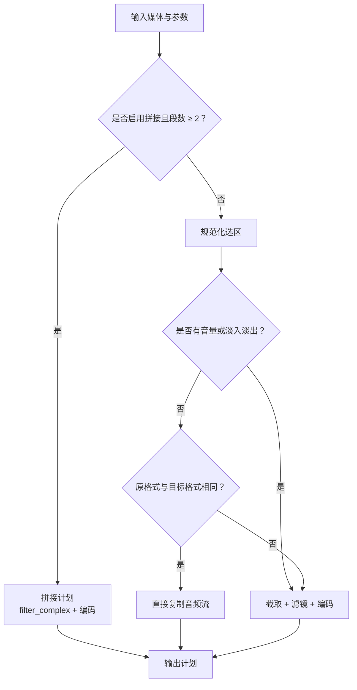
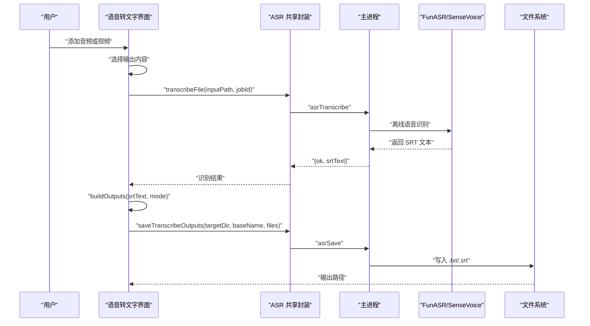
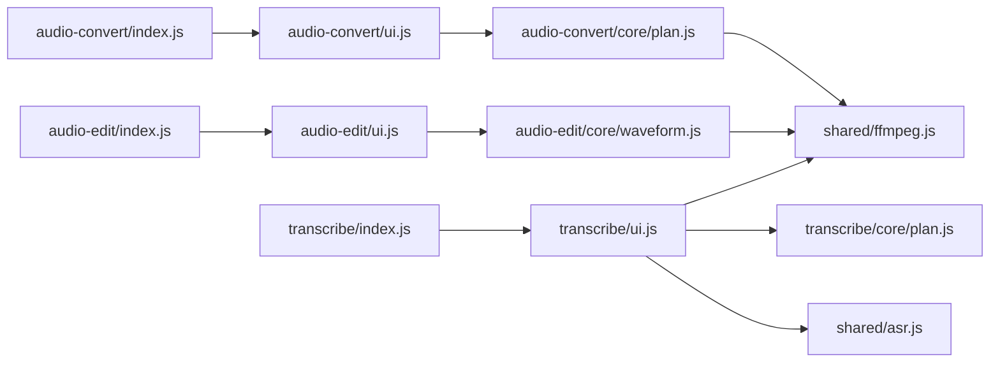

# 音频处理工具

<cite>
**本文引用的文件**   
- [音频格式转换入口](file://app/src/tools/audio-convert/index.js)
- [音频格式转换界面](file://app/src/tools/audio-convert/ui.js)
- [音频格式转换计划逻辑](file://app/src/tools/audio-convert/core/plan.js)
- [音频剪辑入口](file://app/src/tools/audio-edit/index.js)
- [音频剪辑界面](file://app/src/tools/audio-edit/ui.js)
- [音频剪辑波形与编辑计划](file://app/src/tools/audio-edit/core/waveform.js)
- [语音转文字入口](file://app/src/tools/transcribe/index.js)
- [语音转文字界面](file://app/src/tools/transcribe/ui.js)
- [语音转文字计划逻辑](file://app/src/tools/transcribe/core/plan.js)
- [语音识别共享封装](file://app/src/shared/asr.js)
- [FFmpeg 共享封装](file://app/src/shared/ffmpeg.js)
- [音频工具测试](file://app/tests/audio-test.js)
- [语音识别工具测试](file://app/tests/asr-test.js)
</cite>

## 目录

1. [引言](#引言)
2. [项目结构](#项目结构)
3. [核心组件](#核心组件)
4. [架构总览](#架构总览)
5. [详细组件分析](#详细组件分析)
6. [依赖关系分析](#依赖关系分析)
7. [性能与最佳实践](#性能与最佳实践)
8. [故障排查](#故障排查)
9. [结论](#结论)

## 引言

本仓库包含三个面向音频处理的工具：

- **音频格式转换**：把音频或视频转换为多种音频容器和编码，支持批量任务、进度显示、标签保留和视频自动取音轨。
- **音频剪辑编辑**：提供波形可视化、选区拖动、精确起止时间输入、音量调节、淡入淡出以及多段拼接。
- **语音转文字**：调用本地离线语音识别引擎，输出纯文本或 SRT 字幕，支持音频与视频输入。

所有工具都遵循“界面层 + 业务计划层 + 共享底层”的分层设计：界面只负责用户交互；`core/plan.js` 或 `core/waveform.js` 负责把参数翻译成 FFmpeg 或 ASR 参数；真正的进程调用通过 `shared/ffmpeg.js` 与 `shared/asr.js` 委托给主进程。

## 项目结构

音频相关代码集中在 `app/src/tools` 下，每个工具一个目录，通常包含：

| 层级 | 典型文件 | 职责 |
|---|---|---|
| 工具声明 | `index.js` | 注册工具 ID、名称、图标、分组、样式和挂载函数 |
| 界面与流程 | `ui.js` | 渲染 UI、处理拖拽、添加文件、启动任务、更新进度 |
| 业务计划 | `core/plan.js` 或 `core/waveform.js` | 把用户选择转为 FFmpeg 参数、SRT 输出清单、波形计算等纯函数 |
| 共享能力 | `shared/ffmpeg.js`、`shared/asr.js` | 封装 FFmpeg 状态探测、转码、语音识别、取消与进度订阅 |

**图示来源**
- [音频格式转换入口:1-14](file://app/src/tools/audio-convert/index.js#L1-L14)
- [音频剪辑入口:1-14](file://app/src/tools/audio-edit/index.js#L1-L14)
- [语音转文字入口:1-14](file://app/src/tools/transcribe/index.js#L1-L14)
- [FFmpeg 共享封装:1-100](file://app/src/shared/ffmpeg.js#L1-L100)
- [语音识别共享封装:1-37](file://app/src/shared/asr.js#L1-L37)

**章节来源**
- [音频格式转换入口:1-14](file://app/src/tools/audio-convert/index.js#L1-L14)
- [音频剪辑入口:1-14](file://app/src/tools/audio-edit/index.js#L1-L14)
- [语音转文字入口:1-14](file://app/src/tools/transcribe/index.js#L1-L14)

## 核心组件

### 音频格式转换

音频格式转换用于把音频或视频批量转为目标音频格式。它由三个部分组成：

| 文件 | 作用 |
|---|---|
| `audio-convert/index.js` | 声明工具为“音频格式转换”，分组为 `audio`，加载对应样式并挂载 UI |
| `audio-convert/ui.js` | 输出格式下拉、音质下拉、文件列表、拖拽添加、开始转换、进度与取消 |
| `audio-convert/core/plan.js` | 维护支持的输入扩展名、输出格式目标、`buildPlan` 计划生成、时长/大小/声道格式化 |

关键特性：

- 支持常见音频输入（MP3、WAV、FLAC、M4A、AAC、OGG、Opus、WMA 等）和视频输入（MP4、MKV、MOV、AVI、WebM 等）。
- 视频输入自动加 `-vn` 提取音轨。
- MP3 输出默认带 `-id3v2_version 3`，提升老设备与资源管理器对标题、歌手等标签的兼容性。
- 所有音频编码参数统一来自 `shared/ffmpeg.js` 的 `audioEncodeArgs`，避免不同工具产生不一致参数。

**章节来源**
- [音频格式转换入口:1-14](file://app/src/tools/audio-convert/index.js#L1-L14)
- [音频格式转换计划逻辑:1-108](file://app/src/tools/audio-convert/core/plan.js#L1-L108)
- [音频格式转换界面:1-528](file://app/src/tools/audio-convert/ui.js#L1-L528)

### 音频剪辑编辑

音频剪辑工具比格式转换更复杂：它不仅需要转码，还要做波形预览、选区编辑、音量调节、淡入淡出和多段拼接。

| 文件 | 作用 |
|---|---|
| `audio-edit/index.js` | 声明工具为“音频剪辑”，分组为 `audio` |
| `audio-edit/ui.js` | 输出格式、音质、音量、淡入淡出、拼接开关、波形画布、起止时间框、运行与取消 |
| `audio-edit/core/waveform.js` | WAV 解析、峰值计算、像素与毫秒换算、选区合法化、剪辑计划生成、体积估算 |

关键特性：

- 波形通过 FFmpeg 把源文件降采样为 8kHz 单声道 PCM WAV，再在界面解析并分桶取峰值绘制。
- 支持鼠标在波形上拖动创建选区、拖动两端手柄调整起止点。
- 支持精确时间输入（毫秒精度），并对非法选区进行归一化。
- 支持增益、标准化响度、淡入、淡出等音频滤镜。
- 当仅截取且无滤镜、且原格式与目标格式一致时，走“直接复制音频流”路径，几乎瞬间完成。
- 多段拼接使用 concat 滤镜重编码，容忍采样率或声道不一致。

**章节来源**
- [音频剪辑入口:1-14](file://app/src/tools/audio-edit/index.js#L1-L14)
- [音频剪辑波形与编辑计划:1-397](file://app/src/tools/audio-edit/core/waveform.js#L1-L397)
- [音频剪辑界面:1-1018](file://app/src/tools/audio-edit/ui.js#L1-L1018)

### 语音转文字

语音转文字工具面向“音频或视频 → 文本/字幕”的场景，使用本地离线语音识别引擎，不依赖联网服务。

| 文件 | 作用 |
|---|---|
| `transcribe/index.js` | 声明工具为“语音转文字”，分组为 `audio` |
| `transcribe/ui.js` | 输出模式下拉、文件列表、检测 ASR 与 FFmpeg 状态、批量识别、进度与取消 |
| `transcribe/core/plan.js` | 输入扩展名、输出模式、SRT→纯文本推导、SRT 合法性检查、输出清单生成 |
| `shared/asr.js` | 统一封装 `asrStatus`、`transcribeFile`、`saveTranscribeOutputs`、`cancelTranscribe`、`onTranscribeProgress` |

关键特性：

- 前端只负责参数拼装和结果展示；实际识别与文件写入由主进程 IPC 完成。
- 支持输出纯文本、SRT 字幕或两者同时输出。
- 内置 SRT→文本解析器，去掉序号和时间戳行，按段落换行。
- 内置 SRT 合法性校验，可用于自检或异常提示。
- 识别失败不会覆盖已有文件；保存时使用“重名自动加序号”的策略。

**章节来源**
- [语音转文字入口:1-14](file://app/src/tools/transcribe/index.js#L1-L14)
- [语音转文字计划逻辑:1-112](file://app/src/tools/transcribe/core/plan.js#L1-L112)
- [语音转文字界面:1-485](file://app/src/tools/transcribe/ui.js#L1-L485)
- [语音识别共享封装:1-37](file://app/src/shared/asr.js#L1-L37)

## 架构总览

三个工具共享相同的调用路径：**界面 → 业务计划 → 共享封装 → 主进程 IPC → 外部工具**。

**图示来源**
- [音频格式转换界面:200-528](file://app/src/tools/audio-convert/ui.js#L200-L528)
- [音频剪辑界面:200-629](file://app/src/tools/audio-edit/ui.js#L200-L629)
- [语音转文字界面:200-485](file://app/src/tools/transcribe/ui.js#L200-L485)
- [FFmpeg 共享封装:1-100](file://app/src/shared/ffmpeg.js#L1-L100)
- [语音识别共享封装:1-37](file://app/src/shared/asr.js#L1-L37)

## 详细组件分析

### 音频格式转换

#### 支持的输入格式

音频格式转换接受两类输入：

1. **音频格式**：包括 MP3、WAV、FLAC、M4A、AAC、OGG、Opus、WMA、AMR、AIFF、APE、DSF、MPC、TAK、WavPack、TTA、AC3、EAC3、MP2、Speex、CAF、AU、W64、RealAudio 等。
2. **视频格式**：包括 MP4、MOV、MKV、AVI、WebM、FLV、WMV、M4V、TS、3GP、MPEG、VOB、RMVB、OGV、ASF、3G2、F4V、MTS、M2TS 等。

视频输入会自动加上 `-vn`，只提取音轨而不处理视频画面。

#### 支持的输出格式与质量

输出格式分为“常用”和“更多”两组，由 `AUDIO_TARGETS` 管理。其中无损格式包括 WAV、FLAC、ALAC、AIFF、CAF、WavPack、TTA、AU、W64 等；有损格式包括 MP3、M4A、OGG、Opus、WMA、AMR、AAC、AC3、EAC3、MP2、Speex、AU、W64、RealAudio 等。

音质档位为：

| 档位 | 说明 |
|---|---|
| 高品质 | 适合追求较高音质的场景，如 MP3 320k、AAC 256k、Opus 192k |
| 标准 | 平衡音质与体积，如 MP3 192k、AAC 192k、Opus 96k |
| 省空间 | 适合小体积优先，如 MP3 128k、AAC 128k、Opus 64k |

无损格式不需要选择音质，界面会禁用音质下拉并给出提示。

#### 编码参数映射

`audioEncodeArgs` 根据目标格式选择不同的编码器：

| 目标 | 编码器或编码方式 | 特殊行为 |
|---|---|---|
| MP3 | libmp3lame | 使用音质档中的比特率 |
| M4A | AAC | 使用音质档中的比特率 |
| WAV | PCM 16-bit | 无损，忽略音质档 |
| FLAC | FLAC | 固定压缩级别 |
| OGG | Vorbis | 使用音质档中的质量值 |
| Opus | libopus | 使用音质档中的比特率 |
| WMA | wmav2 | 使用音质档中的比特率 |
| AMR | libopencore_amrnb | 强制 8kHz 单声道、固定 12.2k |
| AAC 裸流 | AAC | 使用音质档中的比特率 |
| ALAC | alac | 苹果无损 |
| AIFF | PCM 大端 | 无损 |
| CAF | ALAC | 苹果容器无损 |
| WavPack | wavpack | 无损 |
| TTA | tta | 无损 |
| AC3/EAC3 | AC3/EAC3 | 使用音质档中的比特率 |
| MP2 | mp2 | 统一重采样到 44.1kHz，避免低采样率下码率限制 |
| Speex | speex | 使用音质档中的质量值 |
| AU | PCM 大端 | 无损 |
| W64 | PCM 16-bit | 无损 |
| RealAudio | real_144 | 老式 RealMedia 容器 |

#### 批量转换流程

**图示来源**
- [音频格式转换界面:200-528](file://app/src/tools/audio-convert/ui.js#L200-L528)

**章节来源**
- [音频格式转换计划逻辑:1-108](file://app/src/tools/audio-convert/core/plan.js#L1-L108)
- [音频格式转换界面:1-528](file://app/src/tools/audio-convert/ui.js#L1-L528)
- [FFmpeg 共享封装:200-399](file://app/src/shared/ffmpeg.js#L200-L399)

### 音频剪辑编辑

#### 波形可视化

波形生成采用“先降采样、再解析、再分桶”的策略：

1. 通过 `transformFileToBytes` 让主进程用 FFmpeg 将源文件解码为 8kHz 单声道 WAV。
2. 界面解析 16-bit PCM WAV 头，读取数据块。
3. 多声道平均混音为单声道。
4. 将采样点分成固定数量的桶，每桶取绝对值峰值。
5. 使用 Canvas 绘制波形，并根据选区高亮区间。

这种方式避免把 GB 级音频读进界面内存，同时保证波形图在不同窗口宽度下观感稳定。

#### 剪辑区域选择

剪辑区域支持三种操作：

- 在波形空白处按住拖动：新建选区。
- 拖动左端手柄：调整开始时间。
- 拖动右端手柄：调整结束时间。

同时提供起止时间输入框，支持毫秒精度。`normalizeSelection` 会把非法选区归一化为有效区间，例如结束时间小于开始时间时退回“从开始到结尾”。

**图示来源**
- [音频剪辑界面:200-629](file://app/src/tools/audio-edit/ui.js#L200-L629)
- [音频剪辑波形与编辑计划:1-397](file://app/src/tools/audio-edit/core/waveform.js#L1-L397)

#### 音频效果处理

音频效果通过 FFmpeg 音频滤镜链实现：

| 效果 | 处理方式 |
|---|---|
| 音量增益 | `volume=...dB` |
| 音量标准化 | `loudnorm=I=-16:TP=-1.5:LRA=11`，统一到约 -16 LUFS |
| 淡入 | `afade=t=in:st=0:d=...` |
| 淡出 | `afade=t=out:st=...:d=...`，起点为总时长减去淡出时长 |
| 多段拼接 | `concat=n=段数:v=0:a=1`，重编码以兼容采样率和声道差异 |

#### 剪辑计划与极速复制

`buildEditPlan` 会根据参数判断走哪种路径：

| 条件 | 路径 |
|---|---|
| 拼接两个及以上文件 | 多输入拼接，走 `convertMediaMulti` |
| 仅截取、无滤镜、原格式等于目标格式 | 直接复制音频流，几乎瞬间完成 |
| 其他情况 | 截取 + 滤镜 + 编码，走普通 `convertMedia` |

**图示来源**
- [音频剪辑波形与编辑计划:200-397](file://app/src/tools/audio-edit/core/waveform.js#L200-L397)

**章节来源**
- [音频剪辑波形与编辑计划:1-397](file://app/src/tools/audio-edit/core/waveform.js#L1-L397)
- [音频剪辑界面:1-1018](file://app/src/tools/audio-edit/ui.js#L1-L1018)
- [FFmpeg 共享封装:200-399](file://app/src/shared/ffmpeg.js#L200-L399)

### 语音转文字

#### ASR 集成

语音转文字的前端不直接调用模型，而是通过 `shared/asr.js` 调用主进程的 IPC：

| 方法 | 用途 |
|---|---|
| `asrStatus()` | 检测 ASR 加装包和 FFmpeg 是否存在 |
| `transcribeFile({ inputPath, jobId })` | 识别单个音频或视频 |
| `saveTranscribeOutputs({ targetDir, baseName, files })` | 保存 `.txt` 或 `.srt` |
| `cancelTranscribe(jobId)` | 取消正在进行的识别任务 |
| `onTranscribeProgress(callback)` | 订阅识别进度 |

界面检测到缺少 ASR 加装包时会提示“未检测到语音识别加装包”，缺少 FFmpeg 时会提示需要 FFmpeg 进行音频预处理。

#### 语言支持与转录精度优化

从代码层面可见：

- 前端没有暴露“语言选择”下拉，因此语言策略由主进程和 ASR 加装包决定。
- 界面文案明确标注“FunASR · SenseVoice，纯离线运行，不联网”。
- 测试脚本通过 Windows SAPI 合成中文语音来验证关键词命中，说明官方测试重点覆盖中文识别。
- 前端只做 SRT→文本推导和输出模式控制；模型权重、VAD、分词和语言配置位于主进程及 `addons/asr` 中，不在当前前端源码里。

因此，关于具体支持哪些语言、如何切换语言、如何调优模型精度，应以 ASR 加装包的文档为准；本工具提供的能力是：

- 输入音频或视频。
- 输出纯文本、字幕或两者。
- 本地离线识别。
- 可取消任务、可订阅进度。

#### 转录流程

**图示来源**
- [语音转文字界面:200-485](file://app/src/tools/transcribe/ui.js#L200-L485)
- [语音识别共享封装:1-37](file://app/src/shared/asr.js#L1-L37)
- [语音转文字计划逻辑:1-112](file://app/src/tools/transcribe/core/plan.js#L1-L112)

**章节来源**
- [语音转文字界面:1-485](file://app/src/tools/transcribe/ui.js#L1-L485)
- [语音转文字计划逻辑:1-112](file://app/src/tools/transcribe/core/plan.js#L1-L112)
- [语音识别共享封装:1-37](file://app/src/shared/asr.js#L1-L37)

## 依赖关系分析

**图示来源**
- [音频格式转换入口:1-14](file://app/src/tools/audio-convert/index.js#L1-L14)
- [音频格式转换界面:1-200](file://app/src/tools/audio-convert/ui.js#L1-L200)
- [音频格式转换计划逻辑:1-108](file://app/src/tools/audio-convert/core/plan.js#L1-L108)
- [音频剪辑入口:1-14](file://app/src/tools/audio-edit/index.js#L1-L14)
- [音频剪辑界面:1-200](file://app/src/tools/audio-edit/ui.js#L1-L200)
- [音频剪辑波形与编辑计划:1-200](file://app/src/tools/audio-edit/core/waveform.js#L1-L200)
- [语音转文字入口:1-14](file://app/src/tools/transcribe/index.js#L1-L14)
- [语音转文字界面:1-200](file://app/src/tools/transcribe/ui.js#L1-L200)
- [语音转文字计划逻辑:1-112](file://app/src/tools/transcribe/core/plan.js#L1-L112)
- [语音识别共享封装:1-37](file://app/src/shared/asr.js#L1-L37)
- [FFmpeg 共享封装:1-100](file://app/src/shared/ffmpeg.js#L1-L100)

**章节来源**
- [音频格式转换界面:1-200](file://app/src/tools/audio-convert/ui.js#L1-L200)
- [音频剪辑界面:1-200](file://app/src/tools/audio-edit/ui.js#L1-L200)
- [语音转文字界面:1-200](file://app/src/tools/transcribe/ui.js#L1-L200)

## 性能与最佳实践

### FFmpeg 集成方式

三个工具都依赖 FFmpeg，但职责不同：

- **音频格式转换**：主要使用 `convertMedia` 进行“文件到文件”转码。
- **音频剪辑**：可能使用 `convertMedia`、`convertMediaMulti`、`transformFileToBytes`，分别对应单文件转码、多段拼接、从文件中提取小片段。
- **语音转文字**：ASR 主流程通过 `shared/asr.js`，但音频预处理仍需 FFmpeg，因此 ASR 就绪状态也检查 FFmpeg。

共享层暴露的关键函数：

| 函数 | 用途 |
|---|---|
| `ffmpegStatus()` | 检测 FFmpeg 是否存在、来自加装包还是系统 PATH |
| `probeMedia()` | 获取时长、分辨率、是否有音频、编码器等元信息 |
| `convertMedia()` | 单输入转码 |
| `convertMediaTwoPass()` | 两遍编码，主要用于视频目标体积模式 |
| `convertMediaMulti()` | 多输入转码，音频剪辑拼接使用 |
| `transformImageBytes()` | 图片字节转码 |
| `transformFileToBytes()` | 从源文件路径提取少量产物，避免读满整个文件 |
| `cancelMediaJob()` | 取消 FFmpeg 任务 |
| `onMediaProgress()` | 订阅转码进度 |

### 音频格式转换最佳实践

- 如果只需要通用兼容性，优先选 MP3。
- 如果需要在苹果生态中获得良好兼容性，可选 M4A。
- 如果需要归档或后期处理，可选 FLAC、WAV、ALAC、AIFF、CAF、WavPack、TTA 等无损格式。
- 如果重视体积小，可选 Opus、AAC 或较低档位的 MP3。
- 视频转音频时，工具会自动提取音轨，无需手动去视频。
- 批量转换时，任务进入 CPU 队列串行执行，避免多个 FFmpeg 进程争抢资源。

### 音频剪辑最佳实践

- 如果只是裁剪一段且输出格式与原格式相同，尽量不使用音量或淡入淡出，这样会走“直接复制音频流”路径。
- 如果需要对多段音频合并，勾选“拼接列表”，并注意拼接模式下“截取、淡入淡出、音量”只对单个文件生效，不应用于拼接结果。
- 长音频波形生成可能较慢，界面会对超过 30 分钟的音频给出提示；如果波形无法生成，仍可通过时间框精确截取。
- 使用“音量标准化”可以统一响度，适合社交平台或跨设备播放。

### 语音转文字最佳实践

- 确保 `addons/asr` 和 `addons/ffmpeg` 都已正确放置。
- 如果只需文本，选择“纯文本”；如果需要带时间戳的字幕，选择“字幕”或“文本 + 字幕”。
- 输入视频时，工具会先提取音轨再识别。
- 识别过程可取消；取消后不会留下未完成产物。
- 多语言支持和精度优化应参考 ASR 加装包的说明，因为前端没有语言选择接口。

[本节为通用指导，不直接分析具体代码行]

## 故障排查

### 未检测到 FFmpeg

现象：

- 音频格式转换界面显示“未检测到 ffmpeg”。
- 音频剪辑界面显示“未检测到 ffmpeg”。
- 语音转文字界面提示需要 FFmpeg 进行音频预处理。

处理：

- 把 FFmpeg 加装包解压到软件目录的 `addons/ffmpeg`。
- 重启工具或重新打开页面。
- 如果希望使用系统安装的 FFmpeg，请确保它在 PATH 中。

**章节来源**
- [音频格式转换界面:1-200](file://app/src/tools/audio-convert/ui.js#L1-L200)
- [音频剪辑界面:1-200](file://app/src/tools/audio-edit/ui.js#L1-L200)
- [语音转文字界面:1-200](file://app/src/tools/transcribe/ui.js#L1-L200)

### 未检测到语音识别加装包

现象：

- 语音转文字界面显示“未检测到语音识别加装包”。

处理：

- 确认 `addons/asr` 存在，并包含 FunASR/SenseVoice 可执行文件和模型文件。
- 确认同时存在 `addons/ffmpeg`。
- 重启工具。

**章节来源**
- [语音转文字界面:1-200](file://app/src/tools/transcribe/ui.js#L1-L200)
- [语音识别工具测试:1-200](file://app/tests/asr-test.js#L1-L200)

### 视频没有声音

现象：

- 音频格式转换报错“这个视频没有声音，无法提取”。
- 音频剪辑报错“这个视频没有声音，无法提取”。
- 语音转文字报错“这个文件没有声音，无法识别”。

原因：

- 视频文件确实不包含音轨。

处理：

- 先用其他工具为视频添加音轨。
- 或者改用真正包含音轨的视频。

**章节来源**
- [音频格式转换界面:200-528](file://app/src/tools/audio-convert/ui.js#L200-L528)
- [音频剪辑界面:200-629](file://app/src/tools/audio-edit/ui.js#L200-L629)
- [语音转文字界面:200-485](file://app/src/tools/transcribe/ui.js#L200-L485)

### 波形无法生成

现象：

- 音频剪辑界面提示“无法生成波形”，但仍可按时间框截取。

原因：

- 源文件格式不支持快速降采样 WAV。
- WAV 数据不是预期的 16-bit PCM。
- 解析失败。

处理：

- 优先使用常见格式（MP3、WAV、FLAC、M4A、AAC、OGG、Opus、MP4、MKV、MOV、AVI 等）。
- 如果只需裁剪，可直接使用时间框输入起止时间。
- 对于极长音频，等待波形加载或使用时间框提高精度。

**章节来源**
- [音频剪辑界面:200-629](file://app/src/tools/audio-edit/ui.js#L200-L629)
- [音频剪辑波形与编辑计划:1-200](file://app/src/tools/audio-edit/core/waveform.js#L1-L200)

### 批量转换失败

现象：

- 部分文件转换失败，界面显示“✗ 失败原因”。
- 汇总状态显示成功数和失败数。

处理：

- 查看单个文件的失败消息。
- 检查输入文件是否为真实音频或视频。
- 检查 FFmpeg 是否正常。
- 测试脚本中包含无效文件用例，预期应返回可读错误且不产出空文件。

**章节来源**
- [音频格式转换界面:200-528](file://app/src/tools/audio-convert/ui.js#L200-L528)
- [音频工具测试:200-264](file://app/tests/audio-test.js#L200-L264)

### 语音识别失败

现象：

- 语音转文字显示“识别失败”或“保存失败”。
- 测试脚本记录关键词命中数量和输出文件内容。

处理：

- 确认 ASR 加装包和 FFmpeg 都存在。
- 确认输入文件确实包含可识别的语音。
- 检查输出目录是否有写入权限。
- 无效文件不应产生任何输出文件。

**章节来源**
- [语音转文字界面:200-485](file://app/src/tools/transcribe/ui.js#L200-L485)
- [语音识别工具测试:1-223](file://app/tests/asr-test.js#L1-L223)

## 结论

这三个音频工具共同构成一个围绕 FFmpeg 和本地 ASR 的桌面音频工作流：

- **音频格式转换**适合批量转换、格式统一、标签保留和视频取音。
- **音频剪辑**适合可视化裁剪、精准时间编辑、音量与淡入淡出处理以及多段拼接。
- **语音转文字**适合本地离线识别，输出文本或字幕，便于后续编辑和归档。

它们的共同优势是：

- 分层清晰：界面、计划、共享封装职责明确。
- 参数集中：编码参数、质量预设、滤镜参数集中在共享层，避免工具间不一致。
- 可测试：测试脚本覆盖了计划逻辑、真实转码、视频提取、标签保留、SRT 推导、关键词识别和无效文件处理。
- 可取消：所有长时间任务都支持取消，避免界面卡死。

对于进一步扩展，建议：

- 新增音频格式时，先在 `shared/ffmpeg.js` 的 `AUDIO_TARGETS` 和 `audioEncodeArgs` 中补充。
- 新增音频效果时，优先复用 `audioFilterArgs` 或新增专用参数函数。
- 新增 ASR 功能时，保持前端只做参数拼装和结果展示，把模型、语言和精度策略放在主进程与加装包中。

[本节为总结性内容，不直接分析具体代码行]