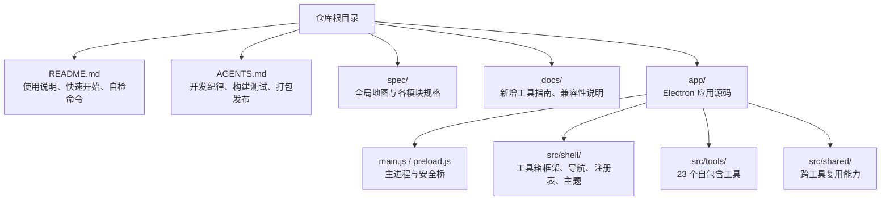
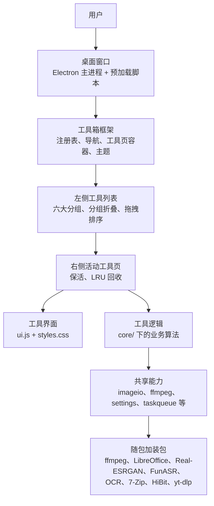
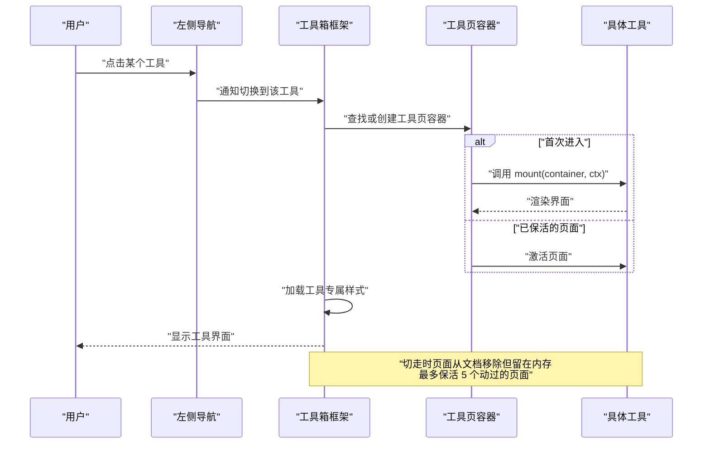
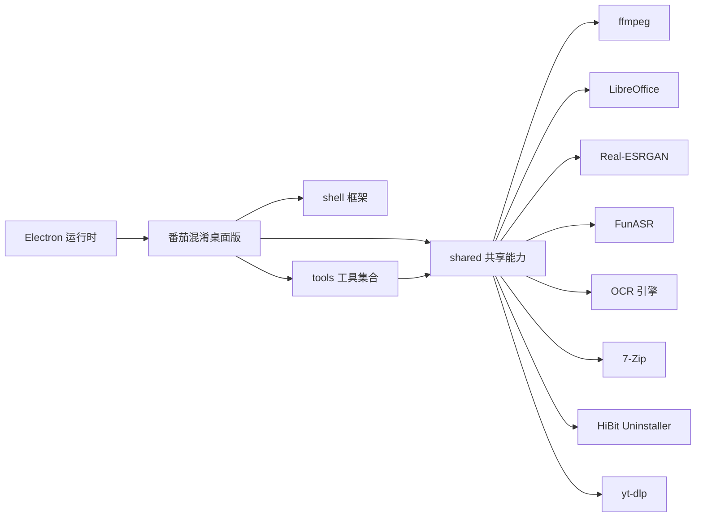

# 项目概述

<cite>
**本文引用的文件**   
- [README.md](file://README.md)
- [AGENTS.md](file://AGENTS.md)
- [00-overview.md](file://spec/00-overview.md)
- [toolkit.md](file://spec/modules/toolkit.md)
- [acceptance.md](file://spec/acceptance.md)
- [新增工具指南.md](file://docs/新增工具指南.md)
</cite>

## 目录
1. [简介](#简介)
2. [项目结构](#项目结构)
3. [核心组件](#核心组件)
4. [架构总览](#架构总览)
5. [详细组件分析](#详细组件分析)
6. [依赖关系分析](#依赖关系分析)
7. [性能与运行环境](#性能与运行环境)
8. [快速开始](#快速开始)
9. [故障排查](#故障排查)
10. [结论](#结论)

## 简介
「番茄混淆桌面版」的核心目标，是把 Android App「番茄图片混淆」的图片混淆与解混淆能力完整移植到 Windows 桌面，并把它从一个单一工具扩展为「工具箱」形态的桌面应用。当前版本已包含 **23 个工具**，按「图片、视频、音频、文档、压缩、系统」六大分组组织，目标是让身边非技术用户也能「解压即用、纯离线、傻瓜化操作」。

关键定位：
- 原始起点是安卓「番茄图片混淆」；桌面端保留其算法与默认参数，同时扩展到更丰富的日常文件处理场景。
- 交付形态是免安装绿色版文件夹，内含 ffmpeg、LibreOffice、Real-ESRGAN、FunASR、OCR、7-Zip、HiBit、yt-dlp 等加装包，无需额外安装即可使用大多数功能。
- 除「视频下载」天生需要联网外，其余工具保持纯离线可用。
- 主要使用者是普通朋友、同事等非技术用户，因此界面强调直观、内置帮助、状态提示和进度反馈。

**章节来源**
- [README.md:1-30](file://README.md#L1-L30)
- [00-overview.md:1-30](file://spec/00-overview.md#L1-L30)
- [AGENTS.md:1-20](file://AGENTS.md#L1-L20)

## 项目结构
仓库采用「Electron 桌面应用 + 模块化工具箱」结构。顶层 README、工作守则 AGENTS.md、规格 spec、说明文档 docs 描述项目边界与验收标准；`app/` 下是 Electron 源码。

**图示来源**
- [AGENTS.md:8-35](file://AGENTS.md#L8-L35)
- [00-overview.md:60-90](file://spec/00-overview.md#L60-L90)

项目结构的关键约定：
- `app/src/shell` 提供工具箱框架：工具注册表、左侧分组导航、工具页容器、设计令牌、通用组件库。
- `app/src/tools/<工具名>` 每个工具一个目录，包含声明、界面、样式和业务逻辑；工具之间禁止互相 import。
- `app/src/shared` 放跨工具复用能力，如图片读写、ffmpeg 封装、HEIC 解码、设置、任务队列等。
- `addons/` 存放随包分发的外部工具；`vendor/` 存放不走 npm 的第三方库。
- 新增工具的标准路径是复制 `_template` 模板，改标识、名称、图标、分组和排序，再在注册表中加一行。

**章节来源**
- [AGENTS.md:8-35](file://AGENTS.md#L8-L35)
- [新增工具指南.md:1-20](file://docs/新增工具指南.md#L1-L20)
- [00-overview.md:60-90](file://spec/00-overview.md#L60-L90)

## 核心组件
工具箱由三层组成：框架层、工具层、共享层。

| 层级 | 位置 | 职责 | 典型内容 |
|---|---|---|---|
| 框架层 | `app/src/shell` | 工具箱外壳、导航、工具生命周期、主题、通用组件 | 工具注册表、侧栏分组、保活与 LRU 回收、进度遮罩、主题变量 |
| 工具层 | `app/src/tools/<工具名>` | 单个工具的声明、界面、样式和业务逻辑 | 图片混淆、PDF 转格式、视频播放器、语音转文字、压缩解压等 |
| 共享层 | `app/src/shared` | 多个工具共用的基础能力 | 图片编解码、ffmpeg 封装、HEIC 解码、设置读写、任务队列、唯一文件名分配 |

框架层是理解整个项目的关键。它不关心某个工具具体做什么，只负责：
- 维护工具清单和分组顺序。
- 渲染左侧导航，支持分组折叠和长按拖动排序。
- 管理右侧工具页的生命周期：首次挂载、切走保活、LRU 回收、再次进入重建。
- 提供统一的状态提示、进度显示、文件对话框、剪贴板、设置读写等上下文能力。
- 保证所有工具共享同一套主题变量，浅色、深色、跟随系统三态切换时不需要逐个修改工具。

**章节来源**
- [toolkit.md:1-40](file://spec/modules/toolkit.md#L1-L40)
- [新增工具指南.md:1-30](file://docs/新增工具指南.md#L1-L30)
- [AGENTS.md:12-35](file://AGENTS.md#L12-L35)

## 架构总览
从用户视角看，应用是一个「左侧工具列表 + 右侧工具界面」的桌面窗口；从开发者视角看，它是 Electron 主进程 + 预加载脚本 + 前端工具箱框架 + 多工具插件式模块的组合。

**图示来源**
- [00-overview.md:60-90](file://spec/00-overview.md#L60-L90)
- [toolkit.md:1-40](file://spec/modules/toolkit.md#L1-L40)
- [README.md:1-30](file://README.md#L1-L30)

这个架构的优势是：
- 新增工具成本低：只需新建工具目录并在注册表加一行，不会污染既有工具。
- 工具可独立测试：核心逻辑放在 `core/`，便于单元测试。
- 用户体验一致：统一的导航、主题、进度、状态提示、批量处理和错误提示。
- 可扩展性强：后续可以继续增加新分组和新工具，而不必重写框架。

## 详细组件分析

### 工具箱框架与工具生命周期
工具箱框架是「番茄混淆桌面版」从单工具演进为 23 个工具的基础。它定义了工具如何被注册、展示、切换、保活和回收。

**图示来源**
- [toolkit.md:15-40](file://spec/modules/toolkit.md#L15-L40)
- [toolkit.md:41-83](file://spec/modules/toolkit.md#L41-L83)

框架的关键行为包括：
- 工具声明必须包含唯一标识、名称、图标、分组、组内排序、样式数组以及 `mount` 函数。
- 工具页默认保活：切走不再销毁，切回来恢复原状，包括已选文件、输入内容、预览画面和滚动位置。
- 保活上限是「动过的」页面最多 5 个；超出后淘汰最久未使用的页面，调用 `unmount()` 清理资源。
- 「动过」判定基于用户交互事件，如点按、打字、拖入文件、粘贴等；只是打开看看不算动过。
- 当前页面永不淘汰；被回收时会提示用户上次内容已自动释放。
- 进度遮罩全局只有一个，归属当前工具页；切走其他工具时遮罩关闭，切回来能恢复。

**章节来源**
- [toolkit.md:15-83](file://spec/modules/toolkit.md#L15-L83)

### 六大工具分组与 23 个工具
根据 README 与 spec 的描述，23 个工具分为以下六组：

| 分组 | 英文标识 | 工具 |
|---|---|---|
| 图片处理 | image | 图片混淆、图片压缩、图片变清晰、图片格式转换、批量重命名、加水印、长图拼接、九宫格切图、文件藏图 |
| 视频处理 | video | 视频下载、视频播放器、视频格式转换、视频压缩、动图与视频互转 |
| 音频处理 | audio | 音频格式转换、音频剪辑、语音转文字 |
| 文档处理 | doc | PDF 转格式、文档格式转换、PDF 编辑整理、文字识别 |
| 压缩解压 | archive | 压缩与解压 |
| 系统工具 | system | 软件卸载 |

这些分组由注册表的 `GROUPS` 定义，左侧导航按分组标题显示，组内按工具的 `order` 升序排列。未声明分组的工具会归入末尾的「其它」组，避免启动失败。

**章节来源**
- [README.md:1-30](file://README.md#L1-L30)
- [AGENTS.md:24-35](file://AGENTS.md#L24-L35)
- [toolkit.md:10-25](file://spec/modules/toolkit.md#L10-L25)

### 图片处理类工具
图片处理是项目的起点，也是验收要求最严格的部分之一。核心能力包括：
- 六种混淆与解混淆模式：空间曲线（gilbert）、方块混淆、像素混淆、行像素混淆、兼容 PE 行模式、兼容 PE 行加列模式。
- 单张、批量、拖拽、剪贴板导入与保存。
- 与手机版「番茄图片混淆」算法完全兼容，逐像素验证。
- 后续扩展出图片压缩、图片变清晰、图片格式转换、批量重命名、加水印、长图拼接、九宫格切图、文件藏图。

验收标准要求：
- 六种模式混淆后解混淆，输出与原图逐像素 100% 一致。
- 尺寸填充规则、保存格式规则与手机版一致。
- 批量导入包含损坏文件时跳过错误项，其余全部成功且可解回。
- 与手机版样本互相兼容，真机实测是关键验收项。

**章节来源**
- [00-overview.md:31-59](file://spec/00-overview.md#L31-L59)
- [acceptance.md:1-40](file://spec/acceptance.md#L1-L40)
- [acceptance.md:16-22](file://spec/acceptance.md#L16-L22)

### 视频与音频工具
视频和音频工具大量依赖随包 ffmpeg，实现格式转换、压缩、播放、动图互转、音频剪辑和语音转文字。

主要特性：
- 视频下载：支持抖音、小红书、B站、YouTube、央视频、直链等，引擎为 yt-dlp，可自更新，是唯一天生需要联网的工具。
- 视频播放器：软件内直接播放 MP4/WebM，MKV/FLV/TS 无损换封装，AVI/WMV 老编码自动重编码，播放走 Range 分块。
- 视频格式转换：MP4/WebM/MKV/MOV/AVI 互转，真实转码并逐个解码校验。
- 视频压缩：画质档和目标体积两遍编码，不达标自动降码率重试一次。
- 动图与视频互转：GIF/WebP/APNG 与视频互转，含聊天表情预设。
- 音频格式转换：21 种输出格式，视频提取声音。
- 音频剪辑：波形选区截取、多段拼接、淡入淡出、音量标准化。
- 语音转文字：音频/视频转中文、英文、日文、韩文、粤语文本或字幕，纯离线 CPU 执行，FunASR 加装包随包。

**章节来源**
- [README.md:1-30](file://README.md#L1-L30)
- [README.md:31-120](file://README.md#L31-L120)
- [acceptance.md:19-30](file://spec/acceptance.md#L19-L30)
- [acceptance.md:29-40](file://spec/acceptance.md#L29-L40)

### 文档与 OCR 工具
文档工具围绕 PDF 和 Office 文档展开，依赖 LibreOffice 作为可选或随包加装包。

主要能力：
- PDF 转格式：PDF↔图片、图片→PDF、合并/拆分/提取页、Word/Excel→PDF。
- 文档格式转换：老版 Word/Excel/PPT/RTF 转 docx/xlsx/pptx/PDF，包含教务系统导出的 Excel 2003 XML「假 .xls」。
- PDF 编辑整理：压缩瘦身、文字水印、页码、旋转、重排、加密解密。
- 文字识别：扫描件转为可搜索 PDF、纯文本或 Word，预处理与压缩，OCR 引擎零网络请求。

OCR 闸门要求：
- 纯离线、纯 CPU。
- 中文字符召回率至少 80%，单张不超过 8 秒。
- 全程无网络请求。

**章节来源**
- [README.md:31-120](file://README.md#L31-L120)
- [acceptance.md:10-22](file://spec/acceptance.md#L10-L22)
- [acceptance.md:28-30](file://spec/acceptance.md#L28-L30)

### 压缩解压与系统工具
压缩解压工具使用随包 7-Zip，支持主流与非主流格式的双向压缩与解压，并提供密码、分卷、免解压预览和 zip-slip 安全保护。

系统工具主要是「软件卸载」：一键启动随包 HiBit Uninstaller 官方便携版，通过 Windows RunAs 和 UAC 提权，只做启动页，不在本软件内重复实现卸载逻辑。

**章节来源**
- [README.md:31-120](file://README.md#L31-L120)
- [00-overview.md:40-59](file://spec/00-overview.md#L40-L59)

## 依赖关系分析
项目的外部依赖主要集中在「随包加装包」中，而不是 npm 依赖。核心运行时依赖是 Electron，内部依赖集中在 shell 框架、工具声明和 shared 共享模块。

**图示来源**
- [00-overview.md:80-90](file://spec/00-overview.md#L80-L90)
- [README.md:31-120](file://README.md#L31-L120)

依赖特点：
- Electron 提供桌面窗口、主进程、预加载脚本和 Node.js 环境。
- ffmpeg、LibreOffice、Real-ESRGAN、FunASR、OCR、7-Zip、HiBit、yt-dlp 作为随包加装包，不进入主安装包的主依赖树，而是以本地二进制形式随应用分发。
- 缺失部分加装包时，对应工具会降级或提示，不影响整个应用启动。
- 工具之间不互相 import，降低耦合；共享能力集中在 `shared/`，提高复用性。

**章节来源**
- [00-overview.md:80-90](file://spec/00-overview.md#L80-L90)
- [AGENTS.md:12-35](file://AGENTS.md#L12-L35)

## 性能与运行环境
项目面向 Windows 10/11 64 位，运行环境如下：
- Electron 自带内核的桌面框架。
- JavaScript/ES6+、HTML、CSS。
- 不引入重型第三方依赖；PDF 工具使用轻量 JS 方案，LibreOffice 等重型能力以加装包形式提供。
- 产物经过瘦身：删除运行期用不到的多语言字典、翻译、DirectML、sourcemap 等。

性能相关约束：
- 图片混淆对大图有参考耗时指标。
- 保活机制限制最多 5 个「动过的」页面驻留内存，避免长期占用。
- 视频播放使用 Range 分块，不移动原文件，缓存用完即清。
- 语音转文字、OCR、AI 放大等重型计算尽量纯离线、纯 CPU，避免不可控的网络延迟。

**章节来源**
- [00-overview.md:80-90](file://spec/00-overview.md#L80-L90)
- [README.md:31-120](file://README.md#L31-L120)
- [toolkit.md:25-40](file://spec/modules/toolkit.md#L25-L40)

## 快速开始

### 给使用者的快速开始
1. 解压下载的免安装文件夹。
2. 双击文件夹中的 `番茄图片混淆桌面版.exe`。
3. 左侧选择工具分组，点击具体工具。
4. 按工具界面提示添加文件或输入参数。
5. 等待任务完成，查看结果或保存到目标目录。
6. 如需卸载，可使用「软件卸载」工具一键启动随包 HiBit 卸载程序。

注意：
- 除「视频下载」外，其余工具均可纯离线使用。
- 所有必需加装包已随包附带，无需额外安装。
- 若遇到权限问题，系统会弹出 UAC 确认，不要静默绕过。

**章节来源**
- [README.md:1-30](file://README.md#L1-L30)
- [README.md:31-120](file://README.md#L31-L120)

### 给维护者的开发与调试
1. 准备 Node 环境：使用仓库自带的便携版 Node。
2. 进入 `app` 目录，配置国内镜像并安装依赖。
3. 使用 `npm start` 启动应用。
4. 使用不同自检开关运行端到端测试，例如媒体测试、音频测试、PDF 测试、压缩解压测试、视频下载测试、文档格式转换测试等。
5. 打包前确保所有自检全绿，截图证据写入 `%TEMP%`。

常见命令类别：
- 启动：`npm start`
- 纯逻辑单测：`npm test`
- 冒烟自检：`electron . --smoke-test`
- 端到端自检：`electron . --self-test`
- 界面自动测试：各工具对应 `--*-ui-test`
- 特定能力自检：`--pdf-test`、`--media-test`、`--audio-test`、`--archive-test`、`--videodl-test`、`--doc-test` 等
- 打包：`npm run pack`

**章节来源**
- [README.md:31-120](file://README.md#L31-L120)
- [AGENTS.md:36-98](file://AGENTS.md#L36-L98)

### 常用用例概览
- 图片混淆：导入图片，选择混淆模式，调整密钥或参数，批量处理后保存。
- 图片压缩：选择画质、尺寸或目标大小，批量压缩并查看体积变化。
- 图片变清晰：使用锐化、降噪、明暗微调或 AI 放大提升清晰度。
- 图片格式转换：PNG、JPG、WebP、BMP、ICO、TIFF、GIF、AVIF 等互转。
- 视频格式转换：MP4、WebM、MKV、MOV、AVI 互转。
- 视频压缩：按画质档或目标体积压缩视频。
- 音频格式转换：多种音频格式互转，或从视频中提取音频。
- 音频剪辑：波形选区截取、拼接、淡入淡出、音量标准化。
- 语音转文字：音频或视频转文本或 SRT 字幕。
- PDF 转格式：PDF 与图片、Office 文档互转。
- 文档格式转换：老版 Office 转新版 Office 或 PDF。
- PDF 编辑整理：压缩、水印、页码、旋转、重排、加密解密。
- 文字识别：扫描件转可搜索 PDF、文本或 Word。
- 压缩解压：ZIP、7Z、TAR、GZIP、RAR 等多种格式双向或仅解压。
- 软件卸载：管理员权限启动 HiBit 卸载工具清理残留。

**章节来源**
- [README.md:1-30](file://README.md#L1-L30)
- [README.md:31-120](file://README.md#L31-L120)

## 故障排查
常见问题可按现象分类：

| 现象 | 可能原因 | 排查建议 |
|---|---|---|
| 双击 exe 无法启动 | 缺少运行环境或加装包权限异常 | 检查是否解压完整文件夹；查看是否被杀毒软件隔离；确认 Windows 权限 |
| 某个工具提示缺少加装包 | ffmpeg、LibreOffice、OCR、asr、yt-dlp 等未就位 | 确认 `addons/` 目录存在对应文件；查看对应工具的提示信息 |
| 视频下载失败 | 网络问题、站点变更、yt-dlp 引擎问题 | 查看 `userdata/videodl-history.json`，检查链接、网络、引擎更新日志 |
| 语音转文字失败 | asr 加装包缺失、硬件不支持、音频无效 | 检查 asr 加装包；确认输入是有效音频或视频；查看自检输出 |
| PDF 转格式失败 | LibreOffice 缺失或 IPC 转换异常 | 确认 LibreOffice 随包存在；运行 `--doc-test` 或 `--pdf-test` |
| 压缩解压失败 | 密码错误、分卷不完整、zip-slip 防护触发 | 检查密码、完整分卷；确认文件未被篡改 |
| 界面卡顿或内存增长 | 保活页面过多、大图片像素数据未释放 | 减少频繁切换的工具数量；重启应用释放内存 |
| 设置丢失 | settings.json 损坏或被误删 | 重新导出或恢复备份；导入设置时只合并已知键 |

调试建议：
- 优先运行对应的 `--*-test` 或 `--*-ui-test`，查看 `%TEMP%\tomato-*.json` 的 `pass`、`ok`、`verified` 字段。
- 截图保存在 `%TEMP%\tomato-uitest`。
- 对于视频下载，先查 `userdata/videodl-history.json`。
- 对于卸载相关，使用测试模式空跑，不真正拉起卸载工具。

**章节来源**
- [README.md:31-120](file://README.md#L31-L120)
- [AGENTS.md:36-98](file://AGENTS.md#L36-L98)

## 结论
「番茄混淆桌面版」从一个安卓图片混淆 App 出发，逐步演化为 Windows 桌面端的 23 工具工具箱。它以 Electron 为运行时，以 shell 框架为底座，以 tools 为扩展单元，以 shared 为复用层，形成低耦合、高扩展的架构。

对用户而言，它提供免安装、纯离线、傻瓜化的日常文件处理能力；对开发者而言，它提供清晰的目录约定、可复用的框架、完善的自检体系和新增工具模板。未来继续增加新工具时，应遵循现有分组、模板和验收标准，保持「不改既有工具代码」的扩展性承诺。