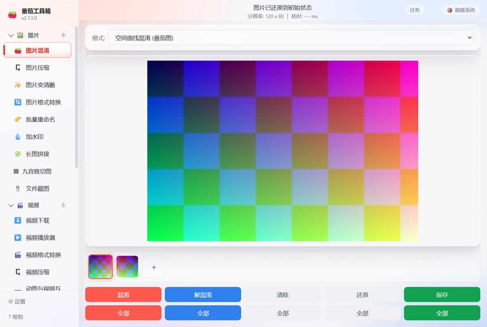
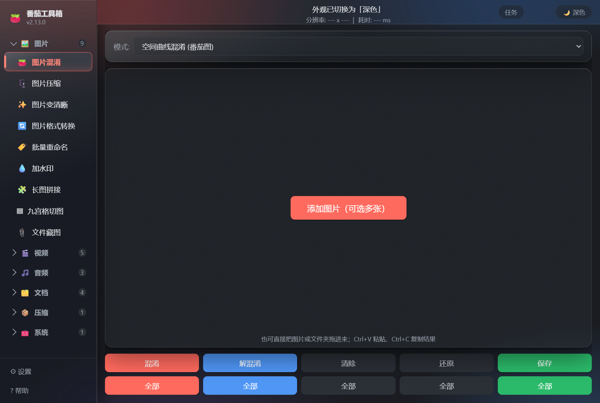

# Tomato Toolbox Desktop

[中文](README.md) · [English](README.en.md) · [Documentation](docs/README.md) · [Changelog](CHANGELOG.en.md) · [Releases](https://github.com/3450892121/tomato-desktop/releases)



**A portable Windows toolbox you can unzip and run.** Images, video, audio, PDFs, Office documents, and archives live in one window. No installer, no registry writes — settings stay inside the app folder.

- **Made for non-technical users**: every tool explains itself, defaults are sensible, and outputs never overwrite the originals.
- **Mostly offline**: only Video Download needs the network; the other 22 tools work offline.
- **Interoperable with the Android app**: Image Obfuscate / Deobfuscate works both ways with the "番茄图片混淆" Android app.
- **Agent-ready**: a local MCP server exposes 41 tools. DSH users can double-click `一键接入DSH.cmd`; no JSON editing and no Node.js installation required.

> **Two names, one app**: the window title says "番茄工具箱"; the executable is `番茄图片混淆桌面版.exe`. It started as a desktop companion for the Android app and grew into a toolbox.

## At a glance

| Item | Details |
|---|---|
| Version | **v2.15.0** |
| OS | Windows 10 / 11, 64-bit |
| Install | **Portable**: unzip and run; delete the folder to uninstall |
| Size | ~820 MB zip, ~1.6 GB extracted |
| Network | Only Video Download needs it; everything else works offline |
| License | MIT (see [`LICENSE`](LICENSE)); third-party notices in [`THIRD-PARTY-NOTICES.md`](THIRD-PARTY-NOTICES.md) |

## 1. Download and run

1. Open [Releases](https://github.com/3450892121/tomato-desktop/releases/latest) and download
   `tomato-desktop-v2.15.0-win64.zip` (~820 MB).
2. Extract it anywhere — Desktop, Documents, or a USB drive; non-ASCII paths are fine.
3. Double-click `番茄图片混淆桌面版.exe`.

On first launch Windows may show "Windows protected your PC" — click **More info** → **Run anyway**. The app is not code-signed, so this is expected.

Settings and caches live in `userdata/` inside the app folder. **No registry, no system-wide install.** Copy the whole folder to move the app.

> New here? The package includes `使用说明.txt` (Chinese) and the in-app Help. A shorter guide: [Getting started](docs/en/getting-started.md).

## 2. What's inside

**23 tools** in six groups (click a group header to expand/collapse):

| Group | Tools |
|---|---|
| Image | Image Obfuscate · Image Compress · Image Enhance · Image Convert · Batch Rename · Watermark · Stitch · Grid Slice · File-in-Image |
| Video | Video Download · Video Player · Video Convert · Video Compress · GIF ↔ Video |
| Audio | Audio Convert · Audio Edit · Speech-to-Text |
| Document | PDF Convert · Document Convert · PDF Edit · OCR |
| Archive | Compress / Extract |
| System | Software Uninstall |

See [Tools](docs/en/tools.md) for details; acceptance criteria live in [`spec/acceptance.md`](spec/acceptance.md) (Chinese).

Good first tasks:

- **Image Obfuscate**: scramble an image so only the same app (or the Android app) can restore it. Single, batch, drag-and-drop, clipboard.
- **Image Compress / Convert**: shrink photos, convert to JPG / PNG / WebP, including HEIC from phones.
- **File-in-Image**: hide any file inside an image that still opens normally.
- **PDF & legacy Office**: PDF ↔ images, merge/split, watermark/page numbers, encrypt/decrypt; old Word/Excel/PPT and "fake .xls" files.
- **Archives**: ZIP / 7Z / TAR and more, with passwords, volumes, and list-without-extract.

## 3. Agent access (MCP)

The app ships a local MCP server with **41 tools** covering **21 GUI tools** (Video Player and Software Uninstall are intentionally not exposed).

**DSH users (recommended; no JSON editing, no Node.js install):**

1. Double-click `一键接入DSH.cmd` in the app folder.
2. Fully quit and restart DeepSeek Harness (quit the process, not just the window).
3. Ask: "Use Tomato Toolbox to compress the images in this folder to under 500 KB."

The script writes the DSH config, installs the Skill, and launches MCP through the app's own executable. To undo, double-click `一键移除DSH接入.cmd`.

For Claude Desktop / Qoder / Trae and manual setups:

- [Agent guide (Chinese, detailed)](docs/Agent接入说明.md)
- [Agent docs (Chinese)](docs/zh/agent.md) · [Agent docs (English)](docs/en/agent.md)
- [MCP server README](app/mcp/README.md)
- [Skill package](skills/tomato-toolbox/SKILL.md)

> **Security boundary**: Video Download always asks for your approval in the GUI; most other tools execute immediately with no confirmation dialog. MCP has a path allowlist, an audit log, a read-only mode, and no-overwrite rules — but it is **not a sandbox**. See [Security](docs/en/security.md).

## 4. What's new in v2.15.0

- **One-click DSH setup**: double-click `一键接入DSH.cmd`; it writes the config, installs the Skill, and starts MCP via the app executable. No JSON, no Node.js; `一键移除DSH接入.cmd` removes it.
- **Documentation overhaul**: main README + sub-documents, Chinese/English, and v2.15.0 release notes.
- **v2.14.1 security hardening** (same batch): path allowlist, audit log `userdata/mcp-audit.jsonl`, read-only mode, no-overwrite enforcement.
- **v2.14.0 agent entry**: local MCP server, 41 tools, video-download approval gate, Skill package.

Full history: [CHANGELOG.md](CHANGELOG.md) (Chinese) / [CHANGELOG.en.md](CHANGELOG.en.md). Release notes: [v2.15.0](docs/en/releases/v2.15.0.md).

## 5. Light and dark themes

Use the top-right switch to cycle Light / Dark / Follow system. The choice is remembered.



## 6. FAQ

**The app does not start, or antivirus blocks it.**
Check Windows SmartScreen first (**More info** → **Run anyway**). Some antivirus products flag unsigned portable apps; add an exception. Everything except Video Download works offline, so you can verify without network.

**Do I need to install/uninstall it?**
No. Unzip and run. To remove it, delete the folder.

**Does it need the internet?**
Only Video Download. The other 22 tools work offline.

**Where are outputs? Will originals be overwritten?**
By default outputs sit next to the input with a suffix such as `-obfuscated` or `-compressed`. **Originals are never overwritten**; duplicate names get a numeric suffix. You can choose another output folder.

**How do I move it to another PC?**
Copy the whole folder. You can also export settings from the Settings dialog and import them on the new machine.

**It says an add-on is missing.**
The release bundle includes ffmpeg, LibreOffice, Real-ESRGAN, FunASR, OCR models, 7-Zip, yt-dlp, and HiBit. If you have a slim distribution without HiBit, see [`docs/加装包说明.txt`](docs/加装包说明.txt) (Chinese) to restore Software Uninstall.

**DSH does not show the tools.**
Fully quit and restart DSH, then confirm `mcp-tomato-toolbox` exists in `~/.dsh/profiles/*/cordis.patch.yml`. See [Agent guide](docs/Agent接入说明.md).

**Why does Video Download keep asking for approval?**
That is intentional. Open the Video Download page and click **Allow once**, or enable **Allow the AI assistant to download (this run)**. The grant expires when the app closes.

More: [FAQ](docs/en/faq.md).

## 7. For developers

Requirements: Windows 10 / 11 64-bit, Node.js 22+ (npm included).

```bash
cd app
npm install          # dependencies, including Electron
npm start            # launch the app
npm test             # unit tests (no network, no add-ons needed)
npm run pack         # build the portable release into app/release/
```

For slow networks in mainland China:

```bash
npm install --registry=https://registry.npmmirror.com
# PowerShell:
$env:ELECTRON_MIRROR = "https://registry.npmmirror.com/-/binary/electron/"
```

Add-ons (ffmpeg, LibreOffice, Real-ESRGAN, FunASR, OCR, 7-Zip, yt-dlp, HiBit) are about 1.5 GB and have different licenses, so they are **not in the repository**. `app/tools/pack.js` copies them from `app/addons/<name>/`. See [Build & test](docs/en/build.md), [`docs/加装包说明.txt`](docs/加装包说明.txt), and [`THIRD-PARTY-NOTICES.md`](THIRD-PARTY-NOTICES.md).

### Layout

```
app/
├─ main.js / preload.js      main process and security bridge
├─ mcp/                      local MCP server (41 tools)
├─ src/shell/                toolbox shell: registry, navigation, tool-page keep-alive, tasks, theme
├─ src/tools/<name>/         one tool per folder: index.js + ui.js + core/ + styles.css
├─ src/shared/               shared image, ffmpeg, HEIC, settings helpers
├─ tests/                    unit tests + self-tests / UI automation
├─ tools/pack.js             packaging script
└─ addons/                   add-ons (not in git)
docs/                        documentation (Chinese/English)
spec/                        module specs and acceptance criteria
skills/tomato-toolbox/       Agent Skill
```

### Verify a change

```bash
cd app
.\node_modules\electron\dist\electron.exe . --smoke-test
.\node_modules\electron\dist\electron.exe . --ui-test
node tests/mcp.test.mjs
npm test
```

Results land in `%TEMP%\tomato-*.json`; check `pass:true` / `ok:true`. See [Build & test](docs/en/build.md) and [`spec/acceptance.md`](spec/acceptance.md) for the full matrix and packaged-build expectations.

## 8. Known limitations

- Video Download can break when a site changes; the app has an "Update engine" action.
- AI upscaling in Image Enhance requires a Vulkan GPU; Speech-to-Text is CPU-only and long audio takes time.
- PDF → Word degrades on complex layouts; password-protected PDFs must be decrypted first.
- RAR can be extracted but not created.
- The app is unsigned; some antivirus products may flag it.
- Phone interoperability still needs a real-device sample; see [`docs/兼容性变体说明.md`](docs/兼容性变体说明.md) (Chinese).

## License

- Original code: MIT, see [`LICENSE`](LICENSE).
- Third-party components and ported sources (leetools, SheetJS, pdf.js, ffmpeg, LibreOffice, 7-Zip, yt-dlp, etc.): see [`THIRD-PARTY-NOTICES.md`](THIRD-PARTY-NOTICES.md).
- The obfuscation modes and file-in-image container are independently implemented; no third-party app code, assets, or installers are included.
- Do not use this software to infringe others' rights or circumvent lawful technical measures. Provided "as is", without warranty.
